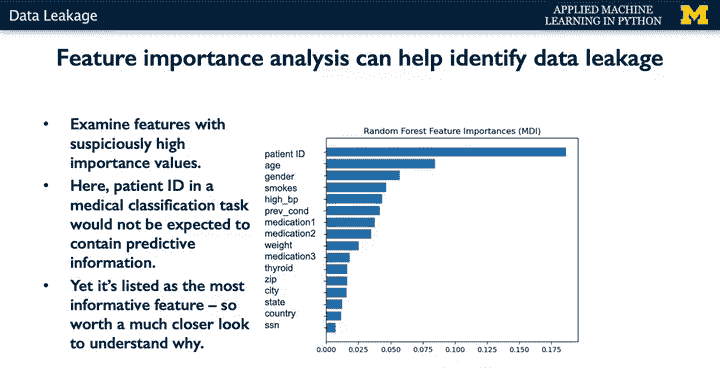

# 密歇根大学《Python用于数据科学实践（1-3课／共5课）｜Applied Data Science with Python 》deepseek翻译 - P88：33_数据泄露问题.zh_en - GPT中英字幕课程资源 - BV1U64y1L7VJ

In data science， the term data leakage， sometimes just referred to as leakage。

Describes the situation where the data youre using to train a machine learning algorithm happens to include unexpected extra information about the very thing you're trying to predict。

Basically， leakage occurs any time that information is introduced about the target label or value during training。

That would not legitimately be available during actual use。

Maybe the simplest example of data leakage would be if we included the true label of a data instance as a feature in the model。

The model would learn the equivalent of。If this object is labeled as an apple， predict it's an apple。

Another clear example of data leakage that we've seen before is having test data accidentally included in the training data。

 which leads to overfitting。However， data leakage can happen for many other reasons， too。

 often in ways that are quite subtle and hard to detect。When data leakage does occur。

 it typically causes results during your model development phase that are too optimistic。

Followed by the nasty surprise of disappointing results after the prediction model is actually deployed and evaluated on new data。

In other words， leakage can cause your system to learn a subop model that does much worse in actual deployment than a model developed in a leak free setting。

So leakage can have dramatic implications in the real world。

 ranging from the financial cost of making a bad monetary and engineering investment in something that doesn't actually work。

To system failures that hurt customers' perception of your system's quality or impact the company's brand。

For these reasons， data leakage is one of the most serious and widespread problems in data mining and machine learning。

And something that as a machine learning practitioner， you must always be on guard against。

So now we'll cover what data leakage is， why it matters。

 how it can be detected and how you might avoid it in your applications。As an aside。

 this term data leakage is also used in the field of data security to mean the unauthorized transfer of information outside of a secure facility like a data center。

However， in some ways， this security based meaning is actually somewhat appropriate for our machine learning setting。

 given the importance of keeping the information about the prediction securely separated from the training and model development phase。

Let's look at some more subtle examples of data leakage problems。

One classic case happens when information about the future that would not legitimately be available in actual use is included in the training data。

Suppose you're developing a retail website and building a classifier to predict whether the user is likely to stay and view another page or leave the site。

If the classifier predicts they're about to leave， the website might pop up something that offers incentives to continue shopping。

An example of a feature that contains leaked information would be the user's total session length or the total number of pages they viewed during their visit to the site。

This total is often added as a new column during a post processing phase of the visit log data。

 for example。This feature has information about the future。

 namely how many more visits the user is going to make。That's impossible to know。

 in an actual deployment。A solution is to replace the total session length feature with a page visit in session feature that only knows the total pages visited so far in the session and not how many are remaining。

A second example of leakage might involve trying to predict if a customer on a bank's website was likely to open an account。

If the user's record contains an account number field。

It might normally be empty for users still in the process of exploring the site。

But eventually it iss filled in once the user does open an account。Clearly。

 the user account field is not a legitimate feature。That it should be used in this case。

 because it may not be available at the time the user is still exploring the site。

Another example of future information leaking in the past might be if you were developing a diagnostic test to predict a particular medical condition。

The existing patient data set might contain a binary variable that happens to mark whether or not the patient had surgery for that condition。

Obviously， such a variable would be highly predictive of the medical condition。

There are many other ways predictive information could leak into this feature set。

There might be a certain combination of missing diagnosis codes that was very indicative of the medical condition。

But again， these would not be legitimate to use since that information isn't available while a patient's condition is still being studied。

Or finally， another example in the same patient that dataset set might involve the form of the patient I D。

The I D might be assigned， depending on a particular diagnosis path。 In other words。

 the I D could be different if it's the result of a visit to a specialist where the initial doctor determined that the medical condition was likely。

This last example is a great illustration of the fact that there are many different ways data leakage could occur in a training set。

 And， in fact， it's often the case that more than one leakage problem is present at once。

Sometimes fixing one leaking feature can re the existence of a second one， for example。As a guide。

 here are some additional examples of data leakage。We can divide leakage into two main types。

 leakage in the training data。Typically where test data or future data gets mixed into the training data。

And leakage in features where something highly informative about the true label somehow gets included。

As a feature。One very important cause of data leakage is performing some kind of pre processingces on the entire data set whose results influence what is seen during training。

This can include such scenarios as computing parameters for normalizing and rescaling。

 or finding minimum and maximum feature values to detect and remove outliers。

And using the distribution of a variable across the entire data set to estimate missing values in the training set or perform feature selection。

Another critical need for caution occurs when working with time series data。

 where records for future events are accidentally used to compute features for a particular prediction。

The session length example that we saw was one instance of this。

But more subtle effects can occur if there are errors in data gathering or missing value indicators。

If a feature relates to collecting at least one record in a time span。

 the presence of an error may give away information about the future。 In other words。

 that no further observations are to be expected。Lakagegen features includes the case where we have a variable like diagnosis ID in a patient record that we remove。

But neglect to also remove other variables， known as proxy variables that contain the same or similar information。

The patient I D in the case where the I D number had clues about the nature of the patient's diagnosis due to the admission process was an example of this。

In some cases， data set records are intentionally randomized or certain fields anonymized that contain specific information about a user such as their name。

 location and so on。Depending on the prediction task。

 undoing this anonymization can reveal user or other sensitive information。

That is not legitimately available in actual use。Finally。

 any of the above examples we've discussed here could be present in a third party data set that gets joined to the training set as an additional source of features。

So always be aware of the features in such external data and their interpretation and origin。

So how can you detect and avoid data leakage in your applications？Before building the model。

 exploratory data analysis can reveal surprises in the data。For example。

 look for features very highly correlated with the target label or value。

An example of this from the medical diagnostic example might be the binary feature that indicated a patient had a particular surgical procedure for the condition。

That might be extremely highly correlated with a particular diagnosis。After building the model。

 look for surprising feature behavior in the fitted model。

 such as extremely high feature weights or very high information gain associated with a variable。

Next， look for overall surprising model performance。

If your model evaluation results are substantially higher than the same or similar problems on similar data sets。

 then look closely at the instances or features that have most influence on the model。

One more reliable check for leakage， but also potentially expensive is to do a limited real world deployment of the trained model to see if there's a big difference between the estimated performance suggested by the model training and development results and the actual results。

This check that the model is generalizing well to new data is useful。

 but may not give much immediate insight into if or where the leakage is happening。

 or if any drop in performance is due to other reasons like classical overfitting。

Let me give you one example of how feature importance analysis can help identify the presence of data leakage。

In this example， we're using the feature underscore Is fitted attribute that's computed when you fit a random forest。

The idea is to use feature importance analysis to examine features for suspiciously high importance values。

 and I'll explain what I mean by suspicious in a minute。So in this example。

 suppose we have a medical data set that includes various features about the patient， their health。

 medications， location， and so forth， as well as their patient ID in the system。

So with train a classifier to predict that a patient will be diagnosed in the future with a certain disease。

 this is a medical classification task。We train the classifier and then examine the feature importance of values。

You would expect that features related to health problems or demographics would have higher feature importance weights in this analysis and that generic features like patient ID or Social Security number would not be expected to contain any predictive information about someone's health。

But when you look at the feature importance numbers。

 you can see that while Social Security number does indeed have low feature importance。

 the patient ID， on the other hand， is listed as the most informative feature。

 that's very surprising。So that's worth a much closer look to understand why。

This scenario actually has happened in real data sets， in one case。

 the patient ID contained a subID that indicated whether the patient was added to the system by a general practitioner or by a specialist after the problem being predicted had been identified。

So in other words， by knowing that the patient ID。The system gets advanced warning that a person had seen a specialist and was thus much more likely to have the disease。

Thus， contributing a form of data leakage to this classification problem。

There are practices you can follow to help reduce the chance of data leakage in your application。

One important rule is to make sure that you perform any data preparation within each cross validation fold separately。

In other words， if you are scaling or normalizing features。

 any statistics or parameters that you estimate for this should only be based on the data available in the cross validation split and not the entire data set。

You should also make sure that you use these same parameters on the corresponding held out test fold。

If you're working with time series data， keep track of the time stamp that's associated with processing a particular data instance。

 such as a user's click on a web page and make sure any data used to compute features for this instance does not include records with a later time than the cut off value。

This will help ensure you' are not including information from the future in your current feature calculations or training data。

If you have enough data， consider splitting off a completely separate test set before you even start working with a new data set。

And then evaluating your final model on this test data only as a very last step。

The goal here is similar to doing a real world deployment。

To check that your train model does generalize reasonably well to new data。

If there's no significant drop in performance， great。 But if there is。

 leakage may be one contributing factor， along with the usual suspects like classical overfitting。

For more real world examples， analysis and guidance about preventing data leakage。

 you can take a look at the optional readings provided in the lesson plan。

