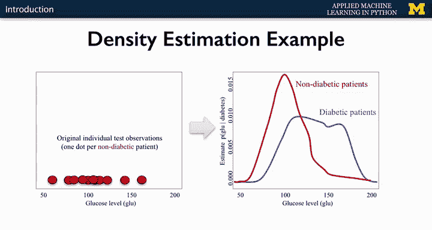
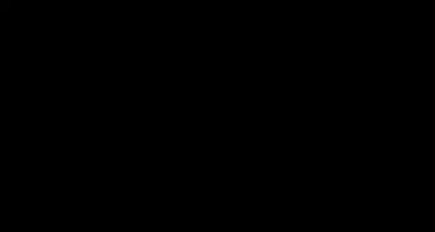

# 密歇根大学《Python用于数据科学实践（1-3课／共5课）｜Applied Data Science with Python 》deepseek翻译 - P89：34_引言.zh_en - GPT中英字幕课程资源 - BV1U64y1L7VJ

Unsupervised machine learning involves a wide variety of tasks where unlike supervised learning。

 there's no target value to be predicted。Instead， the job of the unsupervised learning algorithm is to take the raw data and capture some interesting structure in it。

This is useful for a number of scenarios to explore and visualize the structure in a complex data set。

To do density estimation， to predict the probabilities of events。To compress the data。

 to extract more effective features before applying a supervised learning algorithm。

Or to discover important structures like clusters of similar objects or unusual or individual outliers in the data。

All of these and other unsupervised learning tasks have in common in the property that there are no target values。

 labels or output to learn from or to be predicted。Instead。

 we only have the unlabeled samples in the data set as input。

Here's an example of an unsupervised method， called clustering。

Suppose you' are in charge of running a website that allows people to buy products from your company。

 and the site gets thousands of visits per day。As people access the site by clicking links to products or typing in search terms。

Their interactions are logged by the web server that creates a large log file。

It might be useful for your business to understand who's using your site by grouping users。

 according to their shopping behavior。 For example。

 there might be a group of more expert users who use more advanced features to find something very specific。

While another group of non expert users might just enjoy browsing a broader set of items。

By clustering users into groups， you might gain some insight into who your typical customers are。

And what site features different types of users find important。

You could use insights from clustering users to improve the site's features for different groups or to recommend products to specific groups that would be more likely to buy them。

So in this lecture， we'll give a brief survey of unsupervised learning methods divided into two major categories。

First， we'll look at one family of unsupervised methods called transformations。

 because they essentially just run the original data through some kind of useful process that extracts or computes information of some kind。

Then we'll look at the other broad family of unsupervised learning methods。

 which are the clustering methods。Like in our website example。

 that find groups in the data and assign every point in the data set to one of the groups。Okay。

 let's look at some important unsupervised learning methods that transform the input data in useful ways。

One method called density estimation is used when you have a set of measurements scattered throughout an area and you want to create what you can think of as a smooth version over the whole area that gives a general estimate for how likely it would be to observe a particular measurement in some area of that space。

For example， in a medical application related to diagnosing diabetes。

Density estimation with one variable might be used to estimate the distribution of a specific test score。

The plasma glucose concentration number from a blood test。

For people who have a particular form of diabetes。With this density estimate。

 we can estimate the probability that anyone with that medical condition has a particular glucose score。

 even if that specific score wasn't seen in the original data set。

We could then compare this to the range of glucose levels for people who do not have that condition。

 which is shown by the red line here。Often， density estimates are then used in further machine learning stages as part of providing features for classification or regression。

The more technical way to say this is that density estimation calculates a continuous probability density over the feature space。

Given a set of discrete samples in that feature space。With this density estimate。

 we can estimate how likely any given combination of features is to occur。In Psychit learnn。

 you can use the kernel density class in the S K learnn neighbors module to perform one widely used form of density estimation。

Called Colon density estimation。Colonnel density is especially popular for use in creating heat maps with geospatial data like this one。

