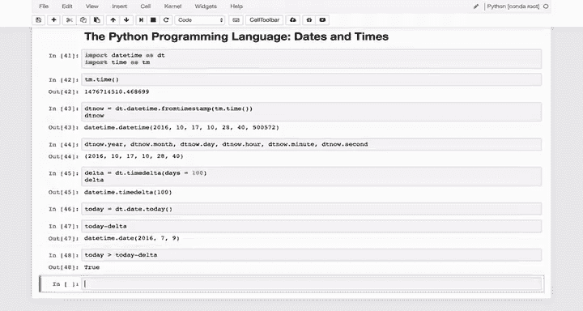

# 密歇根大学《Python用于数据科学实践（1-3课／共5课）｜Applied Data Science with Python 》deepseek翻译 - P8：7_Python日期与时间处理.zh_en - GPT中英字幕课程资源 - BV1U64y1L7VJ

A lot of analysis you do might relate to dates and times。 For instance。

 finding the average number of sales over a given period。

 selecting a list of products to data mine if they were purchased in a given period or trying to find the period with the most activity in online discussion forum systems。

In this course， we're not going to delve too deeply into time series analyses。

 but I wanted to show you some of the basics in Python。First。

 you should be aware that date and times can be stored in many different ways。

 One of the most common legacy methods for storing the day and time in online transaction systems is based on the offset from the epoch。

 which is January 1 in 1970。 There's a lot of historical craft around this。

 but it's not uncommon to see a systems storing the date of a transaction in seconds or milliseconds since this date。

 So if you see a large numbers where you expect to see date and time。

 you'll need to convert them to make much sense out of the data。In Python。

 you can get the current time since the epoch using the time module。

You can then create a timestamp using the from timestamp function on the date time object。

When we print this value out， we see that the year， month， day and so forth are also printed out。

The datetime object has handy attributes to get the representative hour， day， seconds， etc。

Date time objects allow for a simple math using time deltas。 For instance。

 here we can create a time delta of 100 days， then do subtraction and comparisons with the date time object。

This is commonly used in data science， for creating sing windows。For instance。

 where you might want to look for any five day span of time where sales were highest and flag that for follow em。

This is just a little glimpse at dates and times in Python in week three of this course。

 we're going to investigate dates and times a bit more using the Pandas datetime Library。

