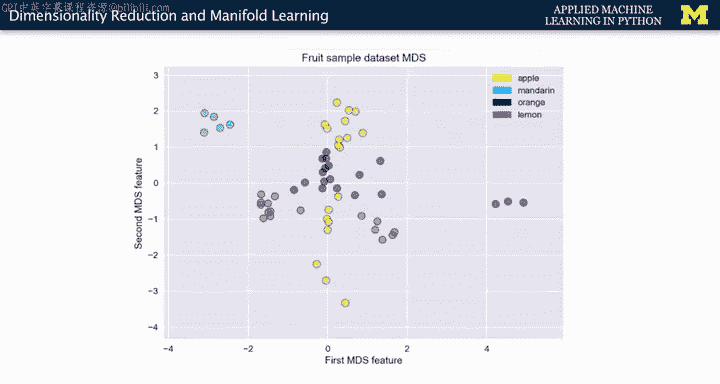

# 密歇根大学《Python用于数据科学实践（1-3课／共5课）｜Applied Data Science with Python 》deepseek翻译 - P90：35_降维与流形学习.zh_en - GPT中英字幕课程资源 - BV1U64y1L7VJ

Another very important family of unsupervised learning methods that fall into the transformation category are known as dimensionality reduction algorithms。

As the name suggests， this kind of transform takes your original data set that might contain， say。

 200 features。And finds an approximate version of data set that uses， say， only 10 dimensions。

One very common need for dimensionality reduction arises when first exploring a data set to understand how the samples may be grouped or related to each other by visualizing it using a two dimensional scatter plot。

One very important form of dimensionality reduction is called principal component analysis or PCA。

Intuitively， what PCA does is take your cloud of original data points and finds a rotation of it so the dimensions are statistically uncorrelated。

PCA then typically drops all but the most informative initial dimensions that capture most of the variation in the original data set。

Here's a simple example of what I mean with a synthetic two dimensional data set。Here。

 if we have two original features that are highly correlated， represented by this cloud of points。

PCA will rotate the data so the direction of highest variance called the first principal component。

 which is along the long direction of the cloud， becomes the first dimension。

It will then find the direction at right angles that maximally captures the remaining variance。

 This is the second principal component。In two dimensions。

 there's only one possible such direction at the right angles of the first principal component。

 But for higher dimensions， there would be infinitely many。With more than two dimensions。

 the process of finding successive principal components at right angles to the previous ones would continue until the desired number of principal components is reached。

One result of applying PCA is that we now know the best one dimensional approximation to the original two dimensional data。

In other words， we can take any data point that used two features before X and Y。

 and approximate it using just one feature， namely its location when projected onto the first principal component。

Here's an example of using Cyyitt learn to apply PCA to a higher dimensional data set。

 the breast cancer data set。To perform PCA， we import the PCA class from SK learn decomposition。

It's important to first transform the data set so that each feature's range of values has zero mean and unit variance。

And we can do this using the fit and transform methods of the standard scalar class， as shown here。

We then create the PCA object， specify that we want to retain just the first two principal components to reduce the dimensionality to just two columns。

And call the fit method， using our normalized data。

This will set up PCA so that it learns the right rotation of the data set。

We can then apply this properly prepared PCA object to project all the points in our original input data set to this new two dimensional space。

Notice here since we're not doing supervised learning and evaluating a model against a test set。

 we don't have to split our data set into training and test sets。

You see that if we take the shape of the array that's returned from PCA。

It's transformed our original data set with 30 features into a new array that has just two columns。

Essentially expressing each original data point in terms of two new features。

 representing the position of the data point in this new two dimensional PCA space。

We can then create a scatter plot that uses these two new features to see how the data forms clusters。

In this example， we've used a data set that has labels for supervised learning。

 namely the malignant and benign labels on cancer cells。

So that we can see how well PCA serves to find clusters in the data。

Here's the result of plotting all the 30 feature data samples using the two new features computed with PCA。

We can see that the malignant and benign cells do indeed tend to cluster into two groups in this space。

In fact， we could now apply a linear classifier to this two dimensional representation of the original data set。

 and we can see that it would likely do fairly well。

This illustrates another use of dimensionality reduction methods like PCA。

To find informative features that could then be used in a later supervised learning stage。

We can create a heat map that visualizes the first two principal components of the breast cancer data set to get an idea of what feature groupings each component is associated with。

Note that we can get the arrays representing the two principal component axes that define the PCA space。

Using the PCA dot components underscore attribute that's filled in after the PCA fit method is used on the data。

We can see that the first principal component is all positive。

Showing a general correlation between all 30 features。 In other words。

 they tend to vary up and down together。The second principle component has a mixture of positive and negative signs。

But in particular， we can see a cluster of negatively signed features that covariry together and in the opposite direction of the remaining features。

Looking at the names， it makes sense this subset would covari together。 We see the pair。

 mean texture and worst texture， and the pair mean radius and worst radius varying together and so on。

PCA gives a good initial tool for exploring a data set。

 but may not be able to find more subtle groupings that produce better visualizations for more complex data sets。

There's a family of unsupervised algorithms called Manifold learning algorithms that are very good at finding low dimensional structure in high dimensional data and are very useful for visualizations。

One classic example of a low dimensional subset in a high dimensional space is this data set in three dimensions。

 where the points all lie on a two dimensional sheet with an interesting shape。

This lower dimensional sheet within a higher dimensional space， is called the manifold。

PCA is not sophisticated enough to find this interesting structure。

One widely used manifold learning method is called multidimensional scaling， or MDS。

There are many flavors of M D S， but they all have the same general goal to visualize a high dimensional data set and project it。

Onto a lower dimensional space， in most cases， a two dimensional page。

In a way that preserves information about how the points in the original data space are close to each other。

In this way， you can find and visualize clustering behavior in your high dimensional data。

Using a technique like MDS in PsyCitLn is quite similar to using PCA。Like with PCA。

 each feature should be normalized so its feature values have zero mean and unit variance。

After importing the MDS class from S K learn Manifold and transforming the input data。

You create the MDS object specifying the number of components。

Typically set to two dimensions for visualization。You then fit the object using the transform data。

 which will learn the mapping， and then you can apply the MDS mapping to the transform data。

Here's an example of applying MDS to the fruit dataset set。

And you can see it does a pretty good job of visualizing the fact that the different fruit types do indeed tend to cluster into groups。

An especially powerful manifold learning algorithm for visualizing your data is called TSNE。

TSNE finds a two dimensional representation of your data。

Such that the distances between points in the 2 D scatter plot match as closely as possible。

 The distances between the same points in the original high dimensional data set。In particular。

 T S NE gives much more weight to preserving information about distances between points that are neighbors。

Here's an example of T SN applied to the images in the handwritten digits data set。

You can see that this two dimensional plot preserves the neighbor relationships between images that are similar in terms of their pixels。

For example， the cluster for most of the digit 8 samples is closer to the cluster for the digits 3 and 5。

 in which handwriting can appear more similar。Than to say the digit one whose cluster is much farther away。

And here's an example of applying TSNE on the F data set。

The code is very similar to applying MDS and essentially just replaces MDS with TSNE。

The interesting thing here is that TS&E does a poor job of finding structure in this rather small and simple fruit data set。

Which reminds us that we should try at least a few different approaches when visualizing data using manifold learning to see which works best for a particular data。

TSNE tends to work better on data sets that have more well defined local structure。In other words。

 more clearly defined patterns of neighbors。