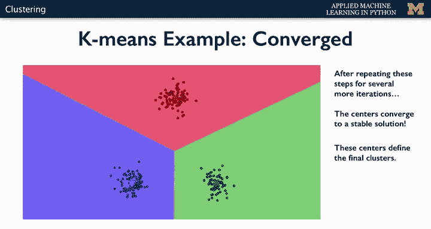
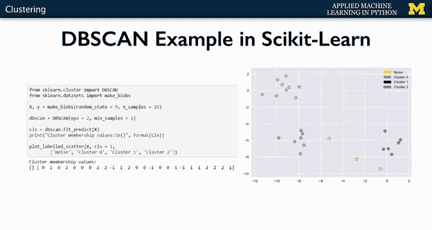

# 密歇根大学《Python用于数据科学实践（1-3课／共5课）｜Applied Data Science with Python 》deepseek翻译 - P91：36_聚类分析.zh_en - GPT中英字幕课程资源 - BV1U64y1L7VJ

Aside from transformations， the other family of unsupervised learning methods are the clustering methods。

The goal of clustering is to find a way to divide up a data set into groups called clusters so that groups of similar data instances are assigned to the same cluster。

 while very dissimilar objects are assigned to different clusters。

If new data points were being added over time， some clustering algorithms could also predict which cluster a new data instance should be assigned to。

 similar to classification， but without being able to train the clustering model using labeled examples in advance。

One of the most widely used clustering algorithms is called K means clustering。

K means clustering finds K cluster centers in different regions of the feature space that it thinks represent very different groups。

You need to specify the value of k ahead of time， which is one of the drawbacks of K means。

For some problems， we may know the number of classes the data should fall into。

 but for many other tasks， we might not。K means operates by first randomly picking locations for the K cluster centers。

Then it goes back and forth between two steps。In the first step。

 given the locations of existing cluster centers， it assigns each data point to a cluster center based on its distance from the center。

In other words， it assigns each state point to the closest center。Then in the second step。

 it adjusts the locations of each cluster center。It does this by setting the new cluster center to the mean of the positions of all the data points in that cluster。

Somewhat magically， after running this alternating process for a while。

 coherent clusters do start to form and the cluster centers and the corresponding cluster assignment for each data point。

😊，Eventually settled down to something stable。Now， one aspect of K means is that different random starting points for the cluster centers。

Often result in very different clustering solutions。 So typically。

 the K means algorithm is run in psyit learn with 10 different random initializations。

And the solution occurring the most number of times is chosen。Here's a step by step example。

We first choose three locations in the space randomly， to be the cluster centers。

Then we assign each data point to the cluster with the nearest center。Now， for each cluster。

 we compute the mean location of all points in the cluster and use that as the new cluster center for the next iteration。

Here's the second iteration of the first and second steps。Eventually， after 20 or 50 or 100 steps。

 things settle down to converge on one solution， as shown here。

。Km means's clustering is simple to apply in psychit Learn。

You import the K means class from SK learn cluster。Create the K means object。

 setting the value of K by specifying the n cluster's parameter。

And then calling the fit method on the dataset set to run the algorithm。

One distinction should be made here between clustering algorithms that can predict which center new data point should be assigned to。

And those that cannot make such predictions。K means supports the predict method。

 And so we can call the fit and predict methods separately。

Later methods willll look at like a glm clustering。

 do not and must perform the fit and predict in a single step， as we'll see。

Here's the output from the notebook code showing the results applied to the fruit data set。

 where we know the value of K ahead of time。Note that K means is very sensitive to the range of feature values。

 So if your data has features with very different ranges。

 it's important to normalize using Minmac scaling， as we did for some supervised learning methods。

Because each cluster in K means clustering is defined entirely by its center point。

It can only capture fairly simple types of clusters。

Kian's clustering tends to work well when the data points form into groups of roughly the same size with simple goobular shapes。

That are well separated。K meanss will tend not to do well if the data forms long irregular clusters。

 for example。Also， the version of K meanss we saw here assumed that the data features were continuous values。

However， in some cases， we may have categorical features where taking the mean doesn't make sense。

In that case， there are variants of k means that can use a more general definition of distance。

Such as the K meoids。Algorithm that can work with categorical features。

A gllometer of clustering refers to a family of clustering methods that work by doing an iterative bottom up approach。

First， each data point is put into its own cluster of one item。

Then a sequence of clusterings are done where the most similar two clusters at each stage are merged into a new cluster。

 And this process is repeated until some stopping condition is met。In Psychit learn。

 the stopping addition is the number of clusters。Here is a visual example of how a kilometer of clustering might proceed on a sample data set until three clusters are reached。

In stage 1， each data point is in its own cluster， shown by the circles around the points。At stage 2。

 the two most similar clusters， which at this stage amounts to the finding the closest points。

 are merged。And this process is continued， as denoted by the expanding enclosed regions that denote each cluster。

You can choose how the aggglomative clustering algorithm determines the most similar cluster。

By specifying one of several possible linkage criteria。In Psyit Learnn。

 the following three linkage criteria are available。Ward， average and complete。

Wd's method chooses to merge the two clusters that give the smallest increase in total variance within all clusters。

Average linkage merges the two clusters that have the smallest average distance between points。

Complete linkage， which is also known as maximum linkage。

Merrgs the two clusters that have the smallest maximum distance between their points。In general。

 Wordd's method works well on most data sets， and that's our usual method of choice。In some cases。

 if you expect the sizes of the clusters to be very different， for example。

 that one cluster is much larger than the rest。It's worth trying average and complete linkage criteria as well。

To perform a Gmeter of clustering in psyit Learnn， you import the aglometer clustering class from SK learnn cluster。

When initializing the object， you specify the n cluster's parameter that causes the algorithm to stop when it has reached that number of clusters。

You call the Fi predict method using the data set as input。

 and it returns a set of cluster assignments for the data points as shown here。

One of the nice things about a glmeter of clustering is that it automatically arranges the data into a hierarchy as an effect of the algorithm。

Reflecting the order and cluster distance at which each data point is assigned to successive clusters。

This hierarchy can be useful to visualize using what's called a dendrogram。

Which can be used even with high dimensional data。Here's the dendrogram corresponding to the wards method clustering of the previous dataset set example。

The data points are at the bottom and are numbered， and the y axis represents cluster distance。

 namely， the distance that two clusters are apart in the data space。

The data points form the leaves of the tree at the bottom。

And a new node parent in the tree is added as each pair of successive clusters is merged。

The height of the node parent along the Y axis captures how far apart the two clusters were when they merged with the branch going up。

 representing the new merged cluster。Note that you can tell how far apart the merged clusters are by the length of each branch in the tree。

This property of a dendrogram can help us figure out the right number of clusters。In general。

 we want clusters that have highly similar items within each cluster。

But that are far apart from other clusters。For example。

 we can see that going from three clusters to two happens at a fairly high y value。

 which means the clusters that were merged were a significant distance apart。

We might want to avoid choosing two clusters and stick with three clusters that don't involve forcing a merge for clusters that have very dissimilar items in them。

Psychic learn doesn't provide the ability to plot dendrograms， but sci Pi does。

Sipi handles clustering a little differently than psychic learning， but here's an example。

We first import the dendrogram and ward functions from the S pi cluster hierarchy module。

The word function returns an array that specifies the distances spanned during the aggglometer clustering。

This ward function returns a linkage array， which can then be passed to the denrogram function to plot the tree。

Typically， making use of this hierarchy is most useful when the underlying data itself follows some kind of hierarchical process so that the tree is easily interpreted。

For example， hierarchical clustering is especially useful for genetic and other biological data。

 where the levels represent stages of mutation or evolution。

But there are other data sets where both ca means clustering and aglom clustering don't perform well。

So we're now going to give an overview of a third clustering method called DB scan。

DB scan is an acronym that stands for densityity based Sp clustering of applications with noise。

One advantage of DB scan is that you don't need to specify the number of clusters in advance。

Another advantage is that it works well with data sets that have more complex cluster shapes。

You can also find points that are outliers that shouldn't reasonably be assigned to any cluster。

DB scan is relatively efficient and can be used for large data sets。

The main idea behind D B scan is that clusters that represent areas in the data space that are more dense with data points while being separated by regions that are empty or at least much less densely populated。

The two main parameters for DB scan are min samples and EPS。

All points that lie in a more dense region are called core samples。For a given data point。

 if there are min sample， other data points that lie within a distance of EPS。

That given data point is labeled as a core sample。Then all core samples that are within a distance of EPS units apart。

Are put into the same cluster。In addition to points being categorized as core samples。

 points that don't end up belonging to any cluster are considered as noise。

While points that are within a distance of EPS units from core points。

 but not core points themselves are termed boundary points。

Here's an example of DB scan applied to a sample data set。As with the other clustering methods。

 D B scan is imported from the S K learnn cluster module。And just like with a gllomb of clustering。

 DB scan doesn't make cluster assignments for new data。

So we use the fit predict method to cluster and get the cluster assignments back in one step。

One consequence of not having the right settings of E P S and min samples for your particular data set might be that the cluster memberships returned by D B scan may all be assigned the label negative 1。

 which indicates noise。Basically， the EPS setting does implicitly control the number of clusters that are found。

With D B scan， if you've scaled your data using standard Scalar or Min Max Scalar to make sure the feature values have comparable ranges。

 Finding an appropriate value for Eps is a bit easier to do。One final note。

 make sure that when you use the cluster assignments from D B scan。

 you check for and handle the negative one noise value appropriately。

 Since this negative value might cause problems， For example。

 if the cluster assignment is used as an index into another array later on。

Unlike supervised learning， where we have existing labels or target values to use for evaluating the effectiveness of the learning method。

 it can be difficult to evaluate unsupervised learning algorithms automatically。

Since there's typically no ground truth to compare against。In some cases。

 as in the breast cancer example， we may have existing labels that can be used to evaluate the quality of the clusters by comparing the assignment of a data point to a cluster with the label assigned to the same data point。

But there are many cases where labels are not available。 In addition， in the case of clustering。

 for example。There' is ambiguity in the sense that there are typically multiple clusterings that could be plausibly assigned to a given data set。

And none of them is obviously better than another， unless we have some additional criteria。

 such as performance on a specific application task that does have an objective evaluation to use as a basis for comparison。

For example， in cases where the results of the clustering are used as features for supervised learning。

We could use the overall classifier accuracy gain from adding these clustering base features as a measure of success for the underlying clustering。

Another issue with evaluating clustering algorithms。

Is that can be hard to automatically interpret or label the meaning of the clusters that are found。

And this is still a step that requires human expertise to judge。

