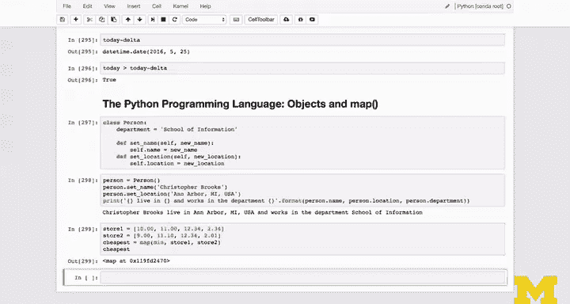

# 密歇根大学《Python用于数据科学实践（1-3课／共5课）｜Applied Data Science with Python 》deepseek翻译 - P9：8_Python高级对象映射.zh_en - GPT中英字幕课程资源 - BV1U64y1L7VJ

Up to this point， we haven't spoken much about object oriented Python。

 While functions play a big role in the Python ecosystem。

 Python does have classes which can have attached methods and be instantiated as objects。Now。

 this course isn't about the nitty gritty details of objects in Python or object oriented programming。

 And actually， while you'll use objects a lot in Python。

 you're less likely to be creating new classes when you use the interactive environment because it's a bit ver bothse。

 But I think it's important to go over a few details of objects in Python just so that you aren't surprised when you see them。

First， you can define a class using the class keyword and ending with a colon。

Anything indented below this is within the scope of the class。

Classes in Python are generally named using camel case。

 which means the first character of each word is capitalized。

You don't declare variables within the object。 You just start using them。

Class variables can also be declared。 These are just variables which are shared across all instances。

 So in this example， we're saying that the default for all people in is it the School of Information。

It's not very useful here， but I wanted to show it for completeness。To define a method。

 you just write it as you would have a function。The one change is that to have access to the instance which a method is being invoked upon。

 you must include self in the method signature。Similarly。

 if you want to refer to instance variable set on the object。

 you prepen them with the word self with a full stop。In this definition of a person， for instance。

 we have written two methods， set name and set location。

 and both change instance bound variables called name and location respectively。

When we run this cell， we see no output。 The class exists， but we haven't created any objects yet。

We can instantiate this class by calling the class name with empty parentheses behind it。

Then we can call functions and print out attributes of the class using the dot notation。

 common in most languages。There are a couple of implications of object ored programming and Python that you should take away from this very brief example。

First， objects in Python do not have private or protected members。 If you instantiate an object。

 you have full access to any of the methods or attributes of that object。Second。

 there's no need for an explicit constructor when creating objects in Python。

 You can add a constructor if you want to by declaring the double underscore in knit。

 double underscore method。Now， I'm not going to dive into any more into Python objects because there's lots of subtlety。

 And to be honest， most of the object oriented features of Python aren't really all that salient for introduction to data science。

 If you're more interested， I recommend checking out the Python documentation from the Python tutorial。

 It's fairly comprehensive overview of the object features of the language。

 and there will be a reference in the class resources。

The map function is one of the bases for functional programming in Python。

 Functional programming is a programming paradigm in which you explicitly declare all parameters which could change through execution of a given function。

 Thus， functional programming is referred to as being side effect free because there is a software contract that describes what can actually change by calling a function。

😊，Now， Python isn't a functional programming language in the pure sense。

 since you can have many side effects of functions。

 and certainly you don't have to pass in the prim of everything that you're interested in changing。

But functional programming causes one to think more heavily about chaining operations together。

 And this really is a sort of underlying theme in much of data science and data cleaning。

 in particular。So functional programming methods are often used in Python。

 and it's not uncommon to see a parameter for a function be a function itself。

The map built in function is one example of a functional programming feature of Python that I think ties together a number of aspects of the language。

The map function signature looks like this。 The first parameter is a function that you want executed。

 and the second parameter and every following parameter is something which can be iterated upon。

 All of the iterable arguments are unpacked together and passed into the given function。

That's a little cryptic。 So let's take a look at an example。 Imagine we have two lists of numbers。

 maybe prices from two different stores on exactly the same items。

And we wanted to find the minimum that we would have to pay if we bought the cheaper item between the two stores。

To do this， we could iterate through each list， comparing items and choosing the cheapest with map。

 we can do this comparison in a single statement。But when we go to print out the map。

 we see that we get an odd reference value instead of a list of items that we're expecting。

This is called lazy evaluation In Python， the map function returns to you a map object and doesn't actually try and run the function men on two items until you look inside for a value。

This is an interesting design pattern of the language and is commonly used when dealing with big data。

This allows us to have very efficient memory management。

 even though something might be computationally complex。Maps are iterable。

 just like lists and tuples， so we can use a for loop to look at all of the values in the map。

This passing round of functions and data structures。

 which they should be applied to is a hallmark of functional programming is very common in data analysis and cleaning。

Here's a problem for you to try that brings together some of the tasks you might be expecting to do with data cleaning。

