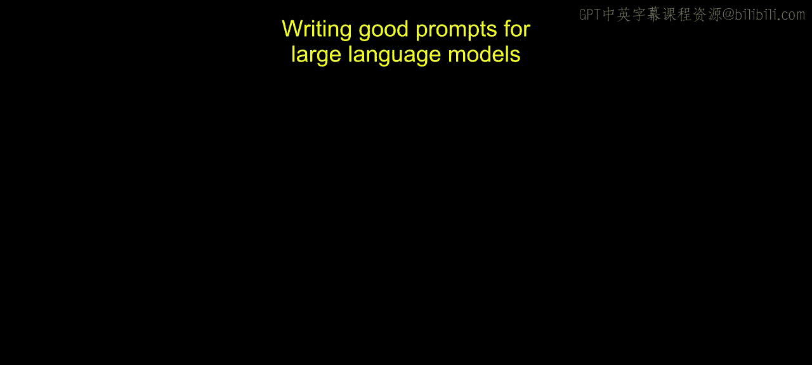
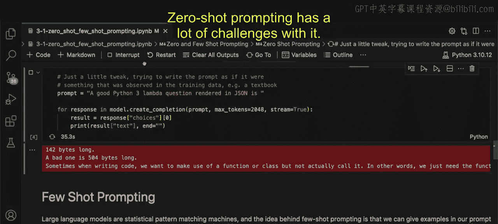
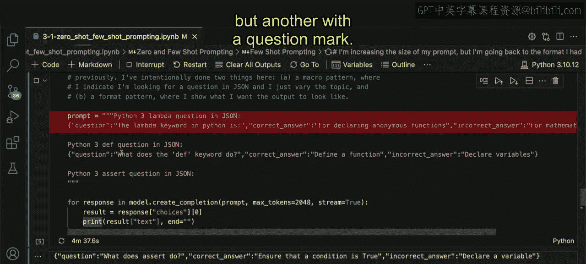
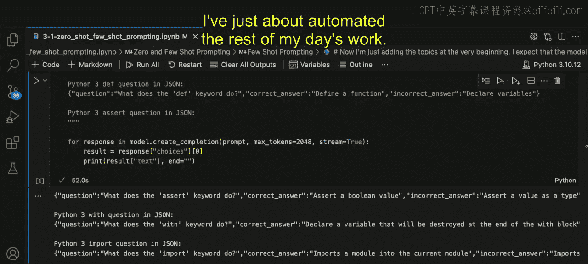
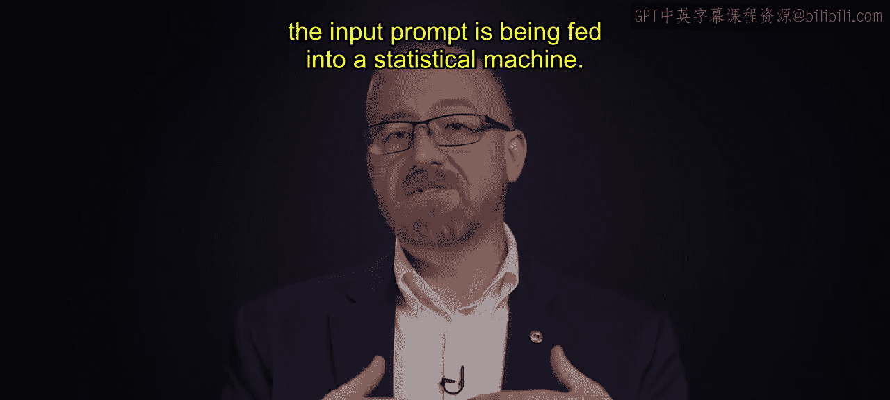
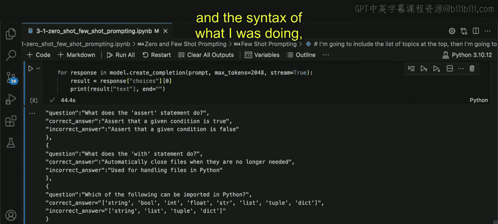

# 密歇根大学《Python程序员的羊驼”课程｜Llama2 for Python Programmers》中英字幕 - P10：9_零次和少量提示.zh_en - GPT中英字幕课程资源 - BV1vi421a7NL

Writing good prompts for large language models is a combination of art， science。

 and perhaps a bit of wizardry and luck。As you know， the model is a statistical machine。

 taking numeric input sequences and creating output sequences to match based on the pretrain data in the model。

 the input sequence itself， and the various parameters that we can use when calling this model。

In this lecture I want to introduce you to two different prompting strategies now I caution there's many more strategies out there。

 but these two form a nice foundation for current practices and they work well with Lamma too。

You've actually seen the first of these zero shot prompting many times in the course。

 it's simply giving the model a single set of instructions to respond to and letting the model use its pretrained weights to generate an output sequence。

And actually calling these inputs as instructions is questionable at best。

 most of us are used to this chat GptT style conversation。

 but the model is actually just doing output sequence prediction So zeroshot prompting is giving an input sequence and taking from the model a predicted appropriate output sequence throughout this lecture I'm going to use a really authentic task you see I teach a lot of programming in my day- to- day job at the University of Michigan and here on the courseursera platform This often covers topics in the areas of Python data science and applied AI。

 One of the things I like to do is give students more quick questions to test their knowledge but coming up with good questions is difficult and then I have to type them all out and enter them into some sort of quizzing tool to be delivered to the learner。

😊，Interestingly， most of these tools can take JO formatted questions。

 but I find typing out JSO documents by hand as slow and error prone。

 so let's see if we together can build a conversational agent to help with this task。

So let's set up our Lama model and this time I'm going to bump up the context window a bit now this can slow things down。

 but it also results in more output tokens being sent back to us。

 which I think is particularly useful for this task。Now in zeroshop prompting。

 we're just asking the language model to continue our text using its pretrained weights。

 since I want to generate some Python3 Lambda questions in Jason。

 this seems like a good starting point， I'm just going to say Python3 Lambda question in Jason and then the colon there is like a little bit of a sign what would come next。

 how would you complete this so let's watch what the results look like？Okay。

 I am trying to use a Lambda function for a post request。

 but I get an error that the value is not valid Jason Okay so this all sounds fine。

 but this is not what I'm looking for so I'm just going to write a little tweak here and I'm going to try and write the prompt as if it was something that was observed in the training data so I'm changing the way I think about this a bit like as if it saw something in a textbook so a good Python3 Lambda question rendered in Jason is I think this maybe will give us a slightly better result。

Okay， so the model here says a good Python 3 lambda question rendered in Jason is 142 bys long。

 so that seems weird and arbitrary， it's a fine response to the sentence but not very good。

 and then it starts going on about what bad ones are and writing code so none of this is really working out very well we need to do a little bit more。

 zero shot prompting has a lot of challenges with it。

Large language models are statistical pattern matching machines and the idea behind few shot prompting is that we can actually give some examples in our prompt to help the model tailor its output to what we're actually looking for this turns out to be sort of a very simple superpower for prompt engineering is very helpful when you want to constrain the responses from a model to a specific format Let's see if it helps us here I'm increasing the size of my prompt。

 but I'm going to go back to the format I had previously I've intentionally done two things here one I've created a macro pattern where I indicate I'm looking for a question in Jason and I just vary the topic and then I create a format pattern where I show it what I want the output to look like so I've got this Python3 Lambda question in Jason colon and then I give it an example I want question followed by some interesting question text about Lambda followed by a correct answer and a colon and so forth。

What's important here is that I give it multiple examples and so that's what the few means in few shot。

 we're not pre-training the model， we're not fine tuning the model。

 but we're giving it a few shots at improving itself so I say here Python3 I want a deaf question like to define a function for instance。

 and then I end with something that I want the model to finish on so I say a Python3 assertt question in Jason colon and I leave it up to the model and the model hopefully will fill that in for me。

So we can see here instantly that this works so much better than our previous attempts here it just carries on and finishes doing what I asked It says a question。

 what does an assert to， It's actually a reasonable question about an assert and it's got an incorrect answer it's got a correct answer but then it actually goes on and looks and sees this macro pattern as well where I would say Python3 list question in Jason Python3 tuupple question is just creating a whole bunch of questions that it thinks would be similar to what it would see in its training data if its training data looked like the previous prompt that we gave it so I think the output that I'm getting here is really interesting and I want to take a quick moment to talk about it I wasn't actually planning to but sometimes with the non-determinism you get interesting things so you can see in my pattern here I said things like the lambmbda keyword in Python is colon or what does the deaf keyword do interestingly because。

The response from the LLM is added to the prompt and constantly done this way in a loop it can pick up its own patterns and we saw that in a previous lecture but we're also seeing that here too so it says a Python3 list question in Jason is and then it's the prompt is a list is a colon and then a tuple is a colon a dictionary is a colon these are really bad pedagogically as questions and I wasn't looking for that I was hoping for a little bit more diversity and that's why I gave one example with this colon but another with a question mark if I increase the number of questions in my few shot and the diversity of those questions it wouldn't pick up this sort of micro patternn and would produce for me better output。

So we actually got really good output from the system there and you're going to get something different if you run that on your end now in my end I saw lots and lots and lots of questions that look the same and I actually want to constrain it a little bit I want to make sure that the models only creating questions about topics that I'm teaching so let's see if we can do that right now so the way I do this with few shot is I'm just going to add the list of topics at the beginning here so I just say the topics Lambda de assert with and import see I've separated them all and then I give my exact same few shot questions examples with the hopes that it's going to pick up that pattern between the list of topics and the questions as I've given them so let's run this。

All right， things are getting exciting。 And I've just about automated the rest of my day's work。

 I actually just want the JO results， and sometimes the result doesn't have all of the J fields I might want。

 Remember here， everything is tokens and sequences and the input prompt is being fed into a statistical machine。

 Let's see if we could tweak this a bit further。😊。

So I know I told you I don't like writing Jason by hand but that's what I'm going to do here I'm going to include the list of topics at the top like I did previously。

 but I'm going to write everything is Jason and I'm going to make it seem like the machine should actually continue to write Jason so here I've got basically the same prompt except I've just set it as a variable in Jason and then I've indicated that questions is going to be a list and then each one of these as a dictionary and that dictionary is going to have a question a correct answer。

 an incorrect answer and so forth。There's a couple of interesting things about this you'll notice that there's going to be some patterns that should get picked up like a comma and a line return at the end and that we end up with lines that have an open brace and then one that starts with question。

 one that starts with correct answer and so forth and I think the machine will be pretty good at picking this up there's no other changes to actually how we programmatically interact with Lamma here。

So we'll just run that and take a look at the results。Okay， this is really solid。

 What's really cool about this。 I think， is that I'm not conversing with the model or trying to prime it to be an expert。

 I just started writing a Jason document， and it captured both the meaning of what I was doing。

 writing questions with correct and incorrect answers and the syntax of what I was doing writing wellform Jason。

 And it did all of this in a quantized to 13 billion parameter model。

 This is a great time to jump into the Coursera labs and work on the notebooks and experiment a bit yourself to see this in action。

 So here's a couple of tasks that you might want to try that leverage some of what you've learned。

 First， how would you reimplement this code using the Lama2 chat model。 And second。

 how would you rewrite these prompts so that there were multiple incorrect answers。

 all in Jason lists of their own。 Give these a shot in the labs workspace and feel free to share your responses to these or what you come up with in the course discussion forms。

😊。

