# 密歇根大学《Python程序员的羊驼”课程｜Llama2 for Python Programmers》中英字幕 - P1：0_欢迎来到“Python程序员的羊驼”课程.zh_en - GPT中英字幕课程资源 - BV1vi421a7NL

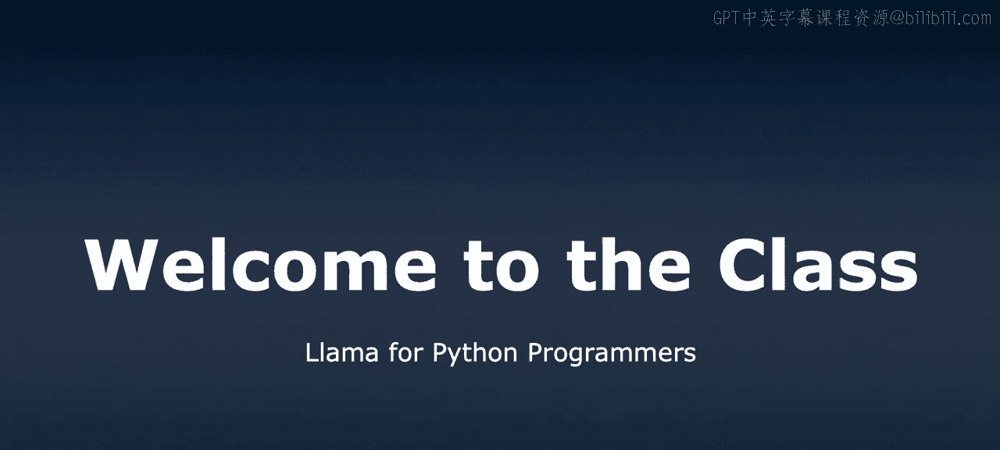

Welcome to Lama for Python programmers。 I'm Chris Brooks associate professor in the School of Information at the University of Michigan。

 I'm a computer scientist by background and my research in teaching at the University of Michigan focus on applying data science。

 machine learning and artificial intelligence to improve learning and education in the primary secondary and lifelong learning spaces。

 I'm thrilled to be bringing you this course on open source large language models specifically the Lama model created by meta and to be presenting it to you here on the Courharra platform where you can experiment。

 explore and learn how to program these models without having to install any software on your own machine。

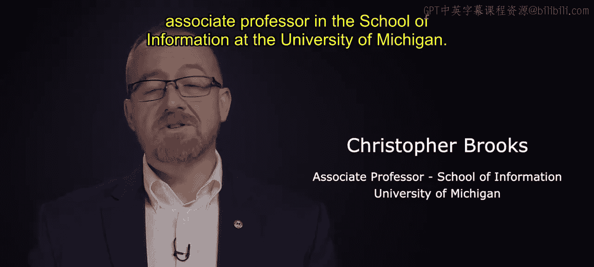

The first Lama model was released by MeAI in February of 2023 and the variants I'll be teaching you about are the Lama2 models that were released later that summer unlike the most wellknow large language model。

 ChadgBT the Lama2 models are all available for download under a royaltyfree license and allow you to integrate them directly into the applications or services that you might be interested in building Now this is incredibly important if you work in a highly regulated industry or one with sensitive data。

 for instance health education or really any situation where you would prefer to not send the data to a thirdpart such as openAI the models are also great for prototyping development with minimal costs。

 since you can run them on hardware that you already own you can also scale these up and put them into production and environments where you already have hardware whether it's just a few machines or networks of private data centers but it's important to note that the Lama2 models aren't toy models they're competitive with commercial offerings and are available to be scaled as a server。

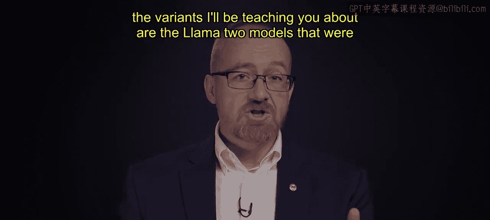

Some popular cloud platforms such as Microsoft Azure or Amazon Web Services this course will be a mixture of lectures for grounding in the first module followed by live code demonstrations in the following modules the code demonstrations will be done using Jupyter notebooks in the VS code environment and on the Coursera platform here you're going to have access to that webhosed version of VS code this will allow you to follow along with the video lectures Live。

 changing code to explore how Lama2 and the software packages we're using called Lama CBP works。

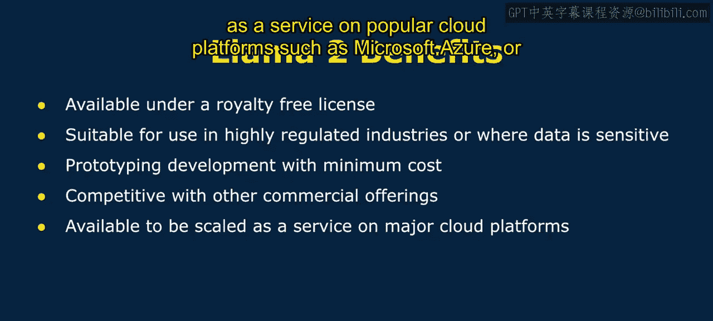

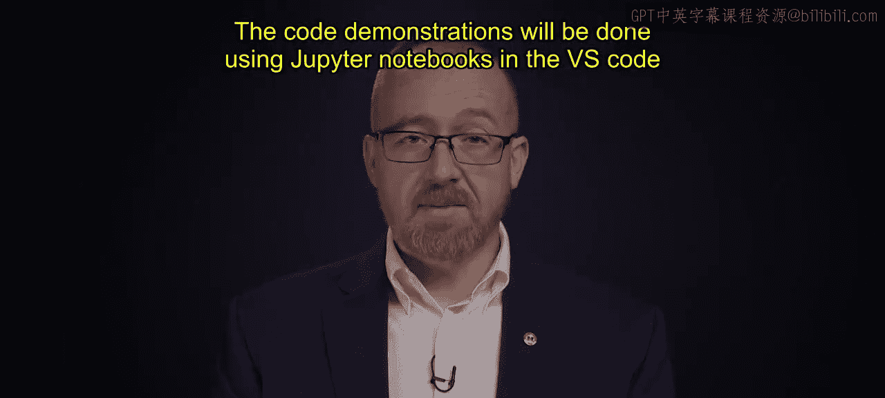

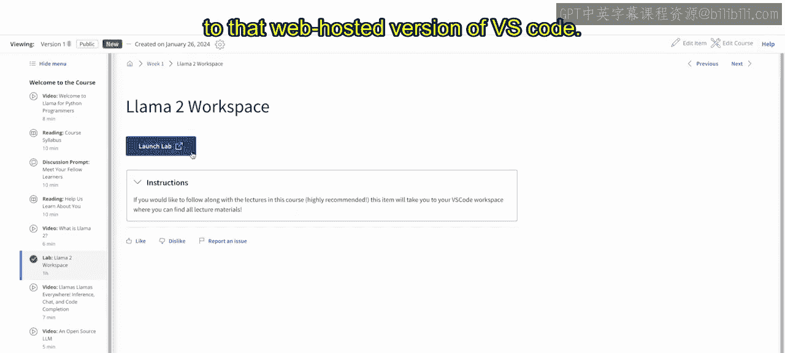

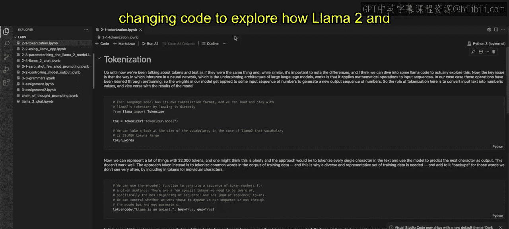

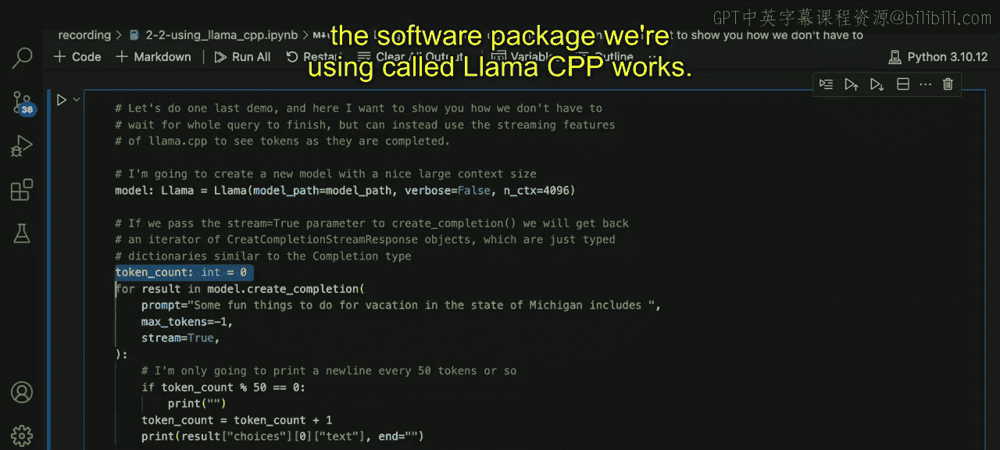

One of the most exciting aspects of the Coursera platform to me is that it allows you to practice what you're learning while you're listening to me talk and I encourage you to do this don't just watch the videos passively be an active participant and use this lab workspace to be successful in this course I'm expecting you to have some basic knowledge of Python I'll be using Python3 for my demonstrations and most of the assessments in the course will be a mixture of short answer。

 multiple choice and some programming questions the world of large language models is a fast movingov space and I'm excited to bring you this course I'd like to hear from you Now I don't actually get to meet many of my students on Coursera but I do get a chance to read your responses to open-ended questions that I ask in the videos。

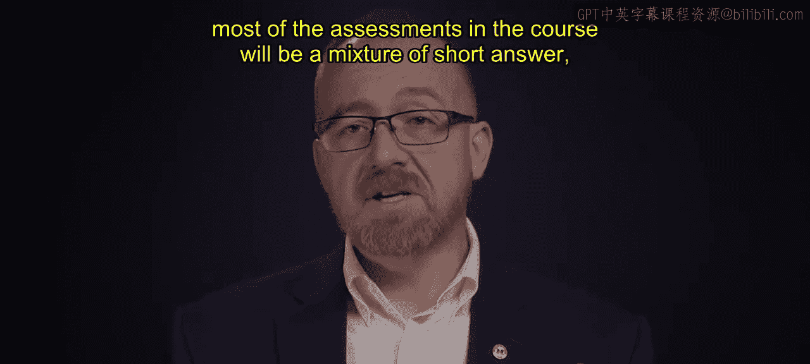

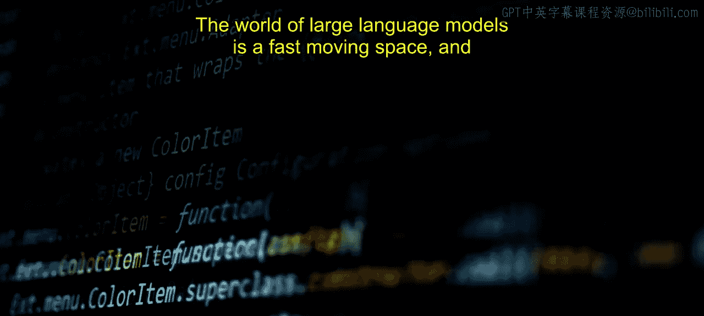

Now， I promise I won't ask too many questions， but before we jump into the material I've prepared for you。

 I'd like to ask you to take a moment and reflect what is it you're hoping to learn in this class and why。

Thanks for sharing your thoughts with me now let's dive in and learn more about Lama2。

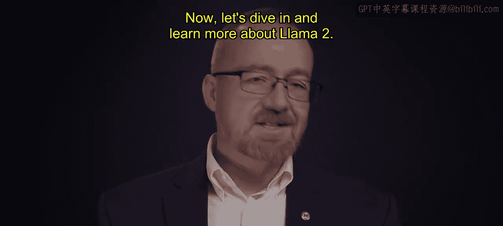

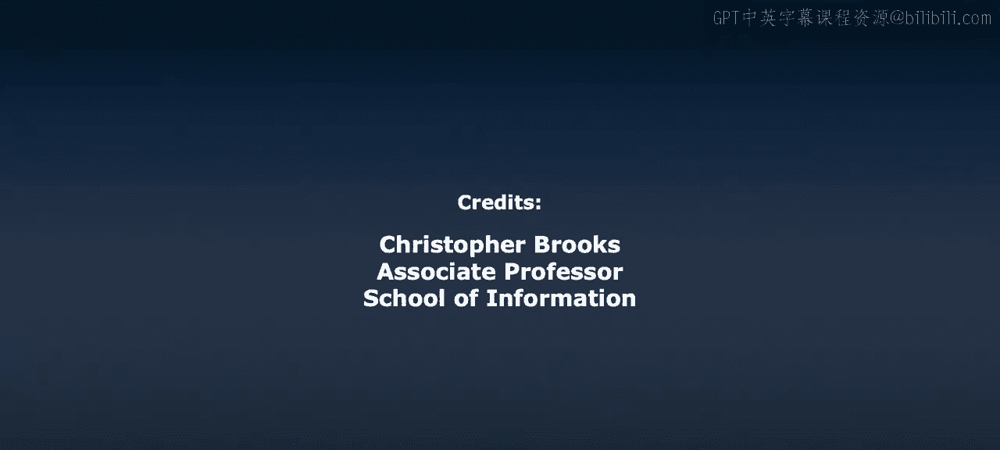