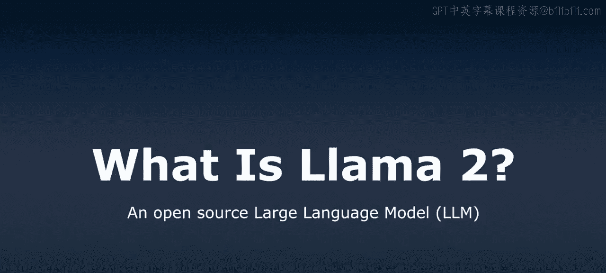
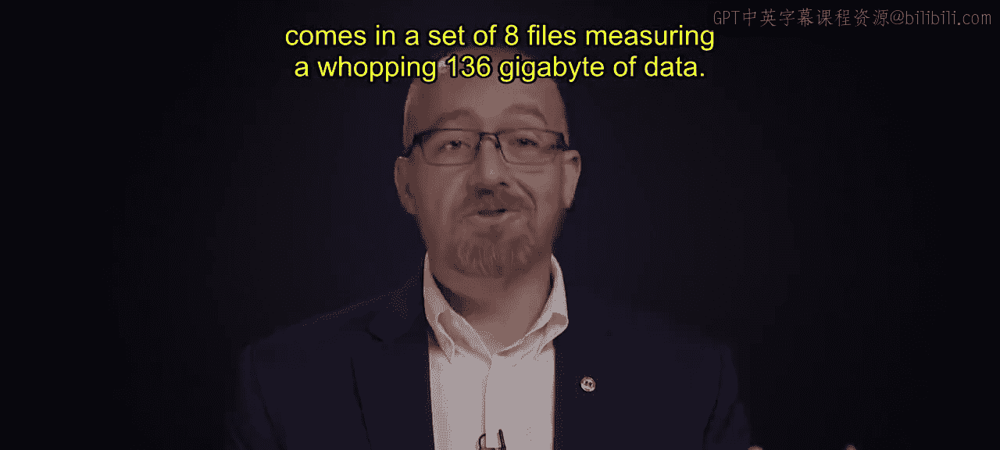
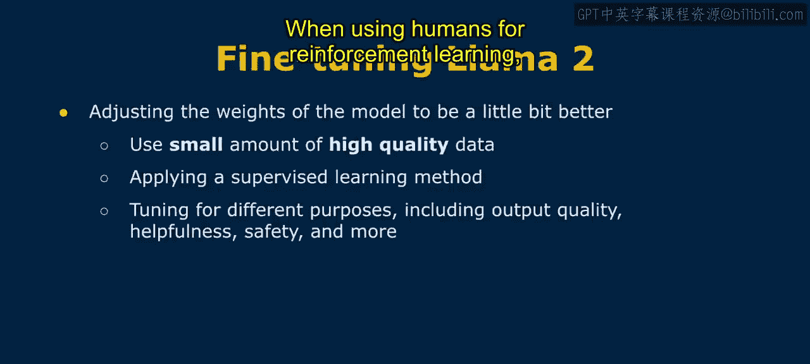
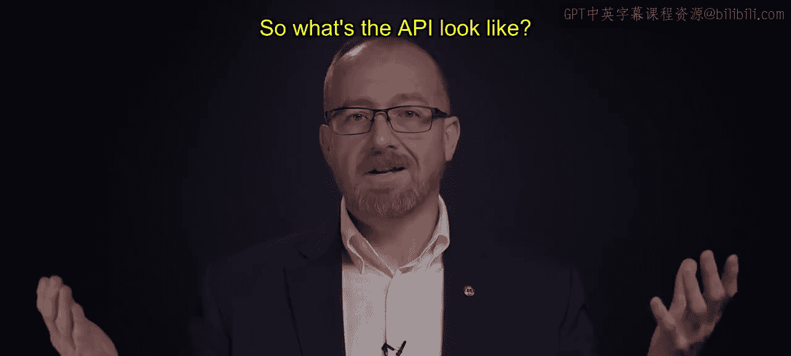
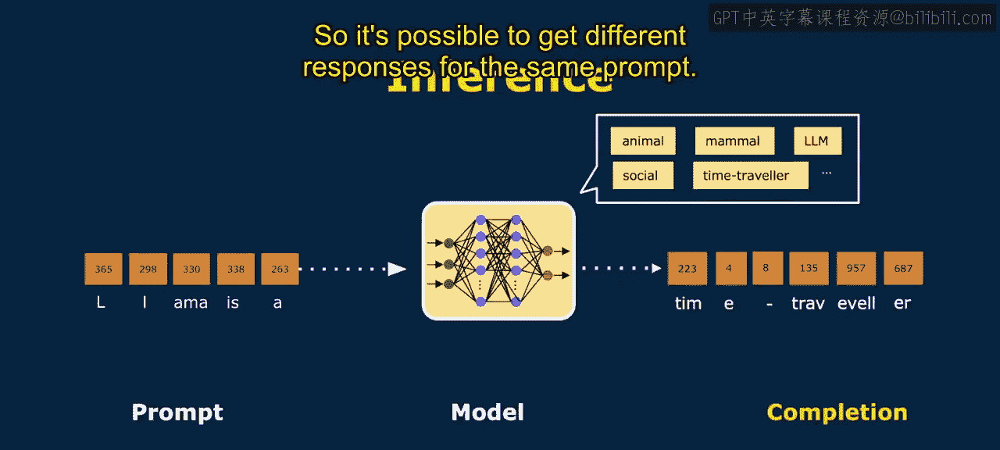
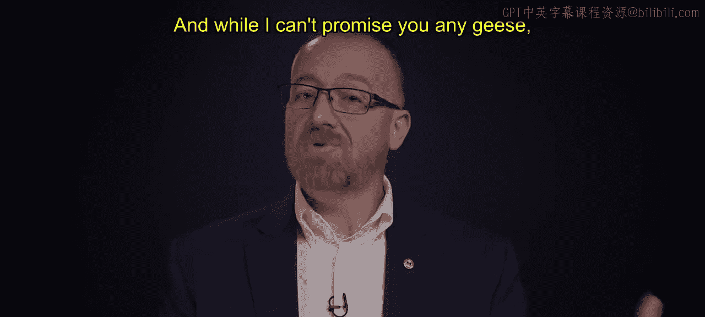

# 密歇根大学《Python程序员的羊驼”课程｜Llama2 for Python Programmers》中英字幕 - P2：1_什么是羊驼2，一个开源的大型语言模型LLM.zh_en - GPT中英字幕课程资源 - BV1vi421a7NL

Broadly speaking， large language models are massive pretrained inference engines which generate text output from text input。

 They're part of a family of artificial intelligence methods called generative AI。

 generative AI is different from some of the other tasks we commonly associate with artificial intelligence and machine learning。

 For instance， classification tasks， which we call supervised machine learning。

 typically take a set of labeled data， and maybe a bunch of pictures where some are cats and some are dogs。

 and then we feed in new pictures， and the model will label them automatically for us。

 having learned from this initial training data， or maybe clustering tasks。

 which we refer to as unsupervised machine learning。

 where we might feed in a large set of unlabeled data， say records about students or employees。

 than look at which typical students or employees are most common in our data set。

 as discovered by our machine learning algorithm。Generative AI builds on top of these and other techniques for machine learning。

 and the focus is to generate new output data in response to both an input data stream and a pretrained corpus。

It's useful to think of this actually as a combination of supervised and unsupervised learning tasks wrapped in a black box with the following goal。

 Given the data which created the black box model， such as all the words on Wikipedia or all the books which have ever been written and given some initial prompt。

 maybe a riddle or a question， What is the most probable continuation of that prompt， The answer。

 if you will。 This is generative AI， and large language models are perhaps one of the most exciting forms of generative AI at present。

😊，In this course， we're going to be considering specifically the Lama 2 open source family of large language models。

 These models are available in different sizes and complexities。

 with the number of parameters measured in the billions。

 and there exist several different kinds of models for different tasks， such as general inference。

 question and answering， chat and even writing code。Now。

 Lama2 is interesting not just because of its high quality。

 but also because it has been made freely available to the world by its creator meta Meta even calls it an open source language model and you can download the model and use it directly on your own hardware without payment not only for research but also for commercial purposes。

 but before we get into how Lama 2 works and what makes it special。

 we should talk a bit more about how LLms are created in general LLms are pre-trained。

 which means they aren't just a machine learning architecture。

 but that architecture has already been initialized with relevant data In the case of Lama2。

 the data was freely available and it was webbased， including content from Wikipedia。

 scraped web pages， open source code repositories on Github。

 free online books from Project Gutenberg and more In fact。

 the authors of Lama2 say they ended up training the models with more than2 trillion tokens and while we'll talk about tokens in a moment。

 you can think of them as being similar to words in these data。Now。

 there's a number of different techniques that are used to actually generate the pretrained model and all belong to the fields of natural language processing and deep learning。

 The core aspect being this transformer architecture。

 which Google researchers released in a landmark paper in 2017 called attention as all you need。

 We're not going to dive into detail in that。 But if you want a programming analogy。

 you can think of a pretrained model is a complex data structure with a very simple API。

 This API lets you call the data structure with some text and will return to you the text it predicts will come next。

The data structure， meanwhile， has been filled through this pretrain process with what we call the weights of the model。

 relationships between all of the pieces of text put into the model through training and the quality of these weights really determines how accurate and thus good the model is at predicting text。

And I actually think weights is a good name for the parameters in pretrain models。

 the very smallest Lama2 model is made up of 7 billion parameters and comes in at a single file which has 13 gigabytes in size。

The largest and most capable Lama2 model， the 70 billion parameter model。

 comes in a set of eight files measuring a whopping 136 gigabytes of data。

To use these models， they actually all have to be loaded into high performance video card Ram。

 And this means that the larger models are well outside the capabilities even high performance desktop computers can provide。

 But we'll talk about a few ways to tweak this in a bit。

 Let's go back to these pre trained models for a moment。 Once we have a pre trained model。

 we can improve it through a process called fine tuning。

 And what we're really doing underneath is just adjusting those weights in the model to be a little bit better。

😊，The amount of data for fine tuning is much smaller。

 but we want it to be even higher in quality than the data we use for pretrain。In some cases。

 we use a high quality data set for this fine tuning。

 but it's also very common to use a process called reinforcement learning with human feedback。

 and metata actually used both of these approaches when developing Lama 2。In the fine tuning process。

 we switch into a supervised learning method where text is invoked against the model and the prediction output。

 the LLM response to the query is evaluated against an expected gold standard。

When using humans for reinforcement learning， those humans provide their preference over a set of alternatives from the model。

 and there's a lot of interesting nuance in how this is done because first of all。

 humans don't agree with one another all the time， and second。

 there's many different ways we can consider whether a response was actually appropriate or not。

In the case of Lama2， a lot of effort was put into different methods of fine tuning。

 including tuning for the model output quality， the helpfulness。

 and the safety of the model and more。Whenever you see a chat agent powered by an LLM respond。

 indicating that it can't do what you're asking because of safety concerns。

 you're experiencing the results of this fine tuning process。Okay。

 now that we have this data structure which has been pretrained on huge amounts of data and we want to use it so what's the API look like well it's deceptively simple the act of calling the model is referred to as inference。

 put simply you provide to the model a prompt， which is just a series of text tokens that have been converted into numeric values and the model will predict which token is the next best continuation of that prompt。

In the case of Lama 2， the model doesn't change between calls。

 but the response it gives has some degree of randomness。

 So it's possible to get different responses for the same prompt。 Now， that all seems really simple。

 but the form and the content of the text you feed into the model is a prompt really can change how the model response quite dramatically。

 And this is because of that fine tuning step， where the model has adjusted its weights based on human preferences。

 This means that you get the most of the model when you understand how it's been fine tune。

 and so that you can create that appropriate prompt based on that fine tuning。

While this course focuses on Lama2， there is significant work being done to create other LLMs and the fine tuning process is something you really need to consider when coming up with prompts。

Beyond that， it's possible to fine tune your own models， including Lama2。

 by coming up with your own set of training data or your own human reinforcement learning preference mechanism。

So allow me to close out this lecture with a riddle， in fact。

 one of the world's oldest recorded riddles， which is from summer from around 18th century BC and is translated here into English。

 and I think this riddle really relates to LLMs in a unique way。 it goes like this。

A house based on a foundation， like the skies。A house， one is covered with a veil。

 like a secret tablet ox。A house set on a base like a goose。 One enters it blind， leaves it seeing。

So what is this？What is a foundation made up of nearly everything around us。

 Yet sits often locked up in a black box guarded， perhaps by gatekeepers like a goose might guard its nest。

And what kind of place is this where you enter it blind and you might be able to leave it seeing。

Recorded on these 18th century Sammerian tablets on the next line was the completion of this prompt。

 a school。I hope through this course to open up the secrets of this tablet box。

 And by the end of this course， you will have gained a new way to see what large language models really are。

 And while I can't promise you any ge， I guarantee you will talk a lot about Lamoth。

