# 密歇根大学《Python程序员的羊驼”课程｜Llama2 for Python Programmers》中英字幕 - P3：2_到处都是羊驼——推理、聊天和代码完成.zh_en - GPT中英字幕课程资源 - BV1vi421a7NL

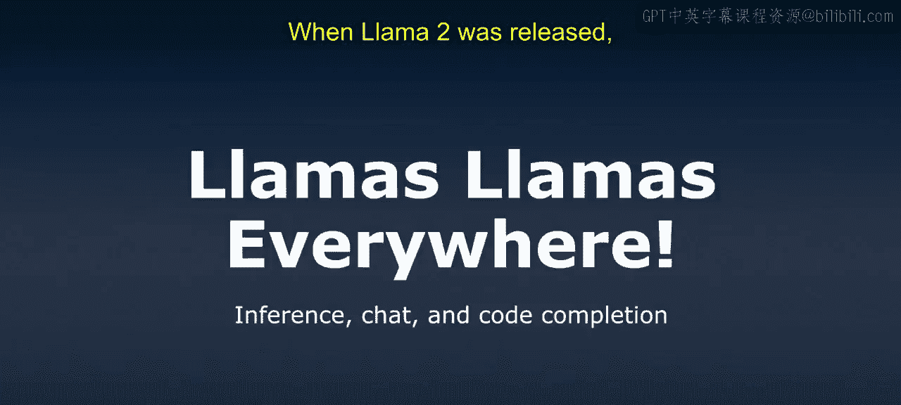

When Lama2 is released， metata provided three different flavors。 The base model。

 a well trained model suitable for inference， where a call to the model with some prompt results in a response back in the form of a completion of that prompt。

 The focus of this model was on high quality responses that were factually correct using the pre traineded process。

Chat， a model built specifically for human interaction through chatting。

 Much of the emphasis here was on dialogue interaction。

 and the fine tuning process improved the chat model through this use of reinforcement learning with human preferences across a range of different metrics。

 Important， metata spent significant efforts in this fine tuning process ensuringuring this model had appropriate guardrails for safety and toxicity。

 Then code Lama， This model was actually released several months after the others and was built specifically for programming tasks。

 Now， we' have already talked about the first two models。 But how does this code lama differ。

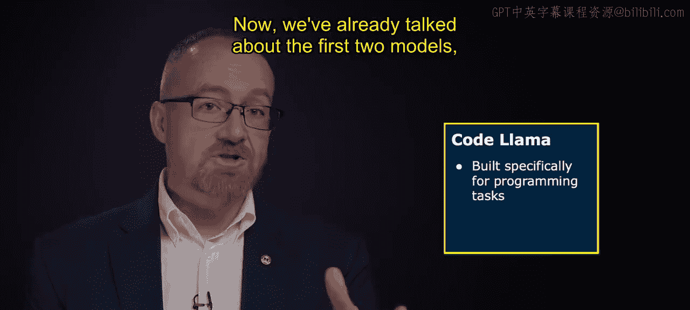

Well， there are actually three different kinds of code Lama models and they were all trained off the base model for Lama 2。

 Remember， Lama2's base model used 2 trillion tokens for training and comes in three sizes， 7。

13 and 70 billion parameters。

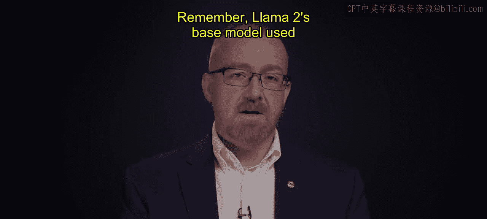

It actually turns out that there was an unreleased 34 billion parameter model。

 and code Lama was released based in part on the 7， 13 and 34 billion parameter models。

In January 2024， roughly four months after the release of the three code Lama models。

 Meta released a 70 billion parameter code Lamma variant。

 and I think this should give you a sense for the amount of effort。

 which goes into training these models。 months and months of highco computing is needed to generate these large statistical models。

 and as you can imagine， experimenting with model architectures can take even longer。

 for each of these base models， meta created finet versions using two different tasks。

 code completion and infiling。 Now， the code completion task is pretty similar to the base model inference mechanism。

 Given some input data， which is code， predict the code which should follow。

 If you've used Gitthub copit or similar tools， you've probably experienced this where the model is predicting what you might write next。

 given the context of what you've already written。 the infilling task is more specialized in this task。

 the model takes in both a prefix of what has been written as well as a suffix of what will come next。

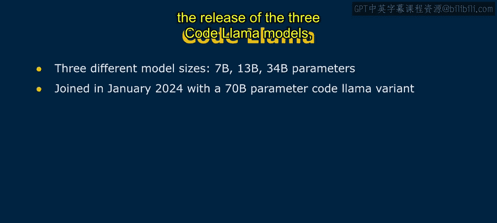

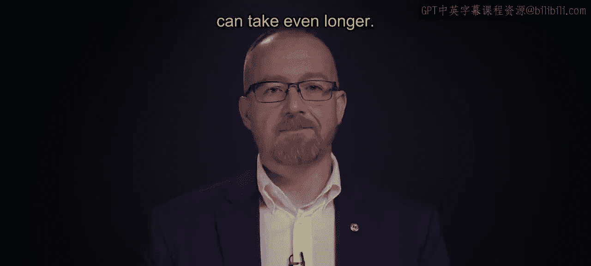

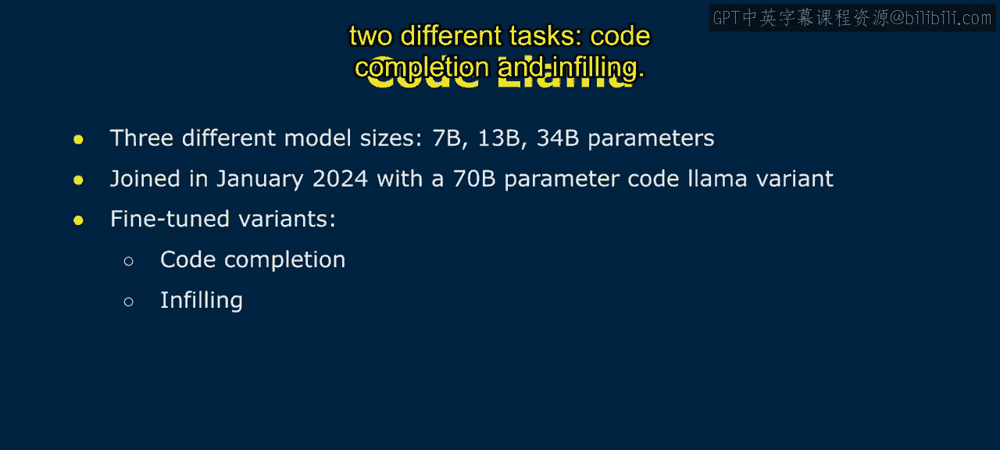

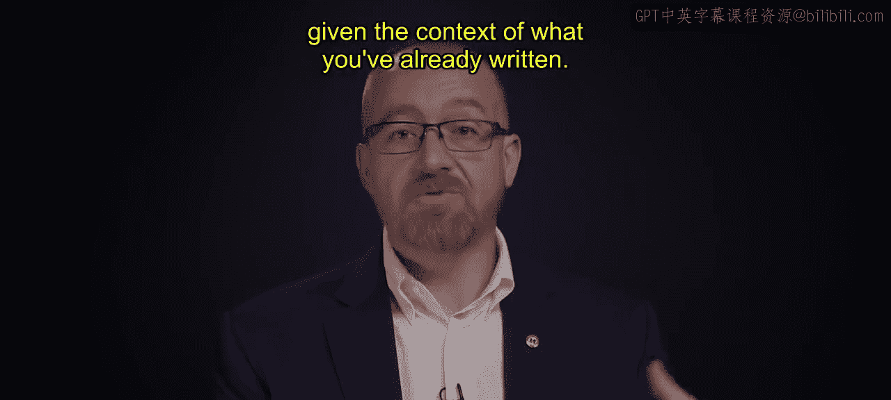

Think of this like placing your cursor between two functions you've written and querying Lama 2。

 asking it to write the code which comes in between them。In both cases。

 an additional 500 billion tokens were used to finet the models coming again from open web resources。

 That's not quite the whole picture， though， metata also took the time to createa different kinds of tuned code Lama models。

 For instance， they created a code Lama Python model by fine tuning with an additional hundred billion tokens of Python training code。

 This model excels specifically at writing Python。 And you can see here how fine tuning one of these base models。

 sometimes called foundational models for a programming purpose。

 like Python programming takes much less effort。

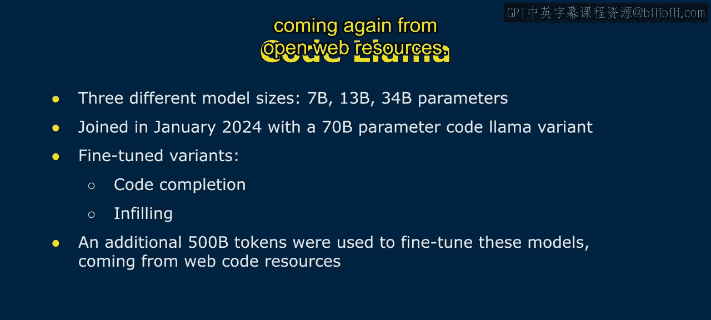

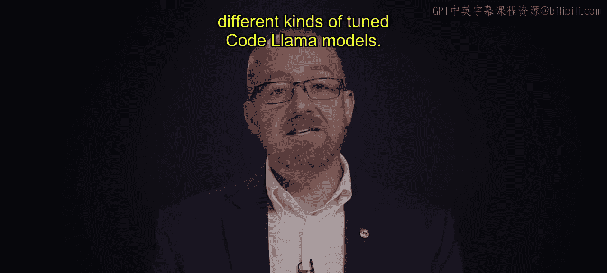

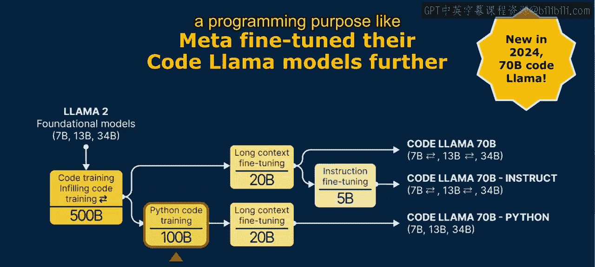

By releasing the model weights freely as Meta is done with Lama2。

 it's possible for communities to form around the fine tuning process。

 taking advantage of a high quality base model while specializing it for a given task。

Meta also created a model called Coded Lama Instruct。

 which was general purpose coded Lama model with an additional 5 billion tokens of human language。

This model improves in its ability to produce quality code from natural language instructions。

 but interestingly， they didn't use reinforcement learning with human preferences for this fine tuning。

Instead， because code can actually be executed and thus its outputs determined。

 Meta used the 70 billion parameter base model to generate roughly 50。

000 unique interview style programming questions。For each of these questions。

 they had codelemma then generate a series of unit tests。

 as well as 10 different Python solutions to the questions。

The unit tests were then run on the test solutions， and the first solution that passed the tests。

 along with its question prompt from the 70 billion parameter model。

 and the unit tests were added to the fine tuning database。 This interview style mechanism。

 along with execution of the code itself in order to fine tune the model is a neat approach when you want to fine tune for domains or tasks where you have an objective measure of success and don't need a human evaluation of results。

 So there's a couple of important takeaways from these early lectures on Lama 2。 First。

 you don't just train a model and you're done， but you can continue to finetna model to improve its performance in a specific way。

😊。

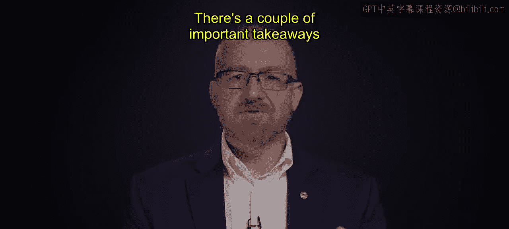

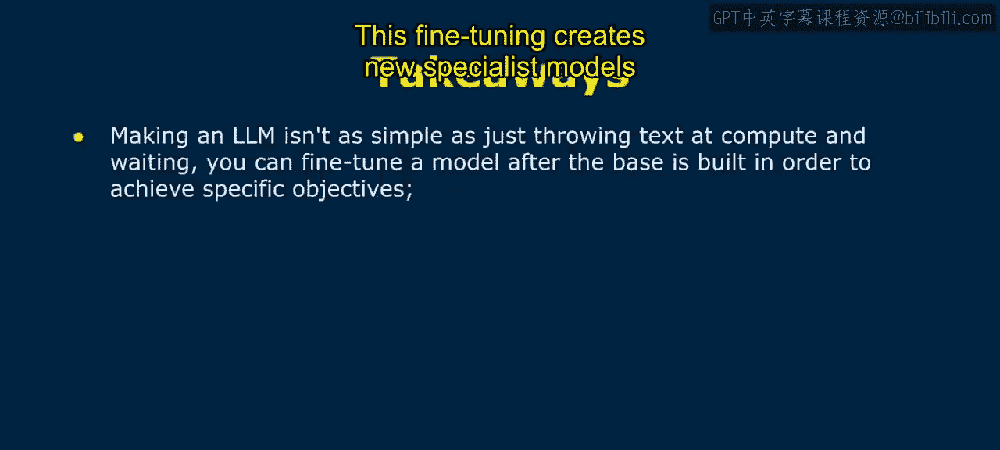

This fine tuning creates new specialist models， which can have different input assumptions。

 such as this infilling task for code lama， as well as modified weights。

 which can improve the results for a specific task。 Second。

 the process of fine tuning can be done with very little data。

 at least compared to the foundational models。 and you can continue to leverage the capabilities of that foundational model。

 For instance， the code Lama instruct series of models only used 5 billion tokens on top of the base code lamma models。

 which used 500 billion tokens and were based on the two trillion token foundational models。

 As the number of tokens decreases， this means your training data doesn't take nearly as long and can be done much more cheaply。

 Finally， even though human preferences are used heavily to generate these kinds of models。

 especially in chat models， there are other interesting mechanisms we can use for reinforcement learning。

 The field of reinforcement learning is much broader than LLMs。

 But I think the code lama instruct training is a great。😊。

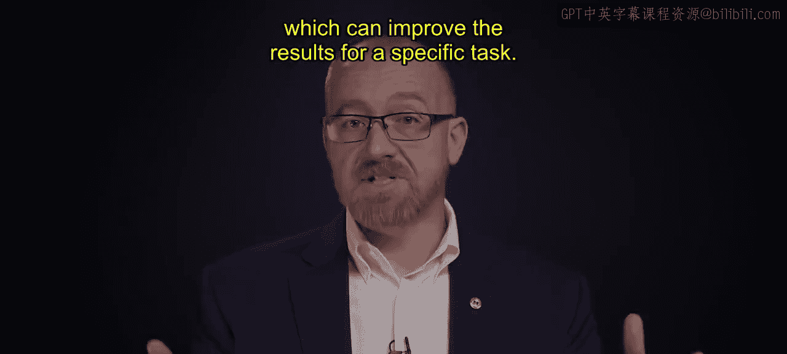

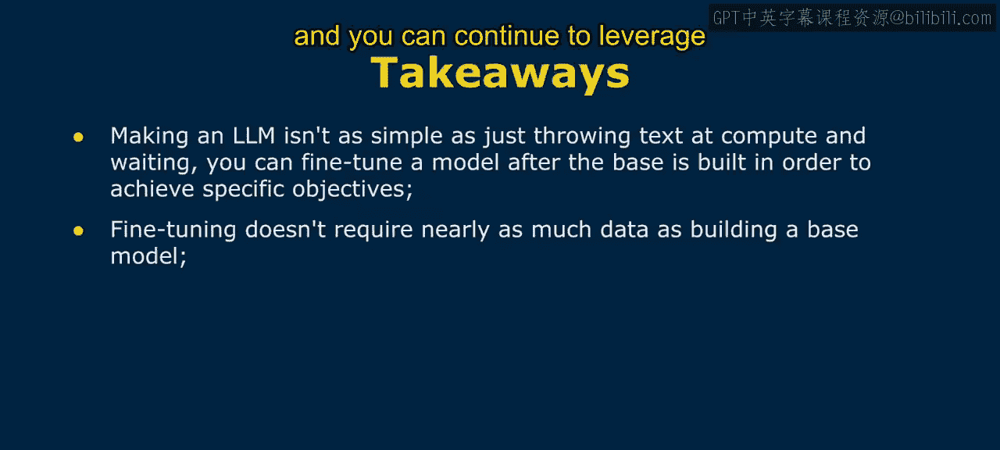

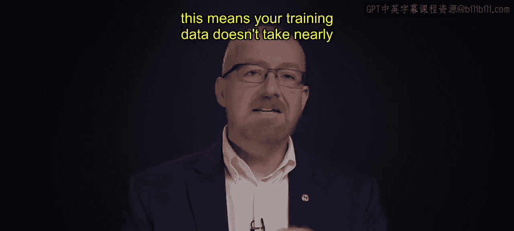

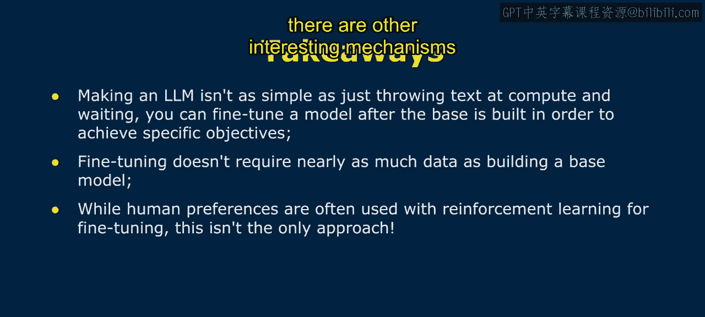

of a process which is enabled by the uniqueness of the task， writing， working code。

And I think this is worth reflecting on for a moment。

 What other kinds of tasks would we be able to generate a reinforcement learning dataset set from using an architecture like the one Me did。

 How could you fine tune a model that you might want to use， whether it's for work。

 a hobby or something else。

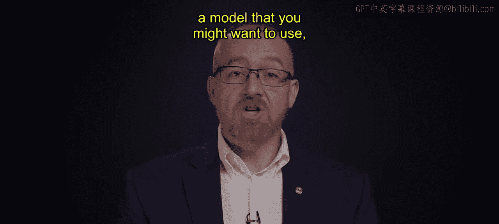

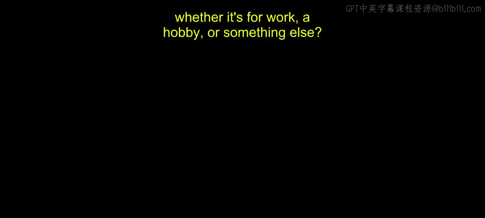