# 密歇根大学《Python程序员的羊驼”课程｜Llama2 for Python Programmers》中英字幕 - P5：4_房间里的大象——在小硬件上运行大型语言模型.zh_en - GPT中英字幕课程资源 - BV1vi421a7NL

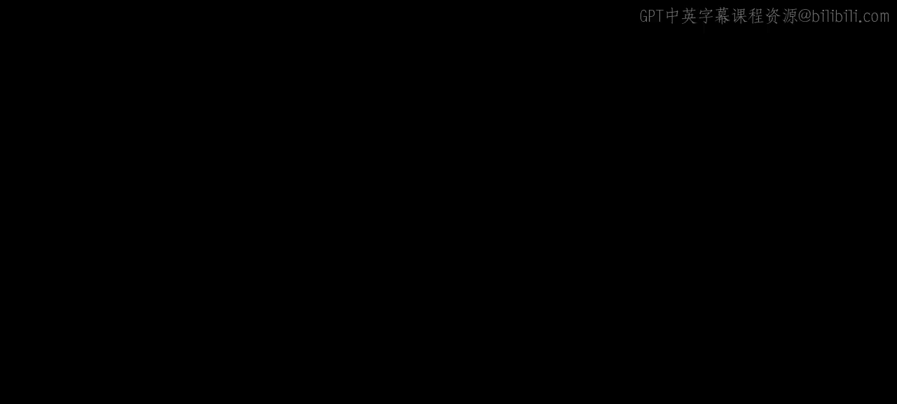

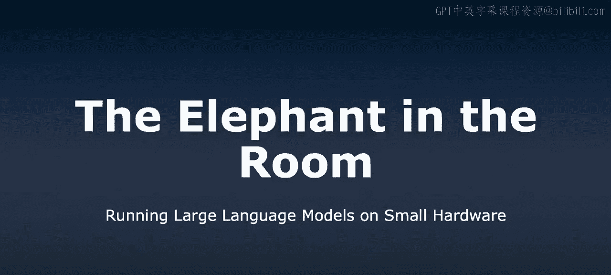

We all want to get our hands on the code and start using L Ms locally on our desktops or laptops or even our phones。

 But before we do that， we've got to address the elephant in the room。

 How can we actually run these large models on commodity hardware。

 And while this does depend on the architecture of the model， especially with some of the new models。

 which are ensembles like the mixture models， we can estimate the memory needed by taking the amount of parameters of the model and multiplying it by 4 B。

 As each parameter is represented by a 32 B floating point value。

 This means that the 7 billion parameter model needs to have 28 GB of memory to be fully loaded for inference。

 And that doesn't include any additional overhead needed by your application。😊。

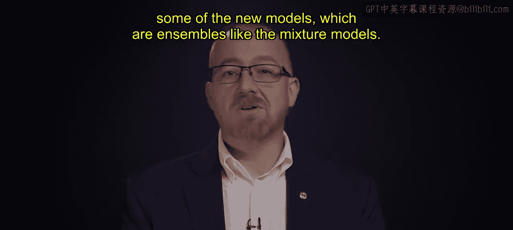

What's even worse is that this computation is really best done on a graphics processing unit。

 so we're not talking about desktop or laptop RAM， we're talking about video card VRAM。

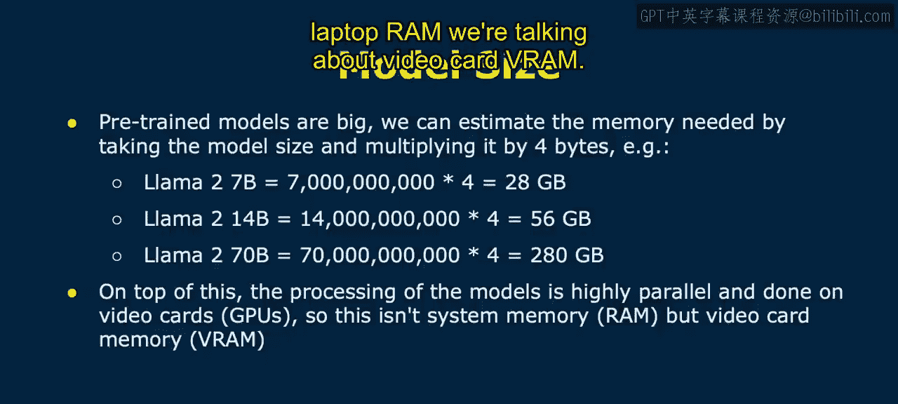

At the time of filming， the top consumer video card for this is the Nvidia G Force R T X 4090。

 and it only has 24 GB of memory， not even enough to run the smallest of the Lama2 models。

But we can trim the model size down， and there's a couple of techniques that we can use to do this。

The starting point for bringing our models down in size is to quantize the model weights。

 Instead of storing each weight as a 32 B float， we could drop this to say 16 B floats and cut the size of the V Ram in half。

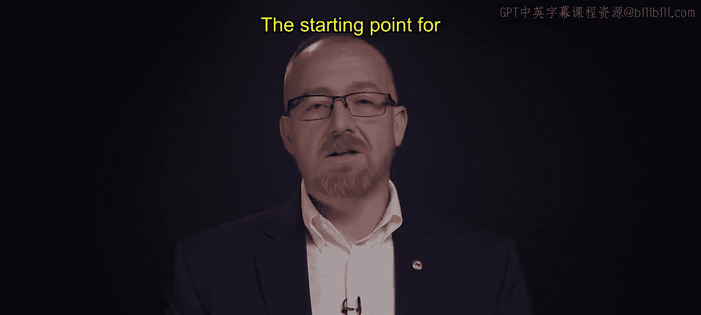

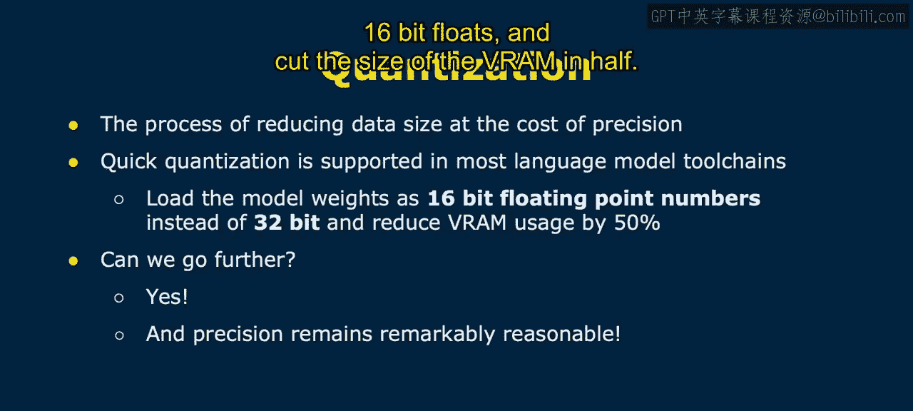

The result is that now we can fit the smallest Lama2 model on a consumer grade video card for inference。

 And what we lose is some precision in the model。 Now， we can make this trick work even further。

 Why store each weight in 2 by if we could reduce it to a single by or maybe half a by a nibble。

 Well， the accuracy trade off is an important one here。 But in practice。

 it turns out that the Lama models continue to perform well when we quantize them down to 4 or5 or 6 B per parameter。

 And that's a huge savings compared to the 32 B per parameter we were starting with。😊。

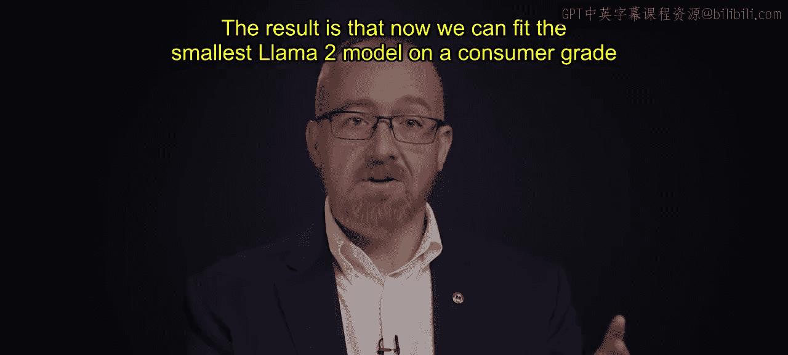

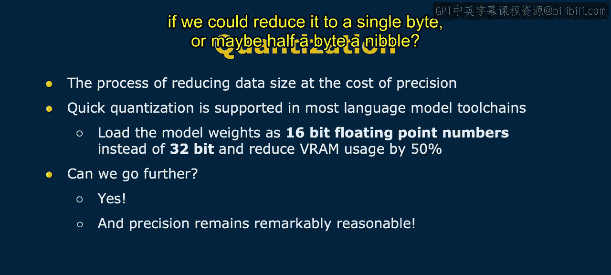

But there's a second interesting opportunity that comes up when we're changing the model weights。

 and that's changing the type of data from a floating point number to an integer number。

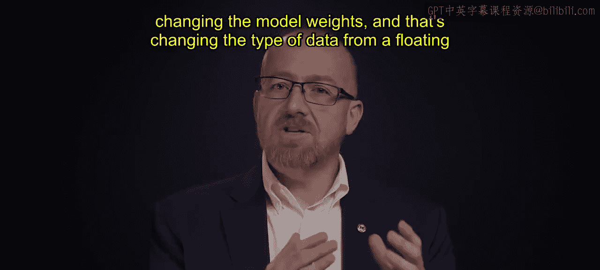

Video cards and the forthcoming torrent of AI processing units work in parallel on floating point numbers。

 but CPUs， which often have many cores work particularly well with integer numbers。

We can not only quantize the weights， but change them to integers so that we can do inference right on the CPU。

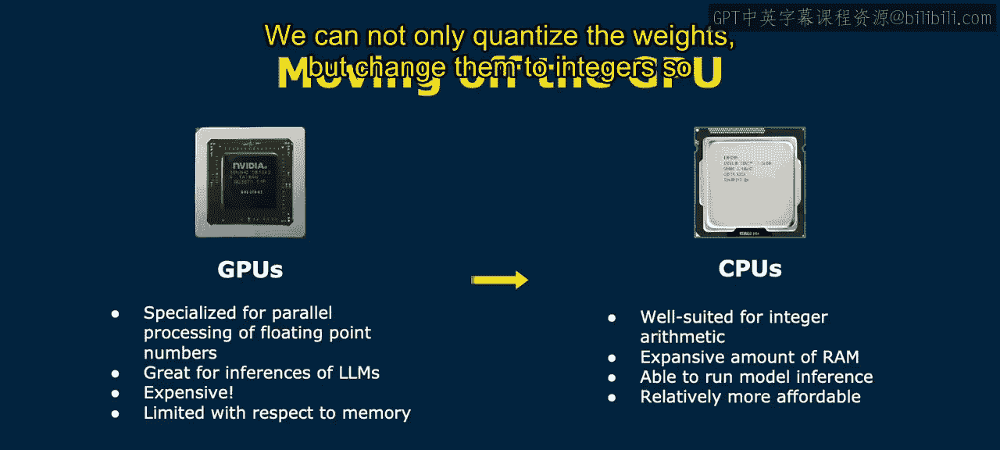

Now this trade off where we have the main CPU， which is good at integer arithmetic。

 but needs help with floating point math， might seem like it's a unique product of our times。

 but it's not really when I was growing up my father had an Intel 386 DX based computer and I spent every moment I could using that machine。

But what was special about that machine is that at a second math copro。

 which handled only operations on floating point numbers。

 While these two processors worked together at a blistering speed of 33 MHz。

 things have come a long way in processor design， and we now have multi core consumer processors that have 1618 cores。

 along with anywhere from 32 to over 200 GB of RA。 And so while quantizing models to make them smaller in size is something we can employ in video cards。

 we can also run model inference without a video card at all。😊，In fact， in this course。

 we've configured the Coursera Las architecture completely without video cards。

 allowing you to explore or test any of the items I'm teaching you without having to install any software at all。

 The tool we've used to convert these models。 and the API we'll be using to interact with them is called Lama CPP。

 It was hacked together in an evening by Georgie Garriganov。

 and it was made available as open source。😊。

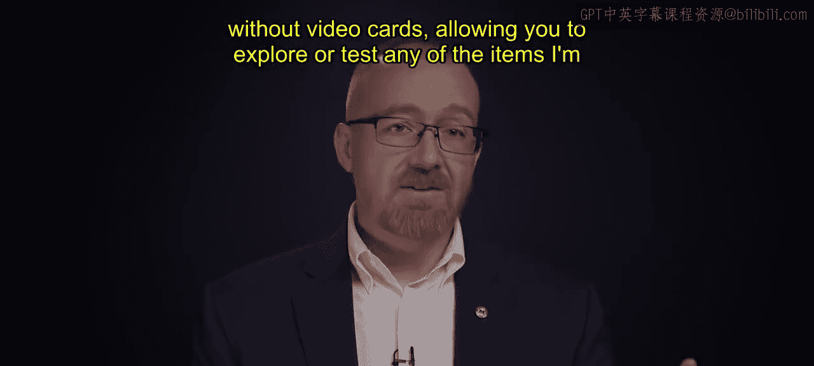

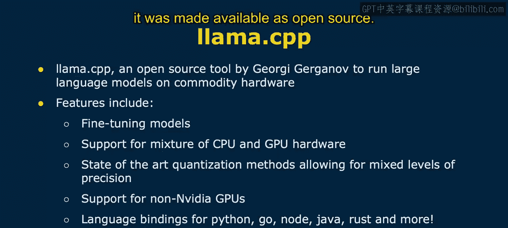

This project has absolutely flourished and now has over 500 contributors an amazing achievement for a project less than a year old。

His goal was to port metataslama code over to pure C and enable quantization so it could be run on Apple processors。

 but Lama CPP isn't limited to just the Apple series of chips。

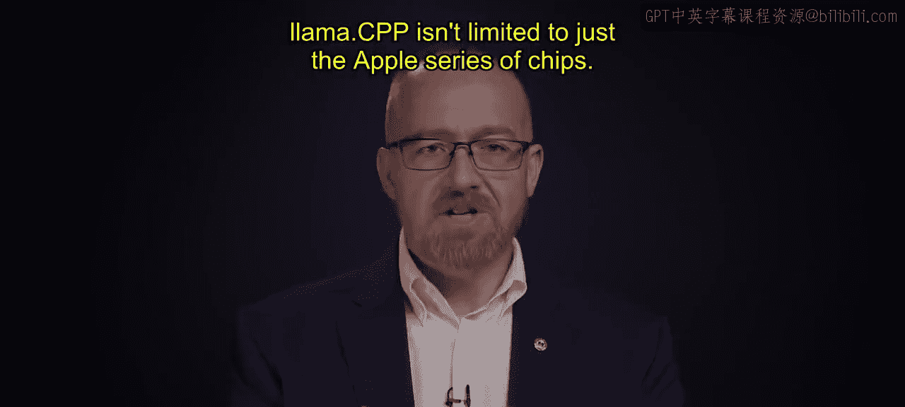

Indeed， the project has grown to so much more and now supports many options for tuning a model。

 including partitioning the model so that some， but not all of it is being made available on the GPU State of the art quantization methods。

 which allow for mixed levels of precision support for non and video video card acceleration and language bindings for a variety of programming languages。

😊。

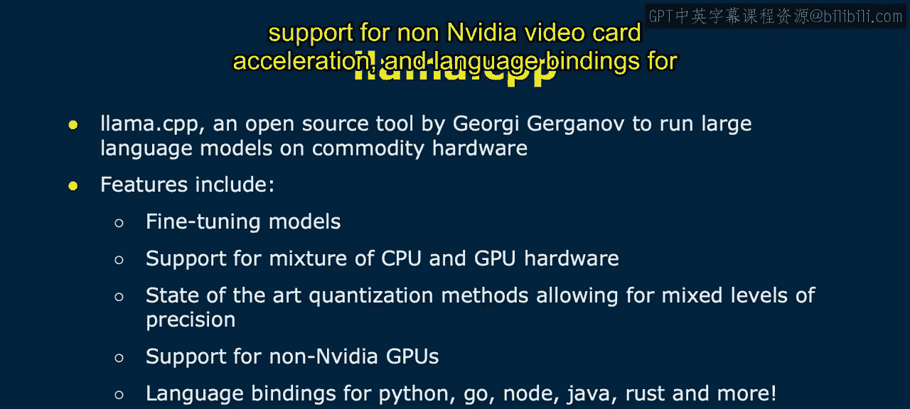

In this course， we're going to be using Lama CPP and its Python bindings as our main method of interacting with Lama 2 language models。

 but you actually don't have to use Python at all or any other programming language for that matter。

Lama CPPP also builds a command line executable， which allows you to prompt a model directly from the terminal。

 I'll give you a quick demo of that in the next video and then we'll dive into the inner workings of Lama 2 with Lama CPPP in the following module。

