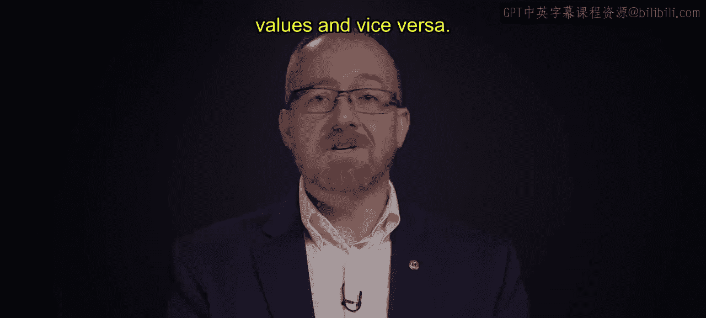
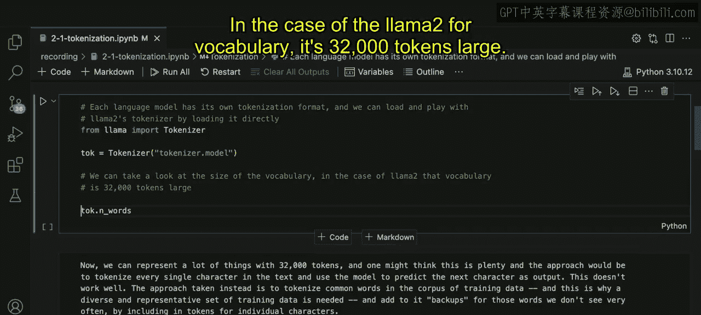
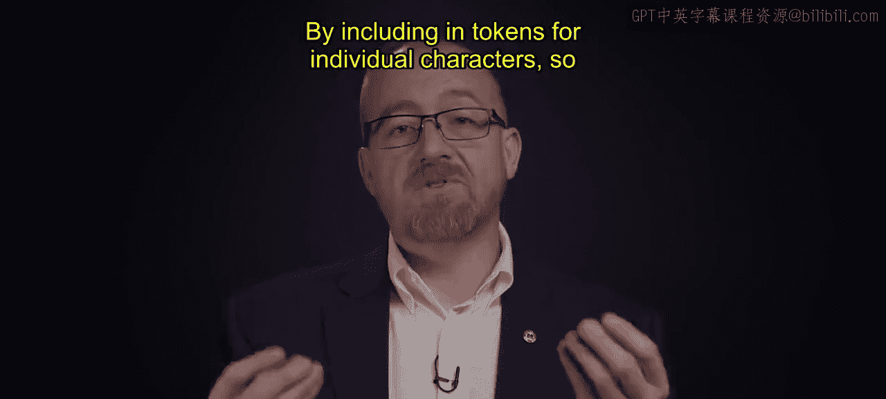
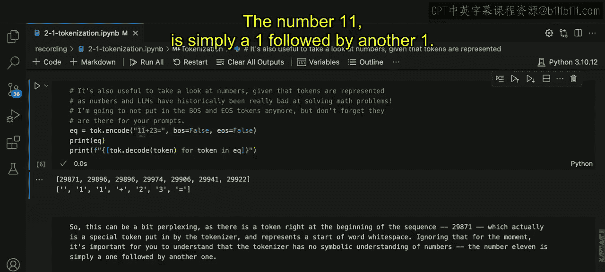
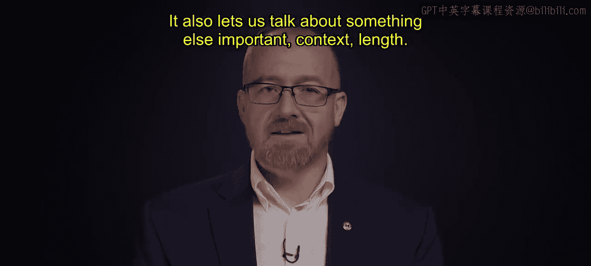

# 密歇根大学《Python程序员的羊驼”课程｜Llama2 for Python Programmers》中英字幕 - P6：5_羊驼2的标记化.zh_en - GPT中英字幕课程资源 - BV1vi421a7NL

Up until now we've been talking about tokens and texts as if they're the same thing and they are actually very similar here。

 but I think it's important to note the differences now we're going to actually dive into some Lama code to explore this issue。

 but the key difference is that the neural network that the architecture underneath that the model's been trained on。

 doesn't work on text， but it works on numerical values。

 and it applies mathematical operations to input sequences， sequences of numerical values。

In our case， these operations have actually been learned through the pretraining process。

 so the weights in our model get applied to this input sequence of numbers and they end up generating a new output sequence of numbers。

The role of tokenization then is to convert the input text into the numeric values and vice versa。

Each language model has its own tokenization format and we can load and play with Lama2's tokenizer directly here and I'm just going to bring that in。

 it's called tokenizer model Now we're going to take a look at the size of the vocabulary in the case of the Lama2 vocabulary its 32。

000 tokens large Now we can represent a lot of things with 32。

000 tokens and one might think that this is plenty and the approach would be to tokenize every single character in the text and use the model to predict the next character output。

This actually doesn't work very well， the approach taken instead is to tokenize common words in the corpus of training data。

 and this is why it's important to have a diverse and representative set of training data。

Then we add backups to it for words that we don't see very often by including in tokens for individual characters so we can actually spell out those words。

 We can use the encode function to generate a sequence of token numbers for a given sentence Now there's a few special tokens we need to be aware of specifically the B beginning of sequence and EOS and of sequence tokens we can control whether we want these to appear in our sequence or not by just including these two parameters as I've done here。

 the B equals true or the EOS equals true in the case of this sentence we can see that in addition to the B and EOS tokens。

 seven other tokens were generated that's a little mysterious is there's actually only four words in the sentence so let's go back to the code and unpack each token and see how the Lama tokenizer worked I'm just going to iterate over each token and ask the tokenizer to decode it for us。

We can see that the start and end tokens have no visible representation that seems pretty reasonable。

 surprisingly though the word Lama isn't in the vocabulary。

 and instead the tokenizer has actually fallen back to spelling it out letter by letter。

 until it hits a token which is in the vocabulary， in this case it's the string AMA。

We see that the words is an an animal are all in the vocabulary as well as a full stop or a period Now let's play with this and interrogate the tokenizer a little bit more。

Okay， so here's our original sentence， aama is an animal and we'll do that one first and then I'll make just a really small change here。

 I'm just going to change the case of the L at the front case does matter and so I'll make that change here and then let's be honest this is how I spelled it the first time with a misspelling because that's about how I spell。

Okay， so spelling matters as does capitalization we see the word Lamma still doesn't appear directly in the vocabulary。

 but the tokenization of the lower caseword and the sentence case words of Lama results in different lengths of sequences with different token values inside of it We also see that the misspelling of the word animal results in two tokens being returned instead of just one it's also useful to take a look at numbers。

 given that tokens are represented as numbers and LLMs have historically been really bad at solving math problems。

Now I'm not going to put in the B and EOS here， you're probably not going to see them anymore in this course actually here I'm just going to use a very simple string。

 11 plus 23 and that's how we would all say it Let's see what Lama says。

So this can be a bit perplexing as there is a token right at the beginning of the sequence 29871 and this is actually a special token put in by the tokenizer and represents a start of word white space Let's ignore that for the moment It's important to understand that the tokenizer has no symbolic understanding of numbers The number 11 is simply a one followed by another one。

Understanding this process at a high level is important because our language model doesn't operate on words or sentences or even text。

 it operates on sequences of tokens， This is important when understanding more advanced concepts in using an LLM such as retrieval augmented generation Brag where an LLM has access to a database of documents。

 all indexed by chunks， those chunks are actually tokens which are expressed as vectors and while the details aren't important right now。

 it's important that you know that tokens and the sequences of tokens are the fundamental unit of input and output of large language models。

It also lets us talk about something else important， context length。

 and we're going to do that by writing some prompts in the next lecture。

