# 密歇根大学《Python程序员的羊驼”课程｜Llama2 for Python Programmers》中英字幕 - P7：6_用羊驼C++构建我们的第一个羊驼2应用程序.zh_en - GPT中英字幕课程资源 - BV1vi421a7NL

Now that we have some knowledge of the fundamentals of how Lama2 is representing data。

 both within the model architecture itself， as well as the sequences of tokens coming in and out of the model。

 we can start to actually query the model Now I've used the word query here。

 but I don't mean it in a relational database sense。

 but more in a human language sense to ask a question。A database query is deterministic。

 if the data hasn't changed and the query isn't changed， then the same result is always returned。

 but a language model is a bit more non-deterministic。

 a more precise word to use to describe our interaction with the model here is inference or predict。

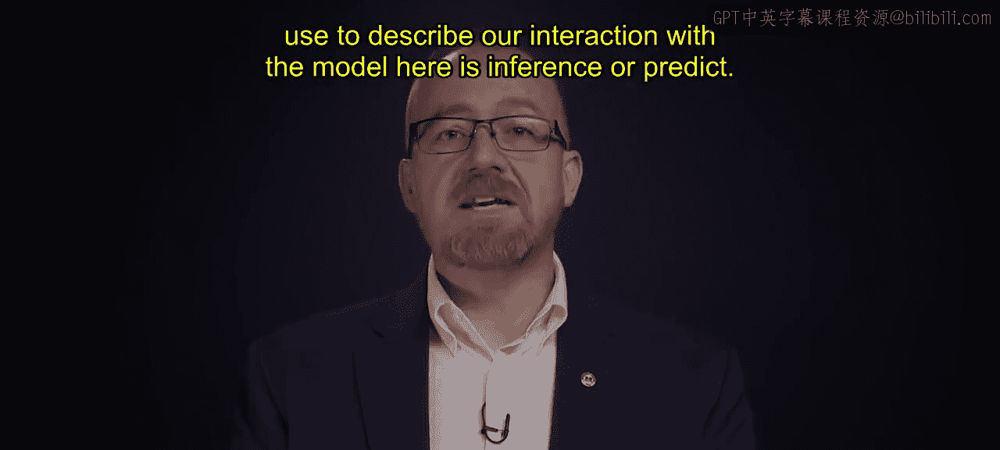

Let's write our first Lama。 CPP application to create a new model to query we have to identify the quantized file that we want to use now in this course we have two models created for experimentation。

 one being the base 13 billion parameter model and the other being the chattd one I've just created an environment variable here in your Co shell called Lama 13B or Lama 13B underscore chat and so we're just going to import Lama CPP。

 the base model that we use for prediction is called Lamma and we'll just create an instance of that indicating that we want to use this base 13 billion model。

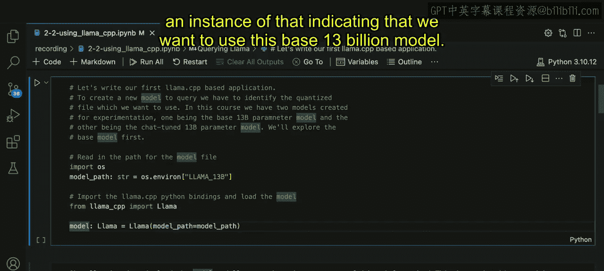

Okay， all we've done is load the model and Lama CPP has given us a ton of debug information。

This is worth taking a quick look at， especially if you might end up using multiple kinds of models。

 either different architectures or different quantization levels。

We see here that this is a Lama2 model and that the context length is up to 4096 tokens and we'll talk a bit more about that in a moment。

 We also see some information about the special tokens which exist for the moment we can see the number of layers in the model which speaks to the internal data structure and whether these have been configured to be offloaded onto a GPU or not one of the most interesting options in Lama CPP is that you don't have to choose between the CPUU or the GPU you can actually use a bit of both depending upon your hardware setup。

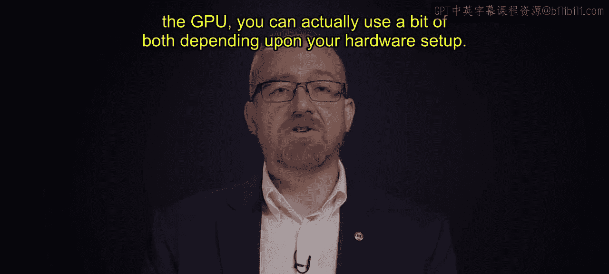

Before we go a bit further， I want to reduce the verbosity of the output a bit now feel free to leave this set to true to see more of the nitty gritty。

 but I'm just going to set model dot verbos to false now that we have the actual model let's do some inference the method we're going to use for this is called create completion and by default we only need to pass it a prompt to complete and it returns to us something called a completion object so I'm going to ask it what the capital of Michigan is and it's going to return a completion object。

The completion object is one of these dictionaries， a type dictionary。

 and so we're going to print out the choices， which is going to be actually the text that we're interested in seeing。

So if you're following along in the notebook， you have undoubtedly got a different response than the one that I'm showing here。

 and that's what I mean by inference。 The model is making a series of these probabilistic choices based on the input sequence and the weights that it's been trained upon。

 We can make the model behave more deterministically by setting its temperature。

 which is a parameter from zero to1， where values closer to zero cause the model to behave more deterministically and values closer to one cause the model to behave more non-deterministic or creative。

 Let's do a little experimentation with this in the Jupiter notebook。

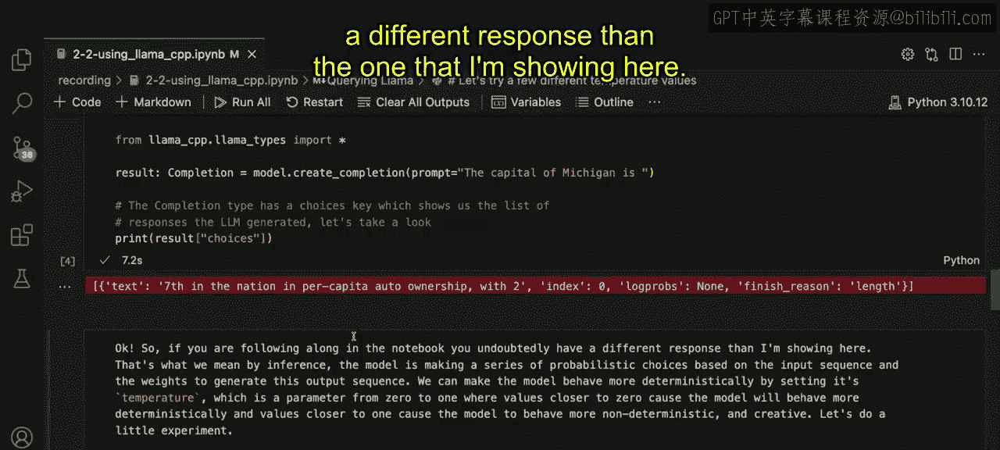

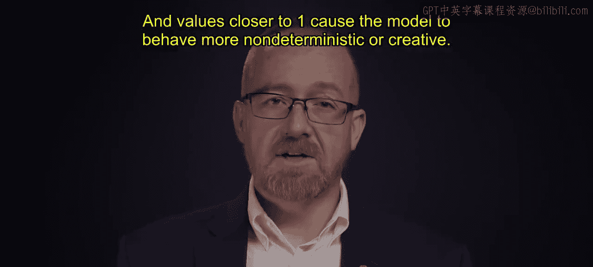

So let's try a few different temperature values I'm just going to create a list of floats here and we're going to go from 0 to 0。

5 to 1 now for each of these temperatures we're going to do three different completions and it really is useful to think of this as a completion we're going to give the prompt it's going to be turned into a sequence of tokens and the model underneath is going to just create more tokens for that sequence and I'm going to print those all out。

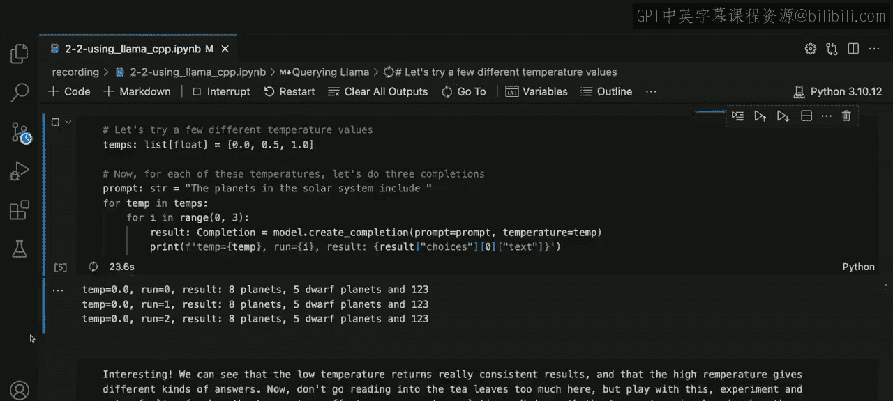

Interesting， we can see that the low temperature results give really consistent results and that the high temperature results give all sorts of different kinds of answers Now don't go reading into the tea leaves a little too much here。

 but play around with this experiment and get a feeling for how the temperature affects your prompt completions。

Underneath the temperature is actually changing how the next token is picked from this set of candidate tokens。

 so higher levels of temperature will deviate more quickly from one another on repeated query Now you've undoubtedly noticed that we're just getting short little responses here generating tokens is slow and by default the create completion method limits the number of tokens return to just 16。

 if we change this to minus-1， we can generate as many tokens as we want as many as are available from the model and the context window。

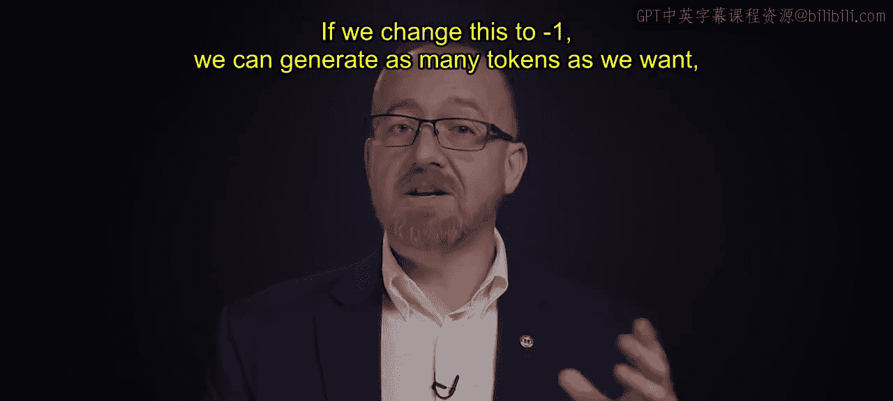

Let's just do one run， here I'm going to leave the temperature at its default value， which is 0。8。

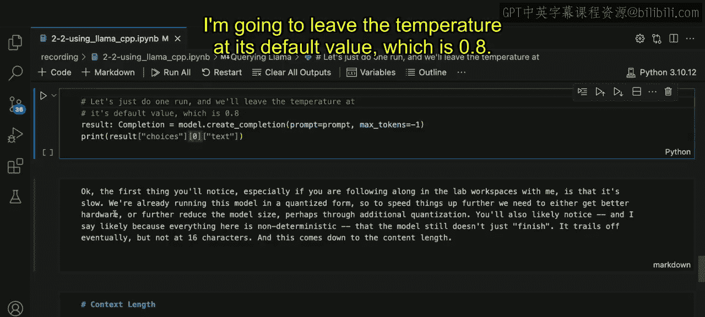

OkayThe first thing you'll notice， especially if you're following along with me in the lab workspaces is that it's slow。

 We're already running this model in a quantized form， so to speed things up further。

 we need to either get better hardware or further reduce the model size perhaps through additional quantization but what I really want to point out here is that the model kind of trails off and this model has a particularly interesting response here。

 it says Mars has been known and it's got this last little bit here but if we scroll across and we take a look at the model's output here。

 we see it also says compared with our own Milky Way galaxy which contains billions upon billions upon billions upon billions upon billions and actually if we just keep scrolling we're going to see that this doesn't end the model is caught in some sort of loop here Now it's not really a loop remember the purpose of this model or the way in which this model works is that it takes a sequence of tokens。

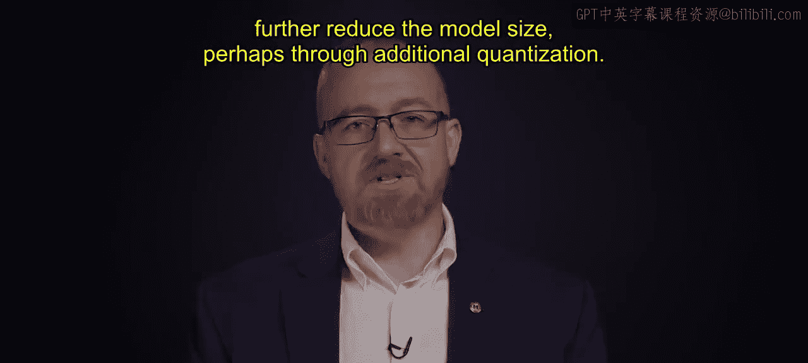

predictdicts what's the next best token and so here using that whole context。

 it's identified that after the word billions comes the word upon。

 and then after the word upon comes billions and it just keeps doing that until it fills this context window。

You probably received a very different response， and I encourage you to jump in the discussion forums and talk about that because there's nondeterminism of the model with the temperature setting that we have now means that everybody should be getting a slightly different response。

 sometimes not just slightly， sometimes significantly。

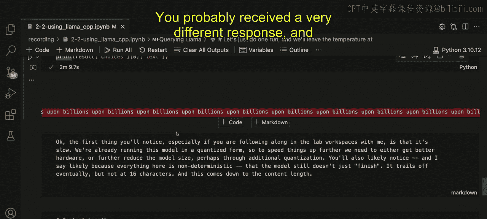

Okay， once you understand tokenization， the context length is really simple。

 it's just the maximum length of the token sequence that the model is trained on。

In the case of the original Lama model， the context length was just over 2，000 tokens。

 which means that the input data used for training the model was broken up into these chunks that were up to 2000 tokens long for Lama 2。

 this was increased to just over 4000 tokens。You can think of the context length like the amount of memory that LLM has for a given query。

 the bigger it is， the more you can put in the query and thus the more the LLM will be aware of that when returning to your a response。

 training and inference with a large context length can increase quality of the output。

 but they do so at the cost of increased computation。When you create a new Lama CPP object。

 the default context length is set to 512 tokens。

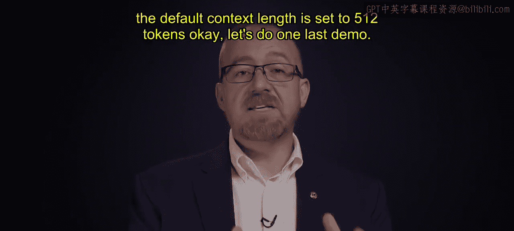

Okay， let's do one last demo and here I want to show you that we actually don't have to wait for the whole query to finish but instead can use the streaming features of Lama CPP to see the tokens as they're completed。

 so I'm going to create a new model very similar I'm setting a nice big context window here。

If we pass this stream equals true parameter to create completion。

 we're actually going to get back in itator and it's going to iterate over these create completion stream response objects again all of these objects are actually just typed dictionaries and this one similar to the completion type so I'm going to set a token count here and then I'm just going to iterate over all of the tokens that come back in this create completion the prompt I'm going to use is some fun things to do for vacation in the state of Michigan so I hope you'll consider coming out to Michigan joining feel free to stop by the university and do whatever other fun things Salama too is going to tell you to do。

Importantly here， I've just got this little mod 50 equals zero。

 that's just so that I can print new line characters， otherwise everything's going to be on one line。

 let's see what this looks like。So the model loading takes a little bit of time and then we start to get this stream back so the first one visiting the Henry Ford Museum。

 this is actually great， I love the Henry Ford Museum took my kids there quite a bit it's a wonderful place Oh look exploring Lake Michigan from Lakeshore Drive also another great option in the state of Michigan a beautiful here。

 especially in the autumn， you get beautiful colors Okay while you learn a bit more about all the wonderful things you can do here on vacation in the state of Michigan。

 I'm gonna go grab a drink， refresh my voice and I'll see you in the next video。😊。

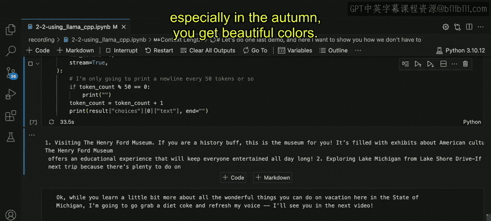