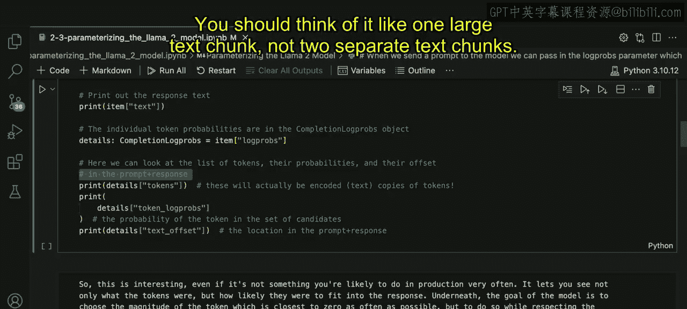
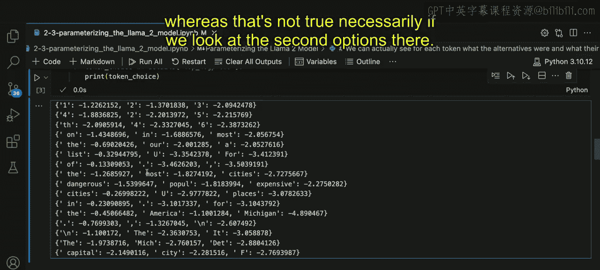
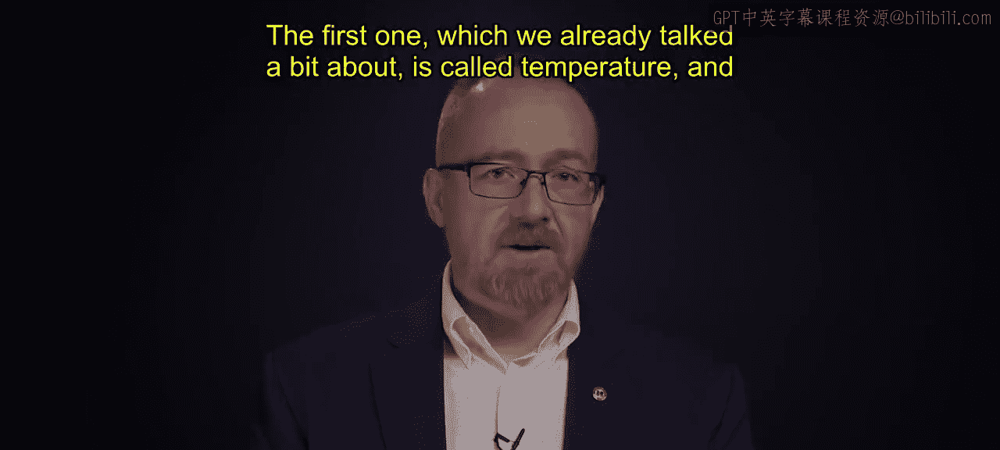
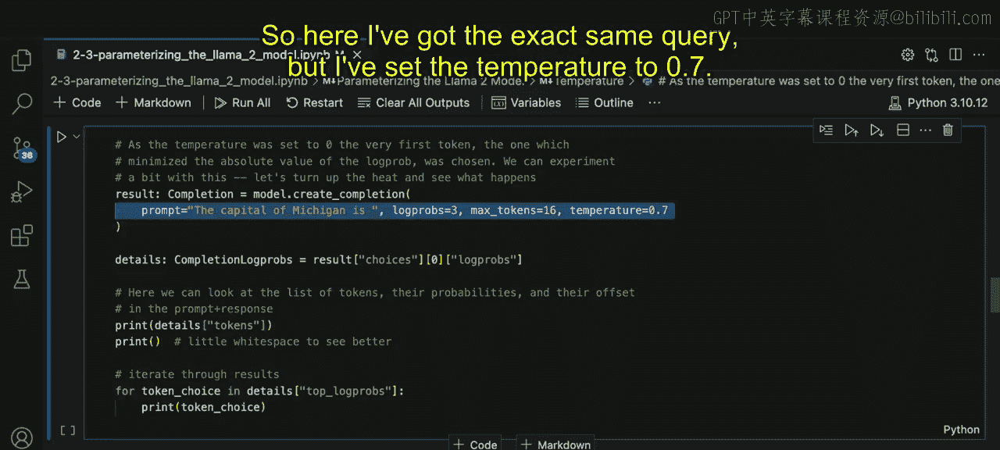
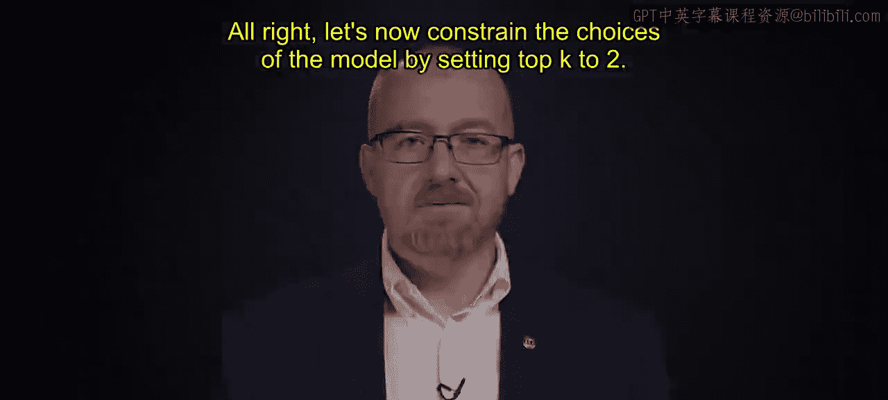
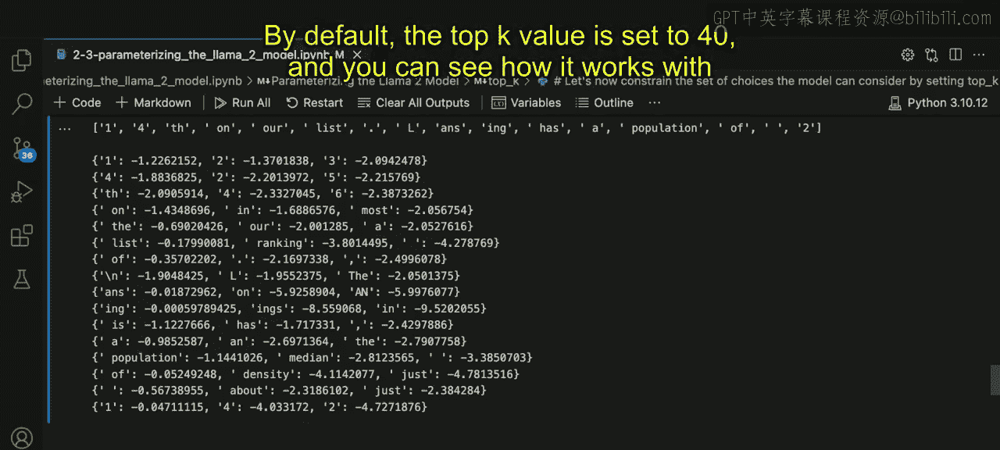
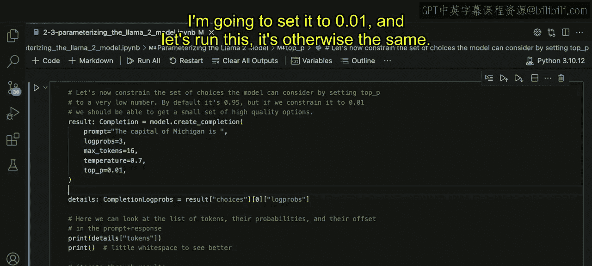
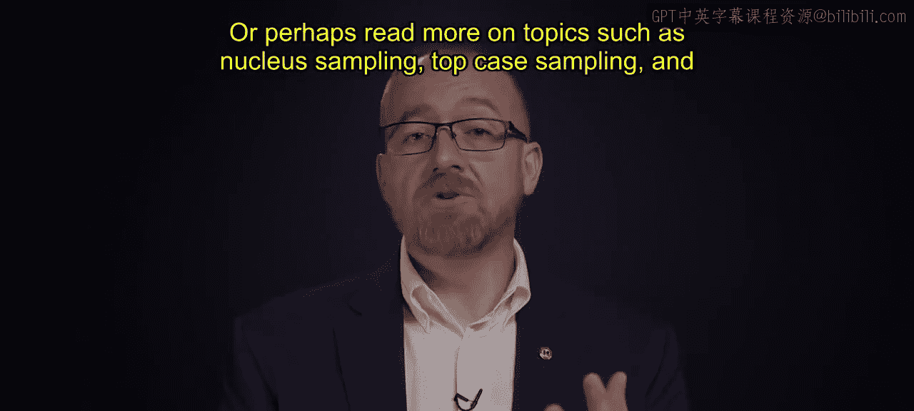

# 密歇根大学《Python程序员的羊驼”课程｜Llama2 for Python Programmers》中英字幕 - P8：7_选择参数.zh_en - GPT中英字幕课程资源 - BV1vi421a7NL

We've talked about some of the fundamentals of large language models， Lama two specifically。

 and how they're non deterministic probabilistic machines which predict token sequences based on pretrained weights。

If we want to， and I don't think this is very often done in deployments。

 we can actually observe some of the inner workings of this choice in Lama CPP by configuring the model when we load it。

This is going to be helpful in getting a better understanding of how we can change the behavior of the model。

 so let's take a look。

Okay， we're going to import the Lama CPP bindings just like we did previously you'll notice here I've condensed everything into one line。

 so we're going to load the model and set its verboity and here we're using something new I'm going to set the logicits all equals to true This is actually going to capture the information about the probabilities for each token。

When we send a prompt to the model， we can pass in the log pros parameter which will determine how many alternative choices we're going to see Now I just will to look at the top three so you'll see here I've got the max token set to 16 it'll be cut off right away。

 set the temperature all the way down to zero so that it's pretty deterministic and I say pretty deterministic and I'm setting that log pros to three。

Here I'm just going to take out the response from that content object and then print it out。

The individual token probabilities are actually in the completion log probs object and so that's in this because everything's a typed dictionary。

 we just take it from the item we take out this log pros Now here's where we actually print those out we're going to print out a list of all of the tokens。

 their probabilities and they're offset in the prompt and response and I think it's important to note here it is prompt and response the whole thing comes together you should think of it like one large text chunk not two separate text chunks。

So this is interesting， even if it's not something that you're likely to do in production very often。

 it lets you see not only what the tokens were， but how likely they were to fit into the response underneath the goal of the model is to choose the magnitude of token。

 the number which is closest to zero as often as possible。

 but to do so while respecting this temperature parameter。Now this is a bit of an oversimplification。

 actually the model considers another parameter called top P as well。

 this parameter determines how many words are in the candidate set for us to consider at all。

Temperature and top P work differently， but together to determine which token is chosen next for both parameters。

 a higher number gives more options and thus less deterministic output。

 Let's dig into this top P temperature relationship a bit more。

So we can actually see for each token what the alternatives were and what their log pro was。

 we can iterate through the set of tokens and since I set to log pros to three。

 we're actually going to see the top three options for each token。Okay。

 so we have the the one had a minus 1。2 log pro， a 2 had a minus 1。3 log pro and a 3 had a minus 2。

0 log pro now if you're following along， you're going to undoubtedly get slightly different numbers。

 although there's a chance that you'll get the same numbers because our temperature was set to zero。

It's interesting and important to note that some of the words here that is the tokens in the vocabulary have white space at the beginning of them。

 so that's an aspect of the tokenizer that's being used for Lama2。

 and that of course we have control sequences in here as well， things like a line。

 feed or a carriage return。Interestingly， because you can look at the alternatives。

 you can get a sense as to the different ways this conversation might have gone the beginning all involves a whole bunch of numbers。

 but after fourth then we get a whole bunch of letters in this one section whereas that's not true necessarily if we look at the second options there Now there's several parameters we can use to constrain or guide what the language model might choose for the next token going into these in detail is a little bit outside of the scope of the short course。

 but I wanted to give you a bit of an intuitive understanding of how they work the first one which we've already talked a bit about is called temperature and we can use our new foundundability to find probabilities of tokens to see better how this is actually working as the temperature was set to zero the very first token。

 the one which minimize the absolute value of the log probe was actually chosen but let's experiment with this a bit so here I've got the exact same query but I've set the temperature to zero points。

And let's just run this and look at the output。So we could see that the sequence returned isn't made up of just the lowest tokens in the candidate sets。

 In fact， depending on a bit of randomness， you might even see that several of the candidate sets have more than three tokens in them。

 that the high temperature resulted in the model actually choosing a token that wasn't even in the top three。

This is important to note two， even though we set the log pros to three。

 that's not the complete candidate set of tokens， but just the ones which are being returned to us programmatically。

 Another parameter we have in our toolbox here is called top K and this more forcefully constrains the language model telling it to only choose from a fixed set of possible matches。

This parameter is an integer value and if we set it to one， for instance。

 the model will have only one choice to choose from and the temperature won't matter at all let's take a look All right。

 let's now constrain the choices of the model by setting top K to2 I've got the temperature set very high so we're going to get lots of diversity and creativity and I've still got our log probe set to three so we only have a top two candidates that can actually be chosen from but I actually want to see the probabilities of the top three and let's run this。

You can see here that because I'm setting this log problemss to three。

 I'm still being shown potential tokens， but they're actually pruned from the candidate set before the model samples from the list as the top K value is set to2。

 By default， the top K value set to 40 and you can see how it works with the temperature to determine which tokens are placed in the output sequence we have another variable that we can use for tuning called top P。

 This variable is a bit more complex。 It constrains the candidate set of tokens based on their cumulative probability distribution It's a floating point number from 0 through one where one would be all possible tokens from our vocabulary。

You can think of this a bit like as follows， each candidate token has a probability of being chosen and put in the output sequence。

We want to only choose from a set of really good options。

 so we take a number of high probability items that we're going to put them in the candidate set。

We don't want to constrain that set to a fixed size of 10 or 15 instead。

 once the number of items in that set have a combined probability equal to whatever top P is。

 then we'll stop adding items to the set， so it's a lot like top K as the goal is to constrain the size of the candidate set。

 but for each position in the output sequence， the number of items we'll choose from will vary depending on how high of the probability the items have。

Let's take a look at it Okay， let's now constrain the set of choices the model can consider by setting this top P to a very low number by default it actually very high 0。

95， but I'm going to constrain it quite a bit I'm going to set it to 0。01 and let's run this。

 it's otherwise the same。

The result of such a small top P is that the candidate set of choices is very small。

 and thus the probability of any given choice in the set can vary significantly。 However， the tokens。

 which remain in the candidate set are reweighted and the temperature then determines how likely a given candidate will be chosen。

 Now， all of this is a bit of an oversimplification。 and there are several more parameters。

 some of which you can tune such as typical P， min P and so forth。

 If you're interested more in how these generative models choose a response。

 I'd encourage you to check out the paper by Holtzman at all that I put in the optional readings for this week。

 or perhaps read more on topics such as nucle sampling， top K sampling and beam search。

