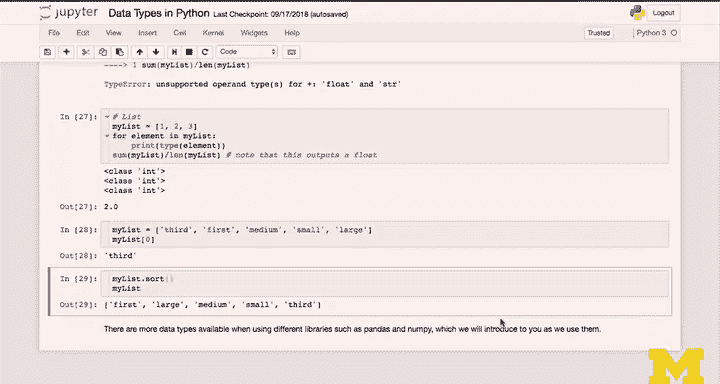

# 密歇根大学《使用Python的统计学（理解并可视化数据、因果推断、建模）｜Statistics with Python》中英字幕 - P10：9_Python数据类型(选读).zh_en - GPT中英字幕课程资源 - BV1dV411Q7j3

Hi， my name is Laen this and I'm a PhD student here at the University of Michigan。

 and today we're going to go over Python data types。

So here I've listed some data types in base Python， this is not including any of the extra libraries。

 these are just things that you get in normal， any programming language。

 so we're going to cover Boolean， integer， floats， string， list and nu type。

 but there also exist a complex object set and dictionary among others。😊。

And we're going to connect these Python data types to the variable types videos that we had in previous lectures。

😊，So first let's look at numerical， so numerical means that when you take the mean and make sense。

 our two categories for numerical are discrete and continuous。😊，For discrete。

 we have integers and for continuous， we have floats。

So I have some little notes here that the differences between integers and floats are essentially how they're stored。

 the amount of memory to store an integer to float is the same。

 but an integer is stored exactly how it is in binary。

 whereas a float has a little bit of math going on。😊。

And I'll explain that a little bit more in just a minute。

 but first let's look at some examples of integers。

 so we're going to use this type function in Python thatll tell us the type of whatever our input is。

 so the type of4 is an integer。😊，And this is going to be any whole number with no decimals will give you an integer。

 so if we look at the type of zero。😊，We also get an integer and if we look at the type of negative 3。

 that is also going to be an integer。Now let's just go ahead and see that these are numerical because we can take the mean。

So here I'm making a list of numbers， we have two， three， four and five。

 I'm going to go ahead and print the mean， and then I'm going to see what does the type of this mean。

😊，So we have the mean of this list is 3。5 and the type is floatat so even though we input integers。

 the output is a floatat because it has a decimal here and be a little bit careful if you go ahead and look at the upper right corner of my Jupyter notebook you'll see that I'm working in Python 3 in Python3 if you take the mean of integers you're going to get a floatat whereas in Python2 if you took the mean of integers you'd actually get an in return and it's going to be the floor so in this case it have returned3 as an integer so if you're working in Python 2 or Python3 just be aware that that difference does exist。

😊，Okay， let's look at some float examples， so here we have a rationalal through divide divide by 5。

 which gives us 0。6。😊，So we can write this in another way right。

 we can do6 times 10 to the negative1 and that's also going to give us 0。

6 because of machine precision it's going to give us a little bit different when we got this 0。6。

 a bunch of zeros and then a1， but they're essentially the same。😊。

And the point that I want to make with this is this is how floats are stored and this is why floats have decimals。

 it uses this number here times some sort of base you can think of as 10。

 but sometimes it's  two or 16， and then the exponent here tells you where the decimal place goes essentially。

😊，So let's go ahead and check the types of these， so if we look at the type of 3 divided to 55 we're going to get a flip because it has this decimal here。

😊，We can look at Pai， which is an irrational and has infinitely many decimal places。Oops。There I go。

 didnt import my library that I needed， so let's go ahead and import the math library and then we'll be able to make our pi function work。

There we go， now we can see that pie has a float。Now if we look at the type of 4。0。

 we've told it to keep aware of this decimal point。

 so instead of storing it as an integer we're going to get that it stored as a float。

 so even though four is a whole number because we've said store this as a float。

 it's storing it as this kind of scientific notation way which accounts for this decimal point。😊。

And Ly， let's go ahead and take the mean of some floats and see what we get。

 so here we have a list of floats we got pi， we got3 to by by 5 and 4。1。😊。

And with look at the type of that， we're going to get afloat。

And if you want to see what the actual sum of that is， the mean would be 2。6 and a bunch of numbers。

Okay， so that covers it for our numerical types， let's go ahead and look at categorical or qualitative。

😊，So we have our two categories again， the nominal and ordial， under nominal， we have Boolean。

 string and none， and under ordial， there's not really anything under ordinal。

 so it's basically just how you use these other types to finds if they have order or not。😊。

So if you're making a visual， this is really important that you specify the order。

 such if you have't that small， medium a large or dislike and like。

 you'll probably want to have some order associated with that。

 but it's really how you put the input into those plotting functions rather than an innate order that you give Python。

😊，Of note is that lists can hold ordinal information because they have indices。

But they aren't inherently themselves ordial， like if you have a bunch of lists。

 you wouldn't necessarily know which order they were supposed to be in。

So let's go ahead and look at some examples of Boolean。Buolean is essentially a true or false。

So you can look at this as just true， true is a reserved word in Python。

 and you have to spell with the capital， otherwise it won't make sense。

 so if we look at the type of true， we get that it's a boolean。

 if we must spell it with a lower case， we get an error because that doesn't mean anything in Python。

😊，Similarly with false。But it's also a type of boolean。

But you can make anything into a boolean so you can specify that you want the string yes to be a boolean as well。

 and then you get the type of it that is going to be a boolean。

For Booleanions we have a sense that true is equal to the value of 1 and false is equal to the value of0。

 and you'll see this in a little bit when I try to take the mean of a Boolean。😊，嗯。

So if we only think of bullolean as true or false， you can make statements that can be true or false and see what the output is。

 so here I have an if statement and I say if6 is less than 5， so this is a Boolean statement。

 it's a true or false statement。Then I want this function to print yes， so six is not less than5。

 when I run this function， nothing happens。But if I were to change it from a false statement to a true statement。

 that6 is greater than5。Then the function would print yes， because it is true。

 therefore do the following。Okay， so I've created this list of a bunch of different Booles we have true。

We have six is less than five， which will evaluate as false because it is we have one is equal to three。

 which will also evaluate as false because one is not equal to three， and we have none is none。

 which is true， none is none。😊，So let's just go and ahead and look at the。

Type of each element in this list。 So for each element in my list， I'm going to print the type。

We have， of course， that each of them is a Boolean。

And then let's go ahead and look at the mean of this， so I'm going to print the mean。

And also ask what the type of the mean is。Okay， so that's a little bit confusing right。

 because I said that if we're looking at categorical the taking the mean doesn't make sense。

 but I just took the mean and it looks like it made sense。

Well what's happening here is like I said before， Booles hold values of zero or1。

 zero for false and true for one， so this mean isn't necessarily the mean of true， six， lesson5。

 one equal to three and none is none， it's actually the mean of how many are true versus how many are false so because half of these are true。

 we're going to get a mean of 0。5 which is just a floatat。😊，Okay。

 now let's look at strings so strings are essentially anything that's in between quotation marks。

 you can use double or single quotation mark， it doesn't matter in Python。

 though it does matter in other programming languages。Generally。

 I use double quotations for multiple words and single quotations for single words。

So let's go ahead and look at the string， this sentence makes sense， so if I check the type of it。

 it of course gives me a string。Let's check the type of make sentence this sense。

That's also a string， even though the sentence doesn't make sense。

Let's go ahead and look at we have math dot pi in here before when we looked at math dot pi we were given that the type was flu because pi itself is an irrational number。

 but when we look at it inside of a quotation works， we get that it's a string。😊。

Because we're asking Python to evaluate it differently。Okay。

 let's go ahead and see if we can take the mean of a list of strings。

 so here I have a list of strings with dog， koala and goose。

 and I'm going to go ahead and take the mean of that。Okay。

 I get an error and that makes sense because what is the mean of dog koala and goose？Okay， next。

 let's look at nu type。So if I check the type of nun。

 which is a reserved word in Python and you can see again that it has a capital in。

We get that as none type。Again， if you make this lower case。

 Python doesn't know what's happening because that none with the lower case in is not a reserved word。

Similarly， we can give x the value of none and then check the type of x and that'll also be a nu type。

Let's go ahead and take the mean of a bunch of nuns。

 so here I have a list of none and there's going to be five of them in there。

If I take the mean of it。I get another error because what does the mean of nuns？

Nothing as far as I know。Okay， finally， we're going to look at lists。

So lists can hold many different types， and they can also be used to store ornal information。

 So you can kind of think of these as。They could be categorical or they could be numerical。

 or they could be nothing， so it's basically how you use them。

So here I've created a list with one of each of the types that we've gone through。

 we have an integer， a float， a string， and a nun。And I can print the type of each element in my list。

 and I get indeed that I get an integer， a float， a string， and a then type。

If I try and take the mean of this list with a bunch of different types。

 I get an error because it's very difficult to add a float to a string。

 in fact it doesn't make sense at all。If instead I made a different list that has just integers in it。

 one， two， and  three， I can print those types。Print the type of each element in my list and then also check if the mean makes sense and this time it does。

 each one of these is an integer taking the of integers does make sense。 we get this output of 2。0。

 which is a floatat。What if we have a list of only strings we have。Third， first， medium。

 small and large。like I said， lists have indices so you can use them as ordinal information so if I look at the first。

Inice C， which is going to give me the first element， remember Python indexes start at zero。

 then we're going to get the output of third。What happens if I sort this list。

So lists and Python have a function that you can always call called sort。

 and it may or may not work depending on what you have inside。

 What happens if I sort a list of strings？It does sort it。

 but it just sorts it by the first letter of each string， so now it's just an alphabetical order。

 which may or may not be useful。So just to keep in mind that when you're using lists。

You can use them however you want。 but if you're using them for keeping。

Orders for something that is ordinal data， you want to be careful to not sort them in ways that make no sense to the data that you have。

😊，There are many more data types available when using different libraries in Pythonons such as pandas and NPI and we'll introduce them to you as we go。

 some that you may already know of our data frames， or there's date time in NPI。

 there's really too many to go over in this lecture but now you know the basics。😊。

