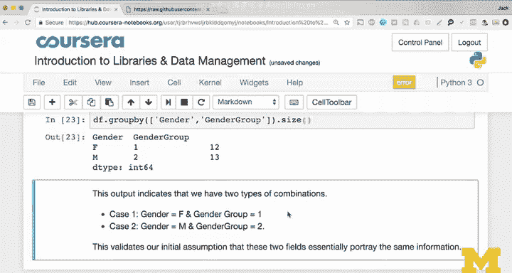

# 密歇根大学《使用Python的统计学（理解并可视化数据、因果推断、建模）｜Statistics with Python》中英字幕 - P11：10_库与数据管理入门(选读).zh_en - GPT中英字幕课程资源 - BV1dV411Q7j3

Yeah。

Hi and welcome to another Python tutorial In this video we will be discussing Python libraries。

 documentation for programming languages， and how to manage your data when carrying out statistical analysis and data science work let's get into it。

Okay， and let's get started with the Python libraries， so Python， like other programming languages。

 has an abundance of additional modules or libraries that augment the base framework and functionality of the language。

Now think of a library as a collection of functions that could be accessed to complete certain programming tasks without having to write your own algorithm。

For this course we will focus primarily on the following libraries NumpI。

 which is a library for working with arrays of data and other mathematical equations。

 Padas provides high performance easy to use data structures and data analysis tools such as data frames SipPI is a library of techniques for numerical and scientific computing Mapllotlibb is a library for making graphs and other visualizations。

Sbornour， additionally like Matpllotlibb， is used to make visualizations and graphing tasks。

 and stats models lastly， is a library that implements many statistical techniques。

Now I want to take some time to note that documentation when learning a new programming language is extremely crucial。

Reliable and accessible documentation is absolute a necessity when it comes to knowledge transfer of programming languages。

Luckily， Python provides a significant amount of detailed documentation that explains the ins and outs of the language syntaxt。

 libraries， and more。Understanding how to read documentation is crucial for any programmer。

 as it will serve as a fantastic resource when learning the intricacies of Python。

And right here is the link of the documentation of the Python Standard Library。

 which I'm sure you become quite familiar with throughout this course。

Now if we scroll down to the bottom here， we can see that it discusses built in functions， constants。

 built in types， and for example here let's just look at numeric types。Nummeric types include int。

 float， and complex。And the documentation also provides the arithmetic and operations that Python supports。

Now getting back to the notebook， let's discuss actual actual code and how we would import certain libraries。

So when using Python， you must always begin your scripts by importing libraries that we'd be using to avoid errors。

The following statement imports the Numpeyy and Pandas library and gives them abbreviated names。

Just to clean up and style your code so it's easier to read and let's go ahead and run this code cell。

Now we do have have imported NumpI as NP and imported pandas as PDd Now that we've imported these libraries。

 how do we go about utilizing them？After importing a library。

 its functions can be called from your code by proppenending the library name to the function name。

 for example， to use the mean function from the NumpI library， you would enter Ny。 mean。

To avoid repeatedly having to type the library name in your scripts。

 it is conventional to define a two or three letter abbreviation for each library； for example。

 nuumpy is abbreviated as NP， which we have done above。This allows us to use NP。mine instead of nupi。

m， Similarlyly the Pada's library is typically abbreviated as PD。

The next cell shows how to call functions within an imported library。

So here we're going to initialize variable A as an NP array and calling the array function within the NI library。

And then additionally。We're going to calculate the mean， which is a function of the endUI library。

And it will output。What we would expect here， if we have zero through 10， Arian is of course， five。

We use the mean function with the Numpy library to calculate the mean of the Numpy 1 dimensional array。

 as you can see above。And now let's get into our next section of data management。

Data management is a crucial component to statistical analysis and data science work the following code will show how to import data via the pandas library。

 via your data， and transform your data。The main data structure that Pandas works with is called a data frame。

This is a two dimensional table of data in which the rows typically represent cases。For example。

 cart will contest participants， as you'll see later， and the columns represent variables。

Paands also has a one dimensional data structure called a series that we will encounter when accessing a single column of a data frame。

Pas has a variety of functions named Reed XXX， which is a placeholderer for things like CSV。嗯。

And CSV stands for a comma separated value。 However， other file formats include Excel， JSON and SQL。

Now to get kind of a grasp on what a CSV actually looks like， let's look at our raw cartwheel data。

As you can see， the first row actually includes the column titles。Which I D age gender。

So on and so forth， and they're all separated by commas， hence the name comma separated values。

Now what we're going to do next is we're going to import this CSV file。

And here we are importing the data first， we store the URL string that hosts our CSV file。

Which is here。And we read the CSV file and store it as a pandas data frame by calling Read CSV。

 which is within the Padas library。Now let's go ahead and run this code and output the object type。

We have RA the Read CSV function， and the type of our variable DF or data frame is a pandas core frame。

 data frame。Now， how do we go about viewing this data now that we have access to it in our environment？

We can use the data frame function， head function。Which will show us the first five rows of our data。

See 1，2，3，4，5 and includes all of the column headers。Within our data frame。

 which is a great way to get a good grasp on what is actually contained within our data frame and data in general。

Now if we want to output the entire data frame， we can just print。Our variable Df。As you can see。

 we have a total of 25 entries。Now， I do suggest using the head。

 especially when you're using larger data sets as it can get quite a bit messier。Now。

 if we want to gather more information regarding the data。

 we can view the column names and data types of each column with the following functions。

So if we want to just output the titles of the columns， we can do so with Df。comns。

 as you can see just like above， we have ID age， gender， gender group， and so on。Now。

 one thing that's extremely important in data management is being able to splice our data frame and select only specific portions of our data。

 and there are three ways of doing so， the dot LOC function， dot ILOC and do IX。

 however in this tutorial we will only cover dot LOC and dot ILOC。Now to start。

 dot LOC takes two single list range operators separate by a comma。

 the first indicates the row and the second one indicates columns Now the first example just to reiterate。

The first。Input。Specifies the rows and the second。Is a string which indicates the name of the column。

Now let's go ahead and run this。As you can see， it returns all the observations of our cartwheel distance column。

Now， using the dot LSC function， we can also access all the rows and multiple columns。

 so let's say we want to see not only cart rule distance。

 but also height and wingspan of our participants。Here we have outputted all three of those columns。

Now， which interesting is that we can select。Only a limited amount of rows rather than all of the rows by specifying a series。

And here we have， we only want all of the rows up to nine。Let's go ahead and run this。

See we have zero。All the way up to9。Now， let's say we only want to select a range of rows for all of our columns and we can do this by just specifying simply。

The row numbers without adding any additional columns。And as you can see， our output。

Includes rows 10th through 15， and all of our columns。Now let's get in the dot I LOC function。

 The dot I LOC function is integer based slicing， whereas dot LOC use labels and column names。

 Here are some examples。So here we specify only an integer。And will only return。

The first four rows of our data frame。Now here we're specifying we want only the first five rows of our data frame。

 one to five， and then we also want。Position of the first two to four columns。

And here you'll see we only get gender and group， which are specified by position 2。And3。Now。

 interestingly， like Ive mentioned before， the dot ILOC function does not allow。

For labels and strings within the function， So if we run this code here。

We'll actually return an error。However， if we were to get rid of this。We would simply see。

This code worked properly。And that is an important difference between the dot LOC and dot I LOC function。

Now next， we'll look at how we can view the data types of our data frames of our columns and we can do this with the D types function。

As you can see， our output includes all of the column names and the specified type of the values within that column。

As you can see， our output indicates we have integers specified by int 604。Floats。

And an object data type。Now， one thing that we might want to do is we might want to observe the different unique values within a specific column。

Now let's do this for gender。 Now you might be able to guess what kind of unique values we'll get。

 but let's go ahead and do it anyways。And what we do here is we specify our data frame。

 use the dot operator， include what the name of our column is that we want the unique values for。

 and then we run the unique function。As you can see， we're returned to F and M。For female and male。

 So within our data frame under column gender， we only have M and F as our values。

Now if we do the same thing for gender group。We'll see that we only have one and two which is interesting。

 and it seems that these fields may serve the same purpose。

 which is to specify male versus female Now let's quickly check by observing only these two columns。

 so we'll use the dot LOC operator toplace our data， return every single observation。

 and specifically for the gender and gender group columns。Now， if we quickly scroll through here。

 we see that it looks like F corresponds to one in gender and gender group。Now。

 when we're looking at messy data where this might not necessarily be the case。

 we might want to utilize functions such as group by。

And group I function will basically make a combination of all of the values for gender and gender group。

So we can see what the different combinations are， and I'll go ahead and run this so you can get a better idea。

See we have the only two combinations are。Female1 and1 for gender group and M and2。

 so we can confidently say that the output indicates that we have only two types of combinations。

 case1 and case2， which validates our initial assumption that these two fields essentially portray the same information。

Now that's just an introduction to data management and later in the course we'll have。

A reading that specifies or includes a deeper dive into the functionality of pandas and how we can utilize its functions to do more advanced data management。

Thank you。Bye bye。