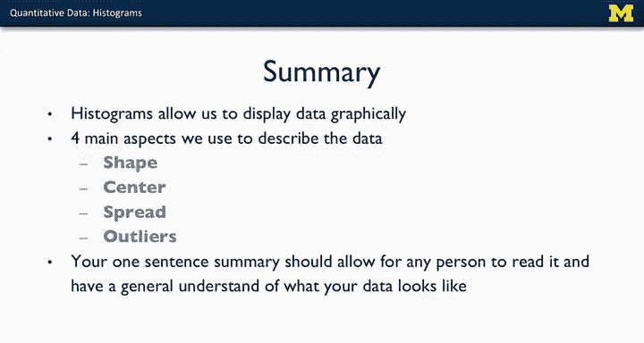

# 密歇根大学《使用Python的统计学（理解并可视化数据、因果推断、建模）｜Statistics with Python》中英字幕 - P13：12_定量数据：直方图绘制.zh_en - GPT中英字幕课程资源 - BV1dV411Q7j3

Hi， I'm Reid Coottz， I am a graduate student at the University of Michigan in the statistics department and today we're going to be talking about quantitative data and specifically histograms histograms are used as a first graphical display of our data。

So let's recall what quantitative variables are They are numerical values which we call quantities that we can perform mathematical operations on。

 some examples of this would be height weight income test scores shoe size or number of heads after 10 coin flips and recall that we had discrete and continuous quantitative variables。

 so discrete random variable would be， for example， the number of heads after 10 coin flips。

 where it has to take an inerger value。Whereas height and weight can take any value that makes them a continuous variable。

 so you can have a height of 5 foot，6，5 foot，7， 5 foot，7 and a half。Any value between these numbers？

So why do we use histograms， they are a great first analysis of our data and we can get a quick view of what our data looks like and what we might want to go on to analyze with our data。

So on the left， we can see we have adult male heights and we have a few data points pointed out。

Out of a sample of 100 males on the right， we have the histogram of all 100 and we can see that it has this kind of bell shaped look to it。

That allows for us to see all of the data in just this one nice compact histogram。On the Y axis。

 we have frequency， which is the number of times we see a certain response。

 and on the X axis we have our variable， which in this case is height in inches。

And then we have all of these rectangles， which are called bins。

And bins can be adjusted depending on what software you're using。

 so for this one I used Python and used 10 bins and it made the histogram and counted how many individuals were within a certain range。

 So for our first bin on the far left， we can see that there are about three individuals who are approximately 62 inches in height who were in this sample。

What is it that we want to talk about with these histograms， which there are four main aspects。

 We have shape， center， spread and outliers， shape。

Is the overall appearance of the histogram so we can have something being symmetric， bell shaped。

 left swed or right skewed。 and we'll talk more about these。Or we could have center。

 which is the mean or median。We talk about spread， which is how far our data reaches。

 so we could talk about range， intercorrtile range， standard deviation， or the variance。

For histograms， we're primarily going to be talking about range。

And then we'll be talking more about the inter quartile range。

 standard deviation and variance in future lectures。

Outliers are the final thing that we want to talk about。

 and these are data points that fall far from the bulk of the data。 So to begin。

 we'll look at the adult male heights again。And we can talk about the shape。

 which how I like to imagine it is drawing。Kind of a blanket over top of my data。

 and I can see that it has a roughly bell shaped distribution。

 and the bell shaped distribution is very common in statistics and it's very friendly to statistical analysis。

We can also say that this is unimmodal， meaning it only has one mode。

And that's because we only see one peak in our shape。Next， we talk about center and our center here。

 because we have a bell shaped and it's also symmetric。

 the center would just be right down the middle。Which we'll call at about 68。Inches。

And what I'm describing here is the median。Which is 68。 And because this is symmetric。

 we would also have the mean。Being 68 as well， approximately。Next we talk about spread。

 and this is where we want to talk about range， typically。Where this is the max。

Minus the minimum of our data。 So our maximum， we can see on the far right is somewhere at about 75。

And our minimum， which is on the far left， is pretty close to 62。And so from that。

 we would get a range of approximately 13 and notice that I'm saying approximately and that's because I'm looking at this graph。

 I'm not getting exact pin points of what the range might be。Finally， we want to talk about outliers。

 for this case， all of the data is pretty concise and together。

 so we would say that there are no apparent outliers。No apparent allies。And from these four things。

 we're able to describe our histogram in a nice concise manner。

Putting it all together into one sentence。 It would look something like the distribution of adult male heights is roughly bell shaped with a center of about 68 inches。

 a range of 13 inches from 62 to 75 and know apparent outliers。

 So this one sentence you could give to somebody and they would understand what it is you're looking at。

 what kind of shape it has， where it's centered， its range。

 and anything that they would really want to know about it。

 Something important to know about histograms is that they are different from bar charts。

 So bar charts are used for categorical data， whereas histograms are used for quantitative data。

Let's look at another example of salaries in San Francisco。

 and this data was collected from 2011 to 2014。So to begin， we start with the shape。

 and we can see that if I were to drape a cloth over this， it would kind of have。2 humps to it。

 And then this long right tail。 And so that long right tail means that we have a right skewed distribution。

And those two humps that we see one at zero and one at about 60，000 or so， $60，000。

 that means that we have a bimodal。Distribution as well。Also note that on our histogram。

 it looks pretty much empty on the right half。 So once we get past 400，000。

 there doesn't appear to be any bins there。But really there are， it's just。

 there's so few people in that higher end that we don't see them。

 they're dwarfed by the size of the other bins。Next， we want to talk about center and for this。

 if I were to draw a vertical line。At about。$80，000 or so。

That would cut the left half of our bins to be an equal size to the right half of our bins。

 meaning the area to the left is about the same as the area to the right of that line that I drew there。

So we can say the median。Would be about $80，000。Now， to get the mean， it's a little bit trickier。

 but because it is right skewed， that means the mean is going to be pulled to the right。

 and it's going to be greater than the median。 So it's kind of hard to guess on this one。

 but let's call it 85。Thousand0 is our mean for this data。Next we talk about spread and again。

 we're going to be talking about the range。Where we would have a maximum of 600。

000 and a minimum of zero， so our range is simply going to be $600，000。It's not very precise。

 but it's the best we can do with this history。Finally。

 we want to talk about outliers and typically when we have a skew distribution。

 we'll also see outliers with it in whatever direction the skew is。

 so that means we would have outliers。On the high end。Of this distribution， so maybe past $200。

000 would be considered an outlier。To summarize that in one sentence。

 we might get something like the distribution of salaries in San Francisco is bimodal and skewed to the right。

 centered at about $80000 with most of the data between $40000 and $120000。

 A range of roughly $600000 and outliers are present on the higher end。

Notice how on this one I included most of the data is between 40，000 and 120，000。

 and that's because when we have a right sd distribution。

 we want to let somebody know where most of the data is。

 so we do have some outliers on the higher end， which they might not be representative of our bulk data。

 so for the most part， people are making between 40，000 and 120，000。

 so it's a nice addition to add to a summary。Our final example is on histograms of exam scores to talk about the histogram of exam scores。

 we would first start with the spread， which we can see this time it has a left skewed distribution because the tail goes to the left。

And we have a unimotal distribution as well。For center。

 we could draw a vertical line that splits our bins into two equal parts so that the area in gold on the left is equal to the area in gold on the right of this red line。

And that is about 80 points， so we can say our median。Is 80。And then because this is left skewed。

 we would have a mean being less than that。 so maybe at about 75。Next。

 we want to talk about spread and again we will talk about the range of our data。

Which is the maximum value minus the minimum value we see we go from 100 at the high end。To about。

 let's say， 15 on the low end。Giving us a range of 85。And finally， we want to talk about outliers。

 so for this， we would say that yes， there are outliers on the lower end and we can also even guess at where they start。

 so maybe below 50 would be considered an outlier and that's because there's not many situations where people get less than 50 points on this exam。

So what that looks like altogether is the distribution of exam scores is skewed left。

 centered at about 80 points with most scores being between 65 and 90 points。

 We have a range of roughly 85 and some outliers are present below 50 points。So again。

 I included that。Most of the data was between 65 and 90 points to give the user an idea of where most people are scoring if I just told you a range of 85。

 you might think maybe everybody failed， but a few people did good。

 but instead we have really most people are doing fine on this exam。To summarize histograms。

 we use them to have a graphical initial display of our data。

There's four main aspects that we want to talk about。Which are the shape， center。

 spread and outliers。 and with these four things， we construct a one sentence summary and with this one sentence summary。

 you should be able to give this to any person and they understand what your data is about and what it roughly looks like。

 And this is a great starting point for analyzing your data to get more ideas with what you might want to do with that data。

