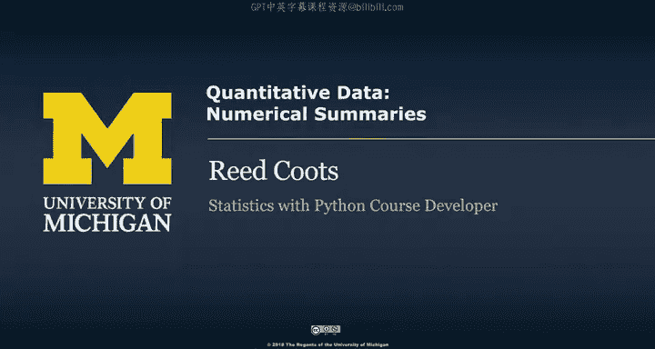
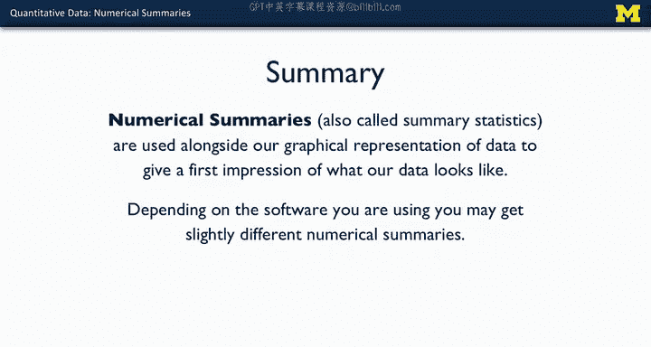

# 密歇根大学《使用Python的统计学（理解并可视化数据、因果推断、建模）｜Statistics with Python》中英字幕 - P14：13_定量数据：数值摘要分析.zh_en - GPT中英字幕课程资源 - BV1dV411Q7j3

Hello and welcome back。 Today we're going to be looking at numerical summaries of our quantitative data。

So let's recall the adult male heights histogram that we looked at in a previous lecture。

 we saw that it had a roughly bell shaped curve。Like this。 And we talked about the shape， center。

 spread and outliers for this citogram。 It was all fairly rough。

 And so today with numerical summaries， we're going to be getting a more definite description of what our data is down to the decimal。

With any software that you use， it's going to be looking a little bit different from any other software。

 So for example， on the right of your screen， I have a numerical summaries that come from a programming language called R。

And this will look slightly different than what we'll be seeing in Python。So but of any software。

 you're typically going to see a five number summary， and this is the minimum first quartile， median。

 third quartile and maximum， so the minimum is just our smallest value， the first quartile。

 often called the 25th percentile， is where 25% of the data falls below that value。 The median。

 which is sometimes called the 50th percentile， is where 50% falls below that value。

 and the third quartile often called the 75th percentile， is where 75% falls below that value。

 and then finally， we have our maximum value。So on the right， we have the adult male heights example。

 and we can see our minimum of 61。7 first quartile of 66。5。

 meaning 25% of people in this study were 66。5 or below in inches in height。The median of 68。3。

 so half of our participants were less than 68。3 and half were above 68。3。The mean is also 68。3。

 so it's the exact same value as the median and that's because we had a symmetric distribution where typically the mean will be about the same as the median。

Our third quartile is 70。1， so 75% of our data falls below 70。1 and 25% above。And our maximum of 75。

1 is just the tallest person who is sampled。 Some other statistics that we can get out of this is called the I QR or inter quartile range。

 And this is the third quartile often denoted with Q3， and we subtract Q1 from it。 So for our case。

 we have a Q1 of 66。5。And we are going to take our third quartile of 70。

1 and subtract two to get our inter quartile range。 So the IQR is another measure of spread。

 So if we don't want to use the range， which is the maximize the minimum， we can also use the IQR。

Now let's look at our distribution for salaries in San Francisco example that we looked at previously。

We saw that it had a bimodal distribution and right skewed。

And this right skew distribution is going to cause our mean to be greater than our median here。

 which we'll see in the numerical summaries and we'll see exactly by how much they differ。

So here we have a much more common Python form of what the data will look like。

 which there's a function in Python called describescribe that is often used to get numerical summaries。

We have again， our minimum， our 25th percentile or Q1。We have our 50th percentile。

 which is the median。We have our 75th percentile， which again is Q3 or the third quartile。

 we have our maximum， our mean， and then we have SD， which is standard deviation。And this again。

 is another measure of spread， where it is approximately the average distance that our data points fall from the mean value。

And finally， we have n， which is our sample size。So here we can see that we have a sample size of 148。

654， so it is a huge sample size that we've been collecting for three years。

 we then see our standard deviation of $50，517， and this is in units of dollars。

 which means that on average a person will fall $50，000 above or below the mean value。

And then we have our actual mean of $74，768， and let's compare this to the median， which is $71。

427 so we can see that the mean is about $3，000 more than the median and again that's because of our right sw that we saw。

We then have our maximum the。Greatest value in our data was 567，595。

 so somebody is making a lot of money in San Francisco。We then can look at our quartiles。

 so the third。And the first quartile， again， we could make the IQR between these two。

To get another measure of our spread。And finally， we have the minimum， which is negative 618。1。

And this is a little perplexing because somebody should not have to pay their employer money。

 so this is most likely due to input error， or maybe there are some sorts of like tax regulations in San Francisco。

 there's something underlying this minimum value that I'm not quite sure of what it is。

 but that's always something that comes about when you're doing these numerical summaries you want to raise questions of why something might be the case。

And for our final example， we were looking at exam scores。 so here we saw a left sked distribution。

 we said it was centered at about 80 points and had it spread from 15 to 100。And。

We said that there would be many outliers below 50。So now that we have a left s distribution。

 what we would expect to see is that the mean。Will be less than the median。

And so let's see if our numerical summaries line up with that guess。

So here we have our numerical summaries for the exam scores。

 it looks a little bit different than the last two again。

 just because whatever software you're using will look a little bit different。So we again have our。

F number summary of the min， the 25th percentile， Q1， the median， the 75th percentile， Q3。

 and the maximum， and then on top of that we have the mean standard deviation and n the sample size。

So for this one， we see。Our median is 78 and our mean is 76。3。

 so our guess on the previous slide that the mean would be less than the median。Was correct。

And that is all because of that left skew that we had。 We have outliers on the lower end。

 And so that's pulling the mean towards it。 The median is what we call a robust estimate of the center。

 meaning it does not。It's not influenced by outliers。We then have a standard deviation of 14。4。

 meaning that on average， a user score for this exam was about 14。4 points away from the mean。

And again， we could calculate the IQR as the Q3 minus Q1。 So for this one。

 if we did Q3 minus Q1 to get the IQR。We would end up doing 87 minus 68。

 and we would get 19 as our IQR。So typically， when it's left skewed or right skewed。

 we want to include an IQR estimate because it's a better form of letting the user know where exactly our data is falling。

The range is less robust to outliers， so our range here would be from 14 to 100。

 and you're not getting a good idea of where most of the data falls。

 whereas the IQR does tell us where most of the data is。To summarize numerical summaries。

 we can also call these summary statistics， we like to use them alongside our graphical representation。

 so things like histograms or box plots to give a first impression of what our data looks like。

 so our graphical representations are usually fairly rough。

And these numerical summaries on top of that allow for a lot more in depth analysis。

Depending on what software you use， you'll typically have slightly different numerical summaries。

 so some might have only the five number summary whereas others will have a standard deviation mean and sample size on top of that。

