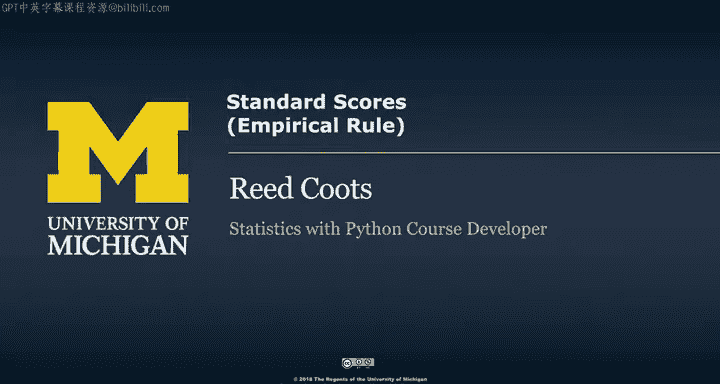
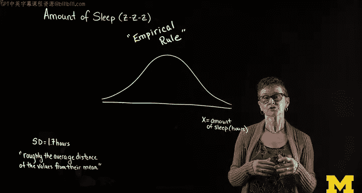
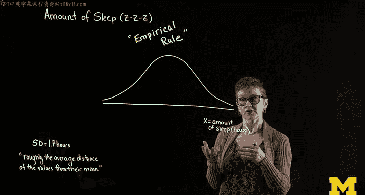

# 密歇根大学《使用Python的统计学（理解并可视化数据、因果推断、建模）｜Statistics with Python》中英字幕 - P15：14_标准分与经验法则.zh_en - GPT中英字幕课程资源 - BV1dV411Q7j3

Yeah。Welcome back。In previous lectures， you've heard us use the term bell shaped for describing distributions。

There are a lot of variables that will have a ball shape distribution。

As well as a lot of our estimates are going to end up being approximately bell shaped。

So here we have a bell shape distribution， not too many markings except a label on our X axes for the amount of sleep。

There have been a lot of studies of college age students and some of the variables that they've measured is how much sleep they get。

 so let's talk about the amount of sleep they typically get on a weekday night。

Turns out that the average amount of sleep is about seven hours。

So we'll mark that mean or average right in the middle of our symmetric distribution。

Now it would be very helpful for us to have a few other values along this axis to get a better feel for how spread out the values are。

A measure of spread that's often reported along with the mean is the standard deviation。

The standard deviation for the amount of sleep for our college age students is 1。7 hours。

Now the standard deviation is going to measure how far away our values are from the mean。

We like to interpret it as roughly。The average distance that our values are from the mean。

So in our case here。The amount of sleep that college age students get on a typical weekday night。

 they do vary from their mean of seven hours by about 1。7 hours on average。

So we want to use this standard deviation， this yards stick。

 and put a few more values along our distribution。If we were to take our mean and go up one standard deviation each way。

So about 8。7。And down to 5。3。We would know that for bell shaped or normal distributions。

 you would expect to see about 68% of our observations in this range。

68% of the values are expected to be within one standard deviation away from the mean。

Now if we were to go out yet another average distance， that would put us out here at about 10。

4 and down to 3。6。Well we would expect more observations in that range。

And with a bell shape distribution， we would actually expect about 95%。

95% of the observations are expected to be within two standard deviations of the meanme。

Let's go out yet one more standard deviation each way， and that's going to put us away out here。

 past 12 hours and down to 1。9， less than two hours of sleep。

And there we would expect just about everybody。For a bell shaped or normal distribution。

 that would be 99。7% nearly all。So this really cool fact about bell shape and normal distributions is sometimes referred to as the 68-95。

99。7 rule。Obviously， another phrase that's often used is that it's called the empirical rule。

So for bell shape distributions， we can go out one， two， and three standard deviations and expect 68。

 95 and 99。7% of our observations to fall in those ranges。

Very useful for getting a frame of reference for how unusual values are。Hi， read。

So you're a college student。How many hours of sleep do you typically get on a weekday night Well I like to sleep a lot。

 so I'll get about 10 hours of sleep 10 hours seriously。That seems like a lot。

 Maybe you can use our distribution here for the amount of sleep and get us an idea of how unusual that is。

 sure。So 10 hours， of course， is quite a bit on our distribution I would fall right around here just below that 10。

4 at 10 hours and so how unusual is this Well we can see that I'm three hours above the mean but a good way to get an estimate of how unusual it is is by calculating what's called a standard score and to do this we find the distance from our mean。

 so 10 minus7 and then divide by the standard deviation of 1。7。Here we would get a value of 1。76。

 and that is my standard score or Z score when dealing with a normal distribution。So 1。

76 is pretty large， recall that 95% of our data is in between the 3。6 and 10。4。

 so I'm just below that 10。4 mark， so fairly unusual for me to have that。

The equation that I'm using here to calculate this is the standard square equation of observation minus the mean。

So my observation was 10， and I'm subtracting the mean of 7 divided by the standard deviation of 1。7。

Now let's take my roommate， for example， he's more of a night owl。

 he'll only get about six hours of sleep a night。So what would his standard score be？For my roommate。

 who has a usual sleeping of six hours a night， he would be six and using the same equation。

 we're going to subtract our mean of7 and divide by the standard deviation of 1。7。

Here we get a value of negative 0。59， so this negative that we have here is very important because it tells us that we are below the mean。

And the 0。59 tells us that we're only slightly below， not too far off from our mean。

 whereas my positive 1。76 was quite a bit above， and the positive tells me it's going to be above the mean。

And finally， let's talk about my friend Mark， who does not sleep a whole lot， he tells me that he is。

 2。7 standard scores below the mean。So recall that the 3。6 was our 2 below， the 1。9 was 3 below。

 so he falls somewhere in the middle， we're not quite sure where。

 so how about we calculate what he gets as an average night of sleep。So he told me that he was 2。

7 standard deviations below， so I'm going to tack a negative on there。

And now I'm trying to find the observation or x for this case。

 and I'm going to subtract the mean of 7 and divide by 1。7 once again。

Another way that we could look at this is by doing 2。

7 standard deviations so multiply them together below our mean of seven。

And this would also get us our value or our observation for Mark。Calculating this out。

 we would see an observation of 2。41 hours， so Mark does not get a whole lot of sleep。

That sort of explains why Mark is answering some of my emails about this project somewhere between 2 and 3 am。

So to summarize。If we know that we have a bell shaped or normal distribution and we know the mean and the standard deviation。

We can use the empirical rule and our standard scores to help us get a nice frame of reference。

Awesome， read。And I think I need a little more sleep tonight。

