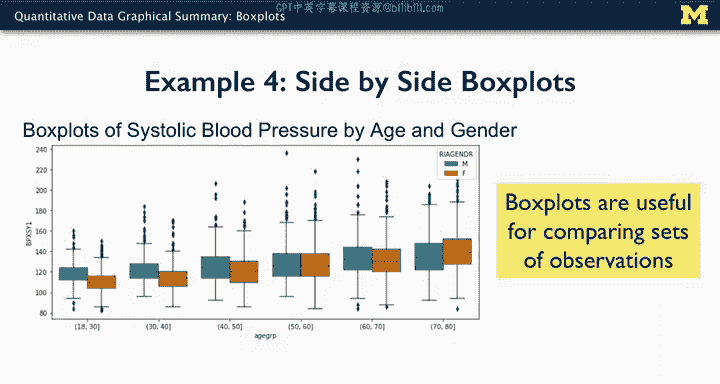

# 密歇根大学《使用Python的统计学（理解并可视化数据、因果推断、建模）｜Statistics with Python》中英字幕 - P16：15_定量数据：箱线图解析.zh_en - GPT中英字幕课程资源 - BV1dV411Q7j3

Hello， in this lecture， we're going to take a look at another graphical representation of quantitative data called box plots。

So what is a box plot？Well we're going to begin with our five number summary。If you remember。

 the five number summary gives us the median as a nice， resistant measure of center。

And then the two quartiles， Q1 and Q3。These are the 25th and 75th percentiles of our data。

 and so the distance between them gives us that middle 50% for how spread out the middle 50% of our data is。

And the final two numbers are the min and the max that， of course。

 will give us the overall range for all of our data。

So Bpot is basically going to take this five number summary and give us a visual picture of it。

A box pot would be started by taking our quartiles Q1 and Q3 to form the edge of the boxes。

So visually， the length of the box is our inter quartile range， a nice measure of spread。

Then the median location would be marked in the middle of the box at the right location。

And the men and max would be drawn by taking lines and extending them out from the box。

 these are sometimes called whiskers， so these are often referred to as box and whisker plots。

So let's take a look at a few examples。In our first example。

 we're looking at the heights of adult males。So here's our histogram。

We might summarize this as being roughly symmetric， bell shaped。Maybe be centered around 68 inches。

Ranging from just shy of 62 inches going past 74 inches。 Now， with the histogram only。

 we aren't able to tell the exact maxim min。 So here's our five number summary， where we can see。

 indeed， the mean and the median are the same at 68。3 inches。

And that our tallest adult male was actually 75。1 inches。

We'll take our five number summary and create the box plot。So first。

 the quartiles are again used to form the box。In the intercrortal range。

 then is the length of that box。The median is shown at the 68。3 inches。

And then our shortest and tallest adult male， men and Max are also。Showone on our box plot。

We mentioned that our histogram looked roughly symmetric and the resulting box plot also reflects that symmetry。

We are able though， however， to pull out the min and max and some exact values from our box plot as we were not able to from the histogram。

Example number two。We're looking at systolic blood pressures。Now。

 this distribution is certainly not symmetric。 In fact， it is said to be skewed。

 Do you recall what direction of skewness this would be。If we take a look at the distribution。

 it is the tail that's being pulled out to the right。

 we have a few unusually large values of blood pressure。

 and so this would be called skewed to the right。Our box plot of the same data is showing us those few unusually large values too。

It's showing us the outliers。Boxpots have a technique for identifying outliers。

 and those points are plotted separately for us so that we can actually see them。

 drawaws attention to them。 They might be the most interesting part of our data set， but certainly。

Look， we want to take a look at them。Our third examples with a small set of data。

 just a few quiz scores， and it looks like we have some students who did pretty well in the quiz and some students who did not do so well。

And no one in the middle。Now our box pot is made of this small data set and it still is a box。

And so we aren't able to see from our box pot that there was actually a gap in the middle and that there are a couple of clusters or groups of observations。

So that's one drawback or caution about box pots is that we don't have the ability to see some of those features of the shape of our distribution。

In our final example， we have a lot of box plots。Here we have box spots that are showing systolic blood pressure。

 but we're bringing in now some additional information on both the age and the gender。

So I want you to take a moment and。Come up with a couple statements that you can regarding what these box pots are showing you。

So what do we see？Let's take a look at age first。And as we go from the young to the old。

 we're generally seeing that blood pressures are rising。

If we also take a look at the length of the boxes。From young to old， we're also seeing that。

Older participants had generally more disperse or more spread out。Blood pressures。

 as compared to the young。If we turn to looking at males versus females。In the younger age groups。

 we're seeing that males generally had higher blood pressures as compared to the females。

But that difference is getting smaller and smaller as we go across the age groups， and in fact。

 it reverses in that final age group， where the males have lower blood pressures than the females。

This might be attributed to the fact that males that have hypertension tend to pass earlier on。

 so we have a more healthy population of males that are being used or compared in this final age group。

So here we're able to get a pretty comprehensive look at this data。

Because box belts are going to be very useful for making comparisons of sets of observations。

To summarize， box pots provide us a very nice graphical picture of our five number summary。😊。

It shows us the center through the median。A couple ways of measuring spread through the intercorrtile range。

 which is the length of the box and the overall range。

And that it even has an algorithm or rule for identifying potential outliers for us and plots them separately。

Box spots can hide a few aspects of some shape。 Histograms do a much better job at showing us the shape。

But box pods displayed side by side are really useful for making comparisons when we have two or more sets of observations。

