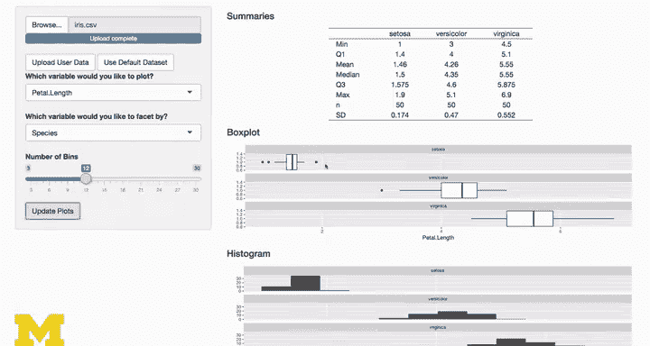

# 密歇根大学《使用Python的统计学（理解并可视化数据、因果推断、建模）｜Statistics with Python》中英字幕 - P17：16_交互式直方图与箱线图演示.zh_en - GPT中英字幕课程资源 - BV1dV411Q7j3

Hello and welcome back so today we have another interactive online app that we're going to be showing and here is where we are primarily going to be looking at box plots and histograms of our data。

Now you can upload your own data using this upload user data， first browsing and then uploading。

 but for now we're just going to look at the default data set， which looks at cars data。

 and so this is a couple dozen cars that we got a lot of data on， such as like miles per gallon。

 the weight of the car， the displacement， the number of cylinders， and such。

And we're going to look at the numerical summaries。

 the box plot of our data and the histogram of our data。

 So right now I've clicked the used default data set， and I can go to upload plots。

There update plots。And we see I have my summaries， so my five number summaries along with the mean。

The sample size of 32， a standard deviation of 6。07 and below we have a box plot of right now miles per gallon and a histogram of our miles per gallon as well。

 Now I can change this to be something more like weight or WT and we'll have a description of all of these later on in the app and clicking update plots again。

This updates it now to my numerical summaries on weight and my box plot and my histogram again。

So to go back to miles per gallon， one of the really nice features about this is that I'm able to facet my data。

 so this is taking a categorical variable and comparing between them So what I could choose here is cylinders so the number of cylinders are cars have。

 which is either four， six or eight and then by updating plots I'll now get three box plots and three histograms。

And three different numerical summaries。 So we can see now that in the box plots。

 four cylinder cars tend to have better miles per gallon than do six and six cylinders have better miles per gallon than do eight cylinder cars and the histogram also shows this down here and we can change the bin size if we wanted to so I could make my bins have fewer bins and then they become a little bit wider and always be clicking this update plots。

On the bottom left here。We could also change it up and instead of looking at miles per gallon I could look at the horsepower of a car and still fasting by weight。

 clicking the update plots， we now see a kind of reverse trend where the more horsepower we have means the more cylinders the car would have so the eight cylinders have the highest horsepower whereas the four cylinders have pretty low horsepower。

And the histograms， again， are down there。With our numerical summaries up top。

One of the cool features about this app is that we can upload our own data。

 so what I'm going to do is click browse。And I'm going to find what is called the IIS data set。

 which is up here in my folder。And now it's uploaded， I'm going to use upload user data。

And it reads in that data。 It reads in your categorical variables。

 It reads in the numerical variables。 and now I can see that I have。These variables here， sL length。

 sL width， pal length and pal width， so the irIS data set is based off of flowers that there are three species of flowers that look often similar。

 but they have different properties。So let's just do a basic sL length across all of our 150 flowers because my sample size is 150 and we got our box plot and our histogram。

But now instead I'm going to facet it by species， so again， there's three species， Satoa。

 Versa color and Virginiaica。And we can see here that they actually differ quite a bit。

 and so that's how we're able to determine what kind of flower you would actually have。

And I could change my variable to be something like petal length and see how those differ。

 so the settosa has very， very small petal length， whereas the versa color and Virginiaica have quite a lot larger length。

So what's nice about this is that you can upload your own data into it and use it just to get an instant feel with your numerical summaries and your box plots on the data that you have。

 and you can even facet it by the categorical variables that you have。

