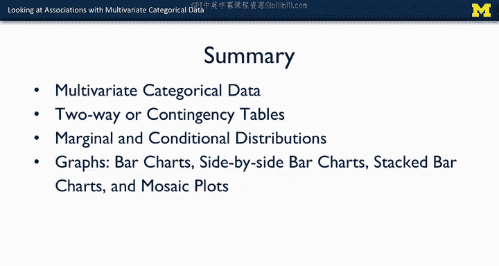

# 密歇根大学《使用Python的统计学（理解并可视化数据、因果推断、建模）｜Statistics with Python》中英字幕 - P18：17_多元分类数据关联分析.zh_en - GPT中英字幕课程资源 - BV1dV411Q7j3

Hi， my name is Julie Deekey。 We will be talking in this video about looking at associations with multivariate categorical data。

To start with， let's dive a little bit deeper into what that title means。

Let's think about what multivariate categorical data are。Imagine that we're gathering a survey。

 we might go to an individual and ask them a question like what is your gender？

Think for a moment to yourself about what kind of variable gender is。

Gender is a categorical variable because our responses are either categories or groups。

 so in this case we have a categorical date variable we might be interested in more than just gender though we might also want to know what is your marital status。

😊，In this case we have two different variables that we're measuring， this is called byvari。

 byvari is two variable， it's also multivariate， multivariate is anything that's more than two variables。

We might not be happy with just having these two variables we might be interested in more。

 so we might ask， what is your highest education level？And we could also ask， what is your age group？

In each of these cases， these are all categorical data， and once we've gathered these four variables。

 we definitely have multivariate categorical data。We can think about looking at the responses to these variables in the form of a spreadsheet or a form。

So we could go to one person and record all of their responses。 For example， in this case。

 we have our first individual that we talked to was a male。Who has a high school degree or GED？

Is not married and has never been married。And is aged 18 to 29。

We might not be satisfied with only knowing information about one person so we could move on and gather a second individual this person might be female。

 has some college or an associate's degree， is either currently married or living with a partner。

And is aged 30 to 44。We could continue this for 15 individuals until we have a lot of information。

At this point in time， it's hard to gain a good picture of our sample from just this one image。

It's hard to get a sense of what our sample looks like。

 so we'll look at different ways that we can display the data that we've collected in a more manageable format。

Once weve collected our full sample， we could choose to record our variables in the form of tables。

For example， we can look at the highest education level that's attained here we can tell of our entire sample we had exactly 1。

331 individuals that had less than a high school degree。At this point in time。

 this is much easier to gain a good sense of what was going on within our entire sample at a single glance。

This leads us into the question of what is a research question for the remainder of the video？

We'll be looking at what factors influence the highest education level attained throughout the rest of this video。

If we're interested in knowing what factors influence that highest education level。

 we want to look at one of our other factors first。

 so we'll split up this univariate categorical data table into two variables in the form of a two way table or a contingency table in this case。

 we can split up each of our categories into whether the respondent was female or male。

It's really hard to make sense of this table without some additional context。

 so we'll add in a total row and column so that we can see how many individuals fell into each category。

First， let's think about what all these values on the inside of the table mean we can see that we have 644 people that we talked to who were female and had less than a high school degree。

We need some extra context so it helps to know that we have 5，549 individuals。

 and then if we divide that 644 by the 5，549， we can figure out the proportion in our sample who are female and had less than a high school degree。

Here we can see that that's 11。6%。We could repeat this process for each of the entries on the inside of our table。

To get a sense of what our entire sample looks like， for example。

 we can see that almost 10% were female and had a high school degree or a GED in our entire sample。

Let's return back to that original table that I showed you a few slides back。

Here we've changed it so that we have additional percentages added in。

 this helps us so that we can see a little bit better how our sample was distributed across our four categories。

😊，It's nice to see the values here， but it can also be helpful to view them graphically In this case。

 this is a bar chart of the highest education level attained it shows the same thing as the table on the last slide。

😊，And we can see that the most common category is the one that has some college or an associate's degree。

This helps us see this very quickly and at a glance in a way that numbers can sometimes leave a little bit of confusion。

Returning to our original research question， we are interested in figuring out how our additional factors influence the highest education level attained。

 so in this case we'll look at the conditional distributions of our education level based on our gender。

One thing that we can do is we can make two bar charts of our education level based on whether we have females or males in this case。

Here， it seems like there are more females in that some college are an associate's degree compared to males。

 but it's hard to tell exactly how these two distributions compare。

One thing that we can do is we can change each of these distributions into proportions or percentages。

In this way， we can compare directly the distributions for our two different genders。

 as opposed to comparing the counts， which may or may not be directly comparable。

One thing to note is that in this case， when we're creating our proportions。

 we'll divide by the total number of individuals in that category so we'll divide by that 2814 for females or 2。

735 for males in that case you can see that we add up to 100% within each of our two columns。

We can also display this in a side by side bar chart。In this case， the side by side bar chart。

 you can directly compare the proportions of individuals within each of the two gender categories that fall into each of the four education level categories from this we can see at a glance very quickly that it is true that there are more females in that some college or an associate's degree level than males based on their proportion and that this is the largest difference between the female and the male education levels。

One additional way to display our distributions is to look at stacked bar charts stacked bar charts show you the proportion of individuals that fall into each of the four categories for each of the two groups。

 and because they're right next to each other， we can also see how those two groups compare to each other。

One additional graph that we can look at is a mosaic plot in this case。

 each of the boxes have an area that's proportional to the number of individuals that fit into that category。

 This is a great way of looking at our data at a glance we can get a really good sense of how the data are distributed。

I'm going to draw a line in here that separates out those who have a high school degree versus those that have some college。

What we can see clearly from this is that the proportion of individuals that have some college is the highest for those in the 18 to 29 age group。

 and it decreases for each age group after that。If these two variables were perfectly independent or had no association。

 then what we would expect to see is a grid that had all straight lines。

 we can see that the line that I've added in here is quite a few blips and is a little bit jagged as we go through the mosaic plot。

One additional way we can look at the mosaic plot is to separate out gender within each of those age categories。

 and this way we can look at the associations between our three variables， age， gender。

 and education。Again， we can see the same kind of jaggedness as we look at the different age groups。

 we can also see， for example， within this 45 to 59 category。

 that the difference between male and female is fairly similar。

 there's a little bit of a blip once we get to that high school college separation。

 but it's a relatively straight line indicating that gender doesn't play as much of a role in that 45 to 59 age category。

When we look at the 30 to 44， we can see that this blip is quite a bit stronger。

 indicating that gender has a bigger association within that age category。Overall。

 today we've talked about what multivariate categorical data are。

The ways that you can use twoA or contingency tables to display your data。

We also looked at how you can change the ways that you're looking at those tables to include either marginal or conditional distributions。

And finally， we've looked at ways that you can visually graph your data。

 whether in the form of bar charts， side by side bar charts， stacked bar charts， Mmosaic plots。

