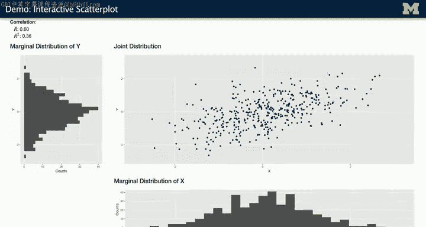
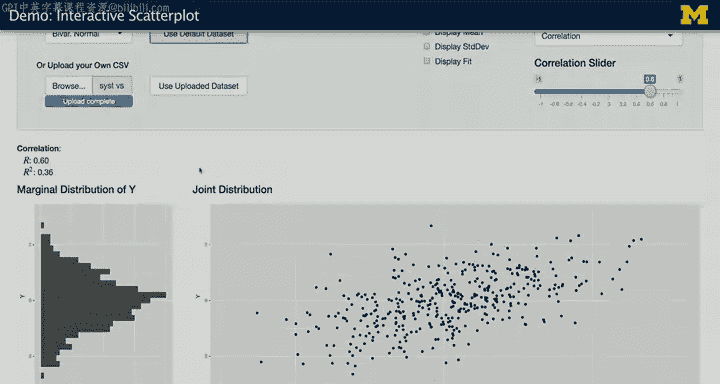

# 密歇根大学《使用Python的统计学（理解并可视化数据、因果推断、建模）｜Statistics with Python》中英字幕 - P20：19_交互式散点图演示.zh_en - GPT中英字幕课程资源 - BV1dV411Q7j3

This is a cool app we created to help visualize multivari quantitative data。

And to get a better understanding of correlation， first。

 I go to the website and then make sure I'm under the Bvari plot tab。

This app has three cool functionalities。 For one， you can look at the scatter plot individual histograms of a default data set。

 which compares weight of a car to its miles per gallon。I do this by clicking Use Deult data set。

And you see it displays the histograms and the scatter plot of the miles per gallon versus the weight。

I can also look at the correlation。By clicking correlation in the top right corner。

 and you see it'll display that these two variables have a correlation of negative 0。87。

The second thing I can do is actually upload my own data。

And check out the scatter plot in histograms。I do this by first having a CSV file ready to upload。

 So CSV file that looks like this。Where here I have agents dog blood pressure。

Then I upload that data。Here it is， open it up。Then I click Use uploaded data set。

And now I see the histograms and scatter plot for salg blood pressure versus age。

Note that this is the same visual that was used in the course video looking at associations with multivari quantitative data。

I can also once again see the correlation between these two variables of 0。58。

The last thing we can do is actually create your own data according to a pre specified correlation。

To do this， i change the default data set to buy very normal。And I click Use defaultult data set。

And now I have a correlation slider， you see this slider right now is set to zero。

 and som I actually have a scatter plot of two variables with zero correlation。

But let's say I wanted to have a scatter plot of two variables with a moderate positive。Correlation。

 I slide the slide over to 0。6 with correlation I want， then I click use default data set again。

And now you'll see a scatter plot of two variables with a positive。

 moderate linear association you also see here the correlation is 0。6。

