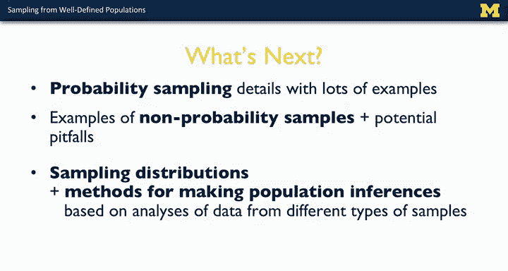

# 密歇根大学《使用Python的统计学（理解并可视化数据、因果推断、建模）｜Statistics with Python》中英字幕 - P22：21_明确总体抽样方法.zh_en - GPT中英字幕课程资源 - BV1dV411Q7j3

Hi， my name is Brady West and this week in week four of the course we're going to be talking about where exactly data come from。

 and we're going to start by talking about drawing samples from welldefined populations as one way of getting our hands on some data to do some analysis。

So just to get started， again， we're going to answer the question。

 where do data come from that we use to perform analysis？Up until the early to mid 20th century。

 researchers had limited tools at their disposal， they attempted to take a census。

 which means that they attempted to measure every single unit in a given population。And in the 1930s。

 Dr。 Jersey Naman made some very important breakthroughs in this area and his work enabled other researchers to use random sampling as a technique to measure populations and what that meant is that we didn't have to measure every single unit in the population to make statements about the population。

 so when thinking about making population inference or making statements about populations based on a sample of data。

 a very important first step is to first define the target population of interest in concrete terms。

 so in other words， what is the population that you want to make inference about or who is this population that we ultimately want to make statements about when we analyze data。

So first of all， who are we measuring， is it males， is it African American males。

 is it older African American males， what exactly does older mean。

 you have to be very specific at these initial stages when thinking about the population that you really wish to make inference about。

When we think about target populations we also have to think about what and where so first of all。

 what timeframe are we interested in are we talking about 2018。

 are we talking about April 2018 are we talking about the first half of April in 2018 so what timeframe are we really looking at and second of all。

 where is the population located so we have to think about geography too are we talking about the Midwestern United States are we talking about the state of Michigan are we talking about a specific county in Michigan like Washingtonaw or maybe even the city of Ann Arbor so these are the specifics that we really need to hash out before we start making inferences about populations we really have to know who what and where we're talking about。

So an important piece of advice when thinking about target populations is to write that population down on paper。

 write down a definition， the who， the what， the where。

 put that definition down on paper and literally staple it to the wall if you're working with a team。

 make sure that everybody has an exact copy of that population statement up on the wall。

 the target population should be clearly defined in a manner that everybody can understand everybody should be on the same page in terms of what population you want to talk about when you analyze a set of data。

So， given that you've written down a nice concrete definition for a target population， now what。

 you have a well defined target population， but how can we ultimately make inferential statements about that population？

Option1， we could conduct a census that is to get the data describing that population。

 we could try to measure every single person in that concretely defined population。

 as you can imagine that's a pretty expensive undertaking， but it's still one of our options。

Option2 is to select a scientific probability sample from the population and attempt to measure all units in the sample now this week we're going to be writing down a very careful definition of what we mean by scientific probability sample。

 but that's a second option。And then option three is to select what's called a nonproability sample from the population and again attempt to measure all of the units in the sample。

 So these are three different approaches that we could take to ultimately get the data that we can work with。

 option1， try to measure everybody in the population option2。

 select a sample where people have known probabilities of selection option 3。

 select a non-prob sample and we're going to spend time this week talking about the differences between these options。

So option 1， conducting a population census。 This tends to be a lot easier when we're talking about smaller target populations。

 very well defined， maybe small geographies where it's not that hard to try to reach and measure every person in the population。

 It can be incredibly expensive for larger populations。 As you might have heard in the United States。

 we do a decennial census of the population。 So every 10 years。

 there's a massive effort to try to measure everybody in the United States and collect selected variables about them。

 This is an incredibly expensive operation。Censuses also require a careful evaluation of how much it will cost to measure all the population units and what administrative data sources are already available。

 that is， do we really need to measure everybody or can we draw some information from other sources that already exist？

The second option that we just introduced is probability sampling。

 and we're going to provide more details about this later this week。

 but just to get started some basics of probability sampling。 First of all。

 we construct a list of all units in the population。

 and this is sometimes referred to as a sampling frame。

 This is the list of units from which we draw the sample that we're ultimately going to try to measure。

Next， we determine a probability of selection for every unit on that list or every unit on that frame。

 and when we talk about probability samples， every single unit on that list。

 whether it's a person or a household or a business or an establishment。

 every single unit on that frame has a known and nonzero probability of being selected into the sample。

 That's what we mean by probability sampling， we can actually determine that probability of selection for every single unit on the list。

 and we're going to talk more about how to determine those probability of selection。Then。

 given those probabilities of selection， we select units from that list at random。

 where the sampling rates for different subgroups on that list are determined by those probabilities of selection。

 so some subgroups may have a higher probability of selection than other subgroups。Finally。

 we attempt to measure those randomly selected units。

 that's where we get the data from the sample we might ask them questions， we might interview them。

 we might collect data from other sources about those randomly selected units。

 but that's where we actually get the data， which is one of our main focuses this week。

Option 3 that we just introduced is nonprobability sampling Noprobability sampling generally does not involve random selection of individuals according to probability of selection。

 and this is a key drawback in terms of the various techniques for collecting data from a sample We're not randomly selecting the units that come into the sample like we do with pro sampling。

 In addition， the probabilities of selection can't be determined for the population units。

 and this makes it more difficult to make representative inferential statements when we analyze the data。

 it's very important that we know those probabilities of selection and with non-proability sampling as the name suggests we don't know those probabilities in advance。

So some examples of what we mean by non-proability sampling。

 you may have seen invitations when you've been online to join optIn web surveys。

 you might see surveys flash up on the screen or you might see other invitations when you're visiting a website in these optIn web surveys you're really just trying to take whoevers interested in taking that web survey。

 you're not selecting people at random from some welldefined list or a sampling frame it's whoever wants to volunteer to participate in that particular web survey and as a result we can't determine those probabilities of selection。

Another example is quota sampling。 That is you try to recruit as many people as you can who fit certain subgroup definitions。

 for example， older African Americanic males until you hit some targets。

 some number of individuals that you wish to measure and in some of those cases with quota sampling。

 researchers try to collect as many individuals as they can not according to any probability scheme。

 but just based on whoever's available just as long as they hit their targets or their quotas。

 This too is another example of non-prob sampling where again。

 we can't write down probabilitybabilities of being selected in that sample。

 we're just trying to meet targets and recruit enough people to meet those targets。

Another example is snowball sampling。 This is where as you can imagine a snowball。

 if you roll it down a hill， it keeps getting bigger and bigger and you're gathering more and more snow as the snowball rolls in this case。

 you recruit somebody to participate in a study and then they might tell a friend and then that friend might tell a friend and your sample ultimately gets bigger by collecting individuals from this chain that you can see up here on the screen。

 So in these cases， again， the friends are recruiting friends and social networks and we don't really have control over who they recruit or the probabilities with which they're going to recruit these other individuals。

 So snowball sampling it's a convenient tool for recruiting a sample。 but as researchers。

 we don't have controls over those control over those probabilities of selection。Finally。

 convenience sampling this is another way that we could collect non-probability samples。

 for example you might go out in the street and just talk to people who are available to collect data and ask questions if you're teaching in a university or a business setting you might just collect data from the individuals in your courses or from your coers or whoever's close to you again。

 no probabilities of selection involved， you're just trying to collect data from the individuals who are convenient and in close proximity to you again in this situation we can't apply probabilities of selection to those individuals and that prevents us from making representative statements about the larger population so these are all common examples that are used in research but the common theme here is that they're all non-probability samples。

 making it difficult to make population inference。We also could do surveys on the street。

 I mentioned that as a type of convenience sampling again where you might post up on a street corner and just ask anybody who walks by if they're interested in collecting data。

 no way to know probabilities of selection or probabilities of being included in that kind of data collection it again is just a form of convenience sampling where you're recruiting people who are willing to answer the questions that you're trying to ask you're not drawing people at random from some welldefined list。

So to summarize here the main problems with nonproability sampling。

 there's no statistical basis for making inference about the target population and in this scenario where we're not randomly selecting individuals with known probabilities of selection from some larger list there's a very high potential for bias If you just think of a simple example of a survey on the street。

 if you decide to ask people questions on the street in a particular area of town where only certain types of people tend to frequent the establishments in that part of town。

 you're only going to be collecting data from a very specific subset of people rather than a random representative sample of the entire larger population and the same is true of all the other types of non-probability samples that we just introduced。

 there's a very high potential for bias in that you're recruiting very specific types of people and measuring those people and you're not getting a full representative sample of the larger target population we're going to spend more time talking about these issues of non-prob。

in a later lecture this week。So why probability sampling。

 I've tried to make an argument so far that probability sampling has some important features with probability sampling the known probabilities of selection for all of the units in the population。

 that's what allows us to make unbiased statements about both population features。

 the stuff that we're trying to estimate when we analyze the data。

 the features of the population that we're trying to understand。

 and the uncertainty in the survey estimates， so in addition to saying what the average income is or what proportion of people have a certain characteristic in the population。

 we would like to say how uncertain we are about those estimates。

 because we're not measuring everybody in the population we're measuring a sample of individuals and we want to make statements about how uncertain we are with the estimate that we're computing as an estimate of a population feature in the introductory text that's available for week4。

 you can read a little bit more about probability sampling and reasons to do this when you're collecting data。

A little bit more about why probability sampling this random selection of population units from this predefined sampling frame or this predefined list。

 this protects us against the bias that can come from the sample selection mechanism I talked about some of these sources of bias in the way that we select our sample Pro sampling allows us to make population inferences。

 again， statements about larger populations based on what are known as sampling distributions and this week we're going to spend a lot of time talking about what we mean by sampling distributions in short。

 if we think about repeating the process of drawing a sample many。

 many times and computing estimates for every single sample that we could hypothetically select a distribution of estimates is going to emerge and when we think about making statements about the population。

 we want to make those statements based on that distribution of all these possible estimates that we might ultimately compute in these repeated。

SamplesNow in reality， we're just going to draw one sample and compute estimates based on that sample。

 but statistically all of our inferences are going to be based on those hypothetical sampling distributions if we were to repeat a sampling process according to a specified design over and over and over again What would we expect to see and that's going to tell us how certain we are about the population statements that we're making so we'll spend a lot of time talking about sampling distributions this week。

So the big idea here is that with very careful sample design following good scientific principles of sampling。

 probability samples yield representative realistic random sample from larger populations and these types of samples have very important statistical properties we're going to be talking about those properties this week but in short。

 Jersey Naman who I introduced at the beginning of this lecture。

 he laid the groundwork for saying how can we take one sample following these principles of probability sample with random selection and then make representative statements about the larger population Naman allowed us to make these larger representative statements and we're going to talk about these important statistical properties so probability sampling is very important in practice and we're going to talk about important differences between probability and non-pro sampling when we're trying to make these larger population statements So that's our big idea here and again our focus is going to be on where to get data sampling。

iss often used to collect data from people and populations。

 but it's very important that we spend good good time designing these samples。

 coming up with welldefined target populations and being very careful about the way that we select these samples so that we can make important statements following these statistical properties that name and laid out so probability sampling is a very important concept that we're going to keep focusing on。

So what's next We're going to talk more about probability sampling and the details of this technique with lots of examples。

 and we're going to also look at examples of non-probability samples。

 we briefly introduce some here and we'll talk more about the potential pitfalls of non-probability sampling and we're going to talk a lot more about sampling distributions again this notion that were if we were to select samples over and over again following the same sample design using random selection and probability sampling a distribution of estimates that we would expect to see will emerge and how we can use this distribution of hypothetical estimates to make representative population inferences based on analyses of data from different types of samples so we'll talk a lot more about that concept of sampling distributions and what it means for making population inference。

