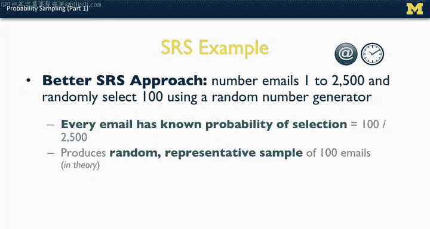

# 密歇根大学《使用Python的统计学（理解并可视化数据、因果推断、建模）｜Statistics with Python》中英字幕 - P23：22_概率抽样方法(上).zh_en - GPT中英字幕课程资源 - BV1dV411Q7j3

Okay， so now let's talk about probability sampling in a little bit more detail and see some examples of different types of probability samples。

 so we'll go into a little bit more detail about this technique and talk about why probability samples again are important for making representative statements about populations。

So here's a brief overview of this lecture， we're going to start with simple random sampling as one type of probability sampling。

 we're going to abbreviate that by SRS and we're going to make links between simple random sampling and the notion of IID data that we talked about in previous lectures for this course。

 so independent and identically distributed data and we'll go over an example。

 a little fictional example talking about email response times for a customer service organization。

Then we'll get into what are called complex samples for larger populations these are samples that have very specific design features。

 namely stratification， cluster sampling and weighting， these are still probability samples。

 they're just more complex than simple random samples and as an example we'll talk about a major national Health Survey called the National Health and Nutrition Examination Survey or NHAs。

And again， we'll keep talking about key benefits of probability sampling as we move forward。

So let's start with simple random sampling or SRS With SRS。

 we start with a known list or a sampling frame， recall from the previous lecture of capital N population units。

 so capital N refers to the size of the population again this could be individuals， households。

 businesses， establishments， but we have capital N units in the population。

 and we have them all listed， and we randomly select little N units from the list。

 so little N is the size of our sample。Every single unit following this sample design has an equal probability of selection。

 and that probability of selection for every single unit on the list is defined by little n divided by capital n。

 so that's our first example of a sampling fraction this is the fraction of the population that ultimately gets selected to be in the sample。

 and in the case of simple random sampling， that probability of being included in the sample is the same for everybody in the population。

 it's little n divided by capital N。What this also means is that all possible samples of size little n are equally likely okay so every potential sample of size little n that we could draw。

 they're all equally likely to be selected when using simple random sampling。Furthermore。

 estimates of means， proportions， totals and other statistics of interest based on the data that we collect from a simple random sample are what we refer to as unbiased。

 so we talked a little bit about bias in the last lecture with simple random sampling as a type of probability sampling when we compute estimates based on a simple random sample。

 those estimates are unbiased and what that means is that these estimates are equal to the population values that we're interested in on average。

 remember that idea of a sampling distribution that we introduced。

 there could be variability in these estimates， depending on what samples we select， but on average。

 across all those hypothetical samples， these estimates are going to be equal to the population values of interest that's what we mean by unbiased。

So here's just a picture of what a simple random sample of say 134 people would look like if those 134 people were randomly selected from a list of size 10。

000 and this is a stadium view of that random sampling and you can see all the black dots in this stadium view。

 those represent the randomly selected individuals so you can see that that random sample of size 134 is representative of all different quadrants of that stadium。

 we have some sample from all those different quadrants so we have a representative selection from all the different areas of that particular stadium and again in this little example。

 those 134 people were selected entirely at random from a larger list of 10，000 people。

 so we can make good representative statements about the larger population in that stadium by collecting data on those 134 people that were randomly selected using this technique。

Okay， so simple random sampling can be with replacement or without replacement With replacement means that when we select somebody from a larger list。

 we replace them in that list， and we give them a chance of being selected again in the sample。

 more common is that simple random sampling is done without replacement。

 So once an individual unit is sampled from a given list， they can't be sampled again。

 But for both of these different types of simple random sampling。

 it turns out that the probability of selection for each unit is still that same quantity。

 little n divided by capital M。 So whether we're doing with replacement selection from a list where people could be selected multiple times or without replacement。

 the probability of selection still remains the same。

 everybody has a little n divided by capital N chance of being included in the sample。Now。

 simple random sampling， while it might seem easy to think about， it's rarely used in practice。 Now。

 why is that collecting data from little and randomly sampled units in a very large population can be prohibitively expensive。

 For example， consider a simple random sample of 1000 people from throughout the United States。

 and suppose that we had to drive to each of those individual households to have somebody interview those randomly selected individuals。

 It would become incredibly expensive to have someone just drive to these randomly selected individual households that could become very prohibitively expensive。

 So we think about alternative types of probability samples that are much less expensive to field in practice。

 and this is especially true for large populations。

 S random sampling is generally done when populations are smaller and it's easier and less expensive to ultimately collect the data。

Okay， what about that connection to IID data， which recalls a concept that we talked about a little bit earlier in this course？

Recall that IID observations are independent and identically distributed thinking about the distributions that they come from。

Simple random sampling will generate IID data for a given variable in theory。

 so when we select a simple random sample and then we collect measurements and all the units in that sample。

 in theory that will produce what is IID in terms of the definition that was introduced earlier。

All randomly sampled units are going to yield observations that are independent。

 so there's no connection between the units that are randomly sampled。

 they're selected independently of each other or they're not correlated with each other in terms of their measures of interest。

 and furthermore， those units are identically distributed so they're representative of some larger population of values again。

 in theory， So all those measures that we're trying to collect from a simple random sample they arise from an identical distribution that describes the distribution of values in the larger overall population。

 So we have a representative randomly selected set of units of observations that are independent from each other。

 So IidD data in terms of a sampling process。So here's an example of simple random sampling just to make things a little bit more concrete。

 supposeuppose that we have a customer service database of capital N。

 which recalls the size of the population 2500 email request that came in in 208 team and the director of the customer service division wants to estimate the average or the mean email response time So how long did it take that customer service division to respond to each of these 2500 email requests。

 Now you might look at this and say well that seems pretty easy。

 we could just go into all 2500 of those emails and see how long it took Well。

 unfortunately in this case the exact calculations require a manual review of each email threads going in and tracking down very specific timets for when that email was responded to So it's not that straightforward to just measure every single one of the 2500 email requests So the director asked the analytics team to sample process and then analyze。

A small sample of little n equals 100 emails instead of trying to measure every single email。

So a couple different approaches we could get at this kind of sample。

 a naive approach would be to simply process the first 100 emails on the list。

 we have a list of 2500 emails， let's just take the first 100。

 In this case the estimated mean response time could be biased if， for example。

 the customer service representatives learn or they get better over time at responding more quickly so maybe at the beginning of these email responses it took a lot longer to respond while people were still getting the process down so our estimated mean might be biased to be too large in that situation。

The first 100 observations could also come from a small group of staff。

 so the first set of emails being responded to could have come from very specific individuals。

 in other words， the email responses were not fully representative。

 they weren't independent of each other because maybe they were being answered by the same staff members and they weren't identically distributed because they arose from a different distribution of response times then the distribution for everybody in the entire department。

So there is no random selection when following this approach， according to specific probabilities。

 what we essentially have following this naive approach is a non probability sample。

 and that provides us with important limitations。A better approach using simple random sampling would be to number those emails from 1 to 2。

500 and then randomly select 100 of those numbers， those IDs for each of the emails using a random number generator。

In this case， every email would have a known probability of selection。

 remember it was the sample size 100 divided by the size of the population 2500。

 so following this simple random sampling approach。

 every email would have this known probability of being selected in the sample。Furthermore。

 this would produce a random representative sample of 100 emails， again in theory。

 a random selection from all possible emails that were responded to。

The estimated mean response time in this case will also be an unbiased estimate of the population mean like we talked about with simple random sampling。

 on average， if we were to draw many， many samples of size 100 and compute the mean of each of those。

 the average of those means would be equal to the true population value。

 this is one of the very nice features of probability sampling。

