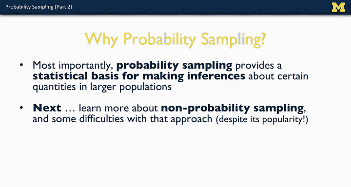

# 密歇根大学《使用Python的统计学（理解并可视化数据、因果推断、建模）｜Statistics with Python》中英字幕 - P24：23_概率抽样方法(下).zh_en - GPT中英字幕课程资源 - BV1dV411Q7j3

Okay， so welcome back to our continued discussion of probability sampling so far we've been talking about simple random samples and some of the nice properties of simple random samples in terms of computing unbiased estimates based on random representative samples of larger populations Now not every probability sample is a simple random sample as I suggested earlier。

 simple random samples have important drawbacks namely they're very expensive for larger populations When we talk about trying to draw samples from larger populations。

 it can be very expensive to draw small samples from larger populations and then measure those individual units This is where we get into what are called complex probability samples simple random samples are rarely conducted in practice the exception is that we might have a relatively cheap data collection based on a well-defined population list or maybe a sample of administrative records where we can literally pull records from a file cabinet or some kind of online filings。

With larger populations as I mentioned， complex samples are often selected again where each sampled unit has a known probability of selection the difference is that with complex samples we use very specific features of probability sample design that allow us to save on costs and make our samples more efficient so that's what we'll be talking about now in general when we refer to complex samples。

 complex samples are anything that's more complicated than simple random sampling so when we use design features for those samples that deviate from the principles of simple random sampling that we've discussed。

Okay， so complex samples have certain key features again relative to simple random sampling。

 remember with simple random sampling， we're taking a random sampling of size little N from a larger population。

 capital M， and we're just selecting units from a list of the population at random。

With complex samples， there are key design features that distinguish these types of samples from simple random samples。

 First of all， the population is divided into different strata and part of the sample is allocated to each stratum What this does is it ensures sample representation from each stratum and reduces the variance of survey estimates This is a technique that's known as stratification you can think about with a simple random sample recall that stadium view in the previous lecture we had a nice representative sample from that whole stadium but remember with simple random sampling every sample is equally likely and when selecting cases at random all 134 of those cases in that previous example could have come from one quadrant of the stadium those cases were selected at random the representative but it just so happens that by random chance they all come from one quadrant of the stadium in that case of simple random sampling we wouldn't have representation from all four quadrants of the。

Stadium like we saw in that previous picture， that's what we call a bad sample。

 still a simple random sample， still a probability sample。

 but not ideal in terms of representation stratification allows us to ensure that we're allocating some of our sample to all these different divisions of the population。

Complex samples are also defined by cluster sampling and in cluster sampling。

 we might select clusters of population units， for example。

 counties in the United States at random first， all with known probabilitybaities so every county would have a known probability of selection within these different strata so for example we might select a certain number of clusters from the western United States a certain number of clusters from the Midwestern United States and so forth and so on what this does in terms of sampling clusters first before we actually randomly select people or households。

 this saves a lot of money on the data collection again， instead of in simple random sampling。

 having to visit each household individually in a random independent sample of households。

 we instead would visit a larger cluster like a US county and then within thatly randomly sample county we would then go to a sample of households within that county to select our to collect our data this again saves on the cost of data collection。

Him。And then we would randomly sample units within those clusters like I mentioned。

 according to some probability of selection， so once we get to a US county we might track down a list of addresses within that US county and randomly select households at random from that list of all possible addresses and again addresses on that list they'd all have known probabilities of selection so we would randomly select those households according to those probabilities of selection just like we talked about with simple random sampling and measure those households。

 collect the measures that we're interested in， but the key distinction here is that those units they come from a second stage of sampling within the initial randomly selected clusters this is the idea of complex sampling。

So in these complex samples， a unit's probability of selection is determined by several things。

 is determined by the number of clusters that were sampled from a given stratum。

 is determined by the total number of clusters in the population in each of those different statum。

Its determined by the number of units that were ultimately sampled from within each of those randomly selected clusters。

 and it depends on the total number of units in the population in each of those different clusters。

So here's an example of how we might find a unit's probability of selection when using one of these more complex samples。

 supposeose that we were selecting a complex sample where we selected little A out of capital A clusters at random within a given stratum。

 so consider the Midwestern US is one major region of the United States and we're defining that as a stratum within the Midwestern US there might be capital A counties that we could sample from and we select little A counties from out of those capital A counties at random within the Midwestern US。

Then once we have that random sample of Little A counties within each of those Little A counties。

 we select Little B out of capital B units at random from within the selected county。In this case。

 we can do a little bit of math and write down the probability of selection of each of those units within that particular county it's little A divided by capital A that's the probability that a cluster was selected at random。

 assuming that we select a simple random sample of clusters。

 then we multiply that first fraction by little B divided by capital B。

That's the second stage sampling fraction so within each of those little A clusters we take little B out of capital B possible units from within that particular cluster。

 so the people designing samples they determine what little A should be what little B should be to satisfy constraints on the sample design and cost constraints。

 but we can write down these probabilities of selection for each individual in the population still based on these kinds of multistage designs where we first select clusters。

 then we select units within those clusters。So here's an example to make it even more concrete using the National Health and Nutrition Examination survey。

 let's suppose that we divide the United States into different regions based on geography and population density。

 so how dense is the population within a particular area and where are we talking about geographically in terms of that area。

 we refer to these divisions of the larger US based on geography and population density as strata。

 and again by allocating sample to each of these different straum。

 we ensure some representation from each of the strata and we minimize the risk of a bad。

 simple random sample where when selecting elements at random。

 maybe they all come from one region in the US。 we want to minimize the risk of that happening。Next。

 we allocate some number of counties or groups of counties to be sampled from each of those different strata。

 and again using the terminology that we just introduced， these are clusters。

 we randomly sample clusters again to save costs that way we can sample households within a very small geographic area such as a counter rather than driving the households that have been randomly sampled from some larger geographic area。

Then we sample certain socidemographic subgroups of individuals at higher rates within those counties。

 This is something that's known as oversampling， so maybe a given project has a certain target sample size for particular subgroups of individuals。

 we might sample these different subgroups at higher rates within those counties when we're randomly selecting households。

 What this leads to is different probabilities of selection for different types of individuals。

 depending on the goals of a given project that oversampling means that different people will have different probabilities of being selected。

 different rates of selection at that second stage， and that's okay。

 We still have a probability design and we can use those probabilities to ultimately make representative statements about the larger population。

So here's a picture of what this kind of multistage sampling process might look like and this is borrowed from the National Health and Nutrition examination survey documentation so we start with the larger United States at stage one and at stage one again we might divide the US into different regions and then sample these counties or these clusters from within each of those regions so you can see the purple dots in this case those are the randomly selected counties at the first stage of random selection then you see we bring one of those counties forward at stage two and we look at smaller area segments within those randomly selected counties we might then select these smaller area segments at random as well those are the little yellow selections within larger counties so this is multiple stages of cluster sampling and again this would be done to save on costs and identify households within those randomly selected clusters or counties in a more cost efficienticient manner rather than just driving the different households at random in an entire US。

Coun sample smaller area segments within that county at the second stage。

Then if we bring forward one of those randomly selected area segments within a county。

 then we start to see the households within that randomly selected area segment。

 we might list all those households or purchase a commercial list of all those households。

 and then once we identify those households， select a random sample of those households。

 maybe using simple random sampling within that particular smaller geographic area segment。

Then once we have a randomly selected household， we have a field staff member who might go visit that household and identify all the individuals within that households。

 we bring a randomly sampled household forward。 we can see maybe the father。

 the mother and the kids within that household and we might select want to select one of those individuals at random within that particular household at all four of these stages we know what the probabilities of selection are and we maintain those probabilities of selection throughout the entire design we always know what they are for each of the different units at every stage that you see here that's the important feature of a probability sampling design ultimately we can compute the probabilities of being included for every single individual that we might randomly sample so I like this image because it's a good 3D view of everything that we're trying to do in terms of a multistage complex sample。

So what happens in the NANs， the National Health and Nutrition Examination survey。

 they drive a huge semitrailer that contains medical equipment and staff to each of these sampled counties and the smaller area segments within those counties and then within those area segments when they sample households they invite the randomly selected people from those households out to this huge semitraer for a survey interview and a medical exam this is where the data come from so once we have this complex multistage design we need to collect data from the randomly sampled individuals those randomly selected individuals within households they're invited to come visit this semitraer complete a survey interview with an interviewer and then under go through a medical exam with trained medical professionals and that's where the data come from for NHANS。

In this type of design， the inverse of a person's probability of selection is then what's referred to as their sampling weight。

 So remember， across all those stages， we can compute the probability of being included in the sample。

 And if we just take the inverse of that probability of selection that yields their sampling weight。

 So for example， if my probability of selection， according to that very complex multistage design counties。

 then area segments within counties， then households within area segments。

 then individuals within households， if ultimately my probability of selection was one divided by 100。

 that means that my sampling weight is 100。 In other words。

 I represent myself and 99 other people in the larger population。 this sampling weight。

 which is a function of the probability of selection， as you can see here。

 is used in the actual data analysis to compute representative population estimates。

 So that probability of selection plays a direct role in the computation of estimates based on a complex sample。

So as I mentioned， those weights get used to compute unbiased estimates of population quantities of interest once we collect these data from the randomly selected individuals。

 so these could be things like mean body mass index or BMI。

 and they account directly for these different probabilities of selection if certain groups were oversampled according to the sample design。

 so these probabilities of selection again play a direct and essential role in the computation of unbiased population estimates。

So why probability sampling again， just to stress a couple of these key concepts。

 Every individual in the population has a known non-zero probability of selection and subsequent random sampling according to these probabilities of selection ensures that all of the units in the population will have some predefined chance of being sampled according to the probability sampling design and once we know these probabilities of selection。

 we can literally write them down for each of the population units。

 we can use those probabilities of selection to compute unbiased estimates using those sampling weights that I just alluded to and we can also estimate features of the sampling distribution that we would ultimately see if we had repeated that complex sampling over and over and over again using those probabilities of selection we can actually simulate what that sampling distribution would look like based on selecting only one sample and this is part of the beauty of probability sampling we don't have to draw sampling over and over and over again to get a sense of what that distribution。

Of estimates might look like that work by Jersey Naman that we talked about earlier in the week that allows us to make population statements based on only one probability sample。

So probability sampling provides a statistical basis for making inferences about certain quantities in larger populations this is the very important point about probability sampling Next up we're going to learn more about non-prob sampling and some difficulties with that approach despite its popularity and the fact that it tends to be a lot cheaper than probability sampling in many cases。

 we're going to learn how to make population statements in that setting it's not as easy as it is within the probability sampling setting it's possible but probability sampling makes it much easier for people analyzing survey data to make representative population statements。

