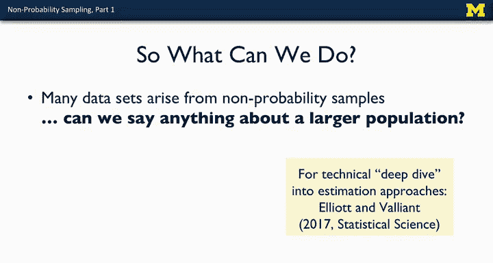

# 密歇根大学《使用Python的统计学（理解并可视化数据、因果推断、建模）｜Statistics with Python》中英字幕 - P25：24_非概率抽样方法(上).zh_en - GPT中英字幕课程资源 - BV1dV411Q7j3

Okay， so we're continuing with our discussion here in week 4 on where data come from。 And so far。

 we've been discussing probability sampling or the idea that when selecting a sample。

 everybody has a known non0 probability of being selected。 Now。

 we're going to turn our attention to another type of sampling known as non probability sampling。

 And this will be in two parts。 And this is part 1。Okay， so just an overview of this lecture。

 first of all， we're going to talk about what defines a nonprobability sample specifically and then we'll talk about common examples of nonproability samples。

 We'll introduce two common population inference methods that are used for non-probability samples and we'll talk about an example of nonprob sampling namely drawing a sample from Twitter。

Okay， so let's start with what are nonprobability samples and some important features of non-prob samples to begin with first of all。

 unlike probability samples， probabilities of selection in non-prob samples cannot be determined for the sample unit。

 so we cannot compute the probability of being selected into a sample for the individuals or the units more generally that are included in a non-prob sample。

Furthermore， there's no random selection of individual units。

 so we don't control the random selection mechanism that ultimately yields the sample in a non probability sample。

The samples can be divided into groups known as strata sometimes or clusters。

 but along the same lines of there being no random selection。

 the clusters are not randomly sampled in earlier stages。Furthermore。

 data collection in non probabilityb samples is often extremely cheap relative to probability sampling。

 so this is a big advantage of non probability samples is that they're often much cheaper。

 much less expensive than probability samples。So what are some examples of non-proability samples we talked about this a little bit when we were introducing probability sampling。

 but here are some examples again。 first of all， very common example is a study of volunteers this happens a lot in clinical trials and oftentimes in smaller studies that are done at academic institutions but studiesies of volunteers are a very common example of non-probability sampling you might see a posting or a flyer that says do you suffer from a particular characteristic or something like that and then you're given a phone number or an email and then you call in and say I'd be interested in being a part of the study that's a non-probability sample because the researchers is just looking for volunteers The researcher doesn't have any control over whose probabilitybabilities of selection will be included in the study or who's ultimately going to be in the sample there's no frame there's no list。

 researchers are just looking for volunteers to join their study。

Another common example that we briefly introduced in the probability sampling sequence is opt in or Intercept web surveys。

 so when you're on a website and you see an invitation to come complete a survey or you see an opinion survey on a particular website and you decide to join this particular survey。

 again there's no probability of selection， there's no random selection。

 those people trying to collect those data are just looking for volunteers to ultimately join the survey。

A third example is snowball sampling。 And again， we talked about this a little bit earlier。

 but this is where the sample grows by people referring others to the actual data collection。

 So somebody might participate in a study， and then they might tell their friend about this study。

 And that friend might participate。 And then that friend tells a friend about the study。

 And it builds up like a snowball。 That's where this name comes from。

 So snowball sampling is another way of getting a sample into into your particular study。

 but there's no probabilities of selection that govern who ultimately participates。

 and there's no random selection。 It all comes from word of mouth about the particular study。

A fourth common type is a convenient sample。 So you see here a common example in academic settings is when university faculty or professors wish to conduct studies and they try to select students from say psych 101 or one of the introductory undergraduate classes because they're generally large counts of individuals in these classes and they try to invite individuals to volunteer in a particular study or they make it a requirement as part of the class then all these students can try to participate in that study。

 but again， there's no random selection there's no probabilities of selection for different students。

 the professors are just trying to get as many students as they can to participate。

 and it's a matter of convenience because those students are close to them the professors have easy access to those individuals and convenient samples can speak more generally to other types of study designs as well。

And then finally another common example is quota samples and we again touched on this briefly。

 but in quota samples you have certain targets that you wish to hit in terms of your sample size and you do whatever you can。

 whatever way necessary to hit those targets so for example， you wish to recruit 2000 individuals。

1000 males and 1000 females and in any way possible you get that many individuals in each subgroup to volunteer you hit those quotas that you're looking for again。

 no probabilities of selection， no random selection you're just trying to do what you can to hit those particular targets and that's quota sampling So a common theme with all five of these different general examples is that there are no probabilities of selection we're just trying to collect data and get the sample into our study in whatever way that we really can。

Okay， so the common feature again， for all these different examples。

 probabilities of selection cannot be determined a priori or before you actually begin the study。

 this is the crucial difference between probability sampling and non-pro sampling and this is going to be a theme that we're going to keep revisiting as we continue on in this particular week。

So what's the problem， Why is this such a big deal。

 this issue of whether or not we have probabilities of selection or not for the different individuals in a sample？

 Well， in a non-probability sample， there's really no statistical basis for making inference about the larger population from which the sample was selected because we don't control the probabilities of selection。

 We don't know these random probabilities of being included in a given sample。

 and we don't use random selection， we don't have any kind of statistical basis for making conclusions about the larger population。

 given those design features。So if we do know the probabilities of selection。

 in addition to if applicable population strata and randomly sampled clusters。

 this allows us to estimate the features of the sampling distribution that would arise if we were to take many random samples using the same design。

 being able to estimate the features of a sampling distribution is absolutely crucial for making inference about a larger population。

 and we'll talk more about the sampling distribution in a lecture coming up but in short。

 this is the distribution of estimates that would arise if we had taken many random samples using the same probability sampling design where the probabilities of selection were known and we use random selection of individuals or units according to those probabilities。

So a crucial issue here with non-prob samples is that the sampled units are not selected at random we talked about volunteers and opting into a web survey and convenient samples and snowball samples and quote a samples across the board there's no selection at random occurring here and what this means is that there's a very strong risk of sampling bias for example in an optin survey on an website。

 you may only get people who were actually interested in visiting that particular website and that by no means is a representative sample of everybody that you might be interested in it's just people who wanted to visit that site and those are the people who might join your particular opt in survey。

Furthermore， the sampled units in a nonpro sample are generally not representative of the larger target population of interest when we draw samples and we want to make statements about larger populations。

 we really want to have a representative sample， people of all different types。

 units of all different types including our sample。

 and generally with volunteers or snowball samples。

 we don't have a fully representative sample from the larger population and that makes it difficult to make unbiased statements about the overall population。

And we hear a lot in the news media about these days about big data and data analytics and so forth。

 for example， people conducting studies where they process millions of tweets on Twitter。

 the problem with a lot of these big data is that they arise from nonproability samples。

 there's no probability sampling mechanism that gives rise to the data that are analyzed again。

 no random selection these data really arise out of convenience and people use these kinds of data to make statements about larger populations。

 So as a researcher， you have to be very careful when analyzing so-called big data and understand fully where those data come from。

 which again is the theme of this week。So what can we do I everything at a loss if we have non-probability samples again。

 they're very cheap relative to probability samples。

 so they're a popular alternative for researchers so what can we do when dealing with these kinds of data。

 Many data sets arise from non-prob samples。 So can we say anything about a larger population given these data。

 There's a reference an article that you can find for this week by Mike Elllott and Rick Vallliant that came out in 2017 in the journal statistical science。

 they do a very technical， very statistical deep dive of into different estimation approaches that can be applied when dealing with non-probability samples。

 So not all is lost。 there's a little bit of work that needs to be done。

 but you can make decent inferences。 it just takes a little bit of work。

 and Mike and Rick's article here， which you can find for this week lays it out basically how you would do this。

So there's two possible approaches that we might follow first of all。

 a pseudo randomization approach where with a little bit of work we treat that nonpro sample like a probability sample and we're going to talk about how to do that。

A second possible approach is calibration， so you weight your nonproability sample to look more like the population that you're interested。

 so that involves weighting and other forms of model based adjustments。

 and we're going to talk briefly about how to implement each of these approaches in practice in the second part on non-prob sampling。

