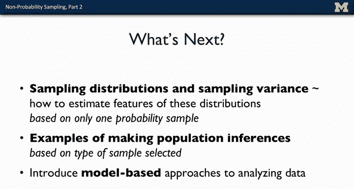

# 密歇根大学《使用Python的统计学（理解并可视化数据、因果推断、建模）｜Statistics with Python》中英字幕 - P26：25_非概率抽样方法(下).zh_en - GPT中英字幕课程资源 - BV1dV411Q7j3

Okay， so here we are with part two on non probability sampling and now we're going to talk about some of those approaches that we might use to make inference about populations when we do in fact have data from a non probability sample。

So we talked about a couple of potential population inference approaches that we could use when dealing with data from a nonprobability sample the first approach that we're going to talk about is called the pseudoranization approach and in this approach we combined the data that we have from a non-prob sample with another probability sample。

 So we put the two sources of data together。 the key thing here is that both samples need to collect similar measurements。

 so similar variables measured and all the units that we're trying to collect data from So in this approach we would start by finding those common measurements。

 those common variables in the two data sets from a non-probability sample and from a probability sample and then we would stack those two data sets together we literally append them to each other。

 as you see here in the picture。We then estimate the probability of being included in the non-probability sample as a function of auxiliary information that's available in both of the samples。

 so we might have additional socidemographic variables like gender and race ethnicity and age and education or maybe some other socioeconomic data that are available on the respondents in both of our samples。

 we use all of that information to determine for each individual in the non-probability sample。

 their probability of being included in the non-probability sample when considering both data sets simultaneously。

We then treat those estimated probabilities of being selected into the non-probability sample as being known for the nonprob sample。

 and then we use the probability sampling methods that we discussed previously for analysis So the way that this works。

 we have an indicator if you're in the nonprob sample in the data set you get a1 if you're in the probability sample you get a0 and then we use something called logistic regression to estimate the probability of being in that non-prob sample as a function of all these other variables like age and gender or an education and race ethnicity Once we have those probabilitybilities of being in the non-probability sample。

 we can then think， okay， what would have been the probability of being in this stack data set for an individual who showed up in the non-probability sample given all of their features。

 their age， their gender， their education and so forth and then we pretend that that estimated probability selection is known and we use methods for。

Aability samples combining these two data sources together。

A second approach that we could use is called the calibration approach， and in this approach。

 we compute weights for all of the responding units in our non-probability sample that allow us to look like a known population or allow the weighted sample when these weights are applied to mirror a known population。

 so for example， suppose in your optin survey on the Internet or in your convenience sample。

70% of the participants are female and 30% are male so you can see in the picture here。

7 of the 10 respondents in your non-probability sample are females。But you know。

 in your target population， remember， we talked about the notion of carefully defining a target population。

 We know in your target population，50% are female and 50% are male。

 So what we do is we develop weights for the non-prob sample。

 and these are weights that would actually be used in the analysis in computing estimates。

 we would ultimately down weight females because there's too many females in our non-prob sample and we would upweight the males。

 So we want our non-probability sample after applying the weights to look more like that known population in terms of a 5050 distribution。

 This is especially important if this characteristic where we see this kind of imbalance is correlated with a variable that we're interested in。

 we ultimately want to make population statements about if our sample looks more like the population in terms of a characteristic that has a strong correlation with our variables of interest we'll get closer and closer to making unbiased statements。

About the population。The limitation therefore， is if the weighting factor。

 the factor that we're using to develop these weights or make our non-probability sample look more like the population is not actually related to the variable of interest。

 we're not going to reduce some of the sampling bias that might have come from the non-probability sampling。

 so it's important to pick characteristics for developing the weights that are closely related to the variables that you're actually interested in。

So here's an example， let's return to this idea of Twitter and analyzing the data collected from tweets to illustrate this notion of a non probability sample。

Suppose we used an API to extract information from several hundred thousand tweets， again， big data。

 lots of information， lots of tweets included in our sample， and from each of these tweets。

 we have a coding team that goes through those tweets and determines an indicator of whether there's support expressed for President Trump and this is no easy task so this might often involve computer scientists or other coders who could process the information in these100。

00 tweets， and then compute this binary indicator， yes or no。

 of whether that particular tweet indicated support for President Trump。In this scenario。

 the probability of a tweet being selected cannot be determined。

 we just grabbed all these tweets where there may have been some mention of President Trump。

 In some sense， this is a convenient sample of tweets。

 and we can't determine the probability of any one tweet being selected using this mechanism。

 We don't have a frame of all possible tweets。 The tweets don't have probabilities of selection。

 We don't randomly select them。 We just take whatever is available that indicated some mention of President Trump。

The Twitter users， furthermore， are not a random sample of our larger population。

 so people who join Twitter are generally interested in expressing their ideas or opinions about particular topics。

 and people can choose to join Twitter again， no random selection。

 no probabilities of joining Twitter， Twitter users are not a purely random representative sample of some larger population。

 so we have to keep that in mind as well。So again， we get lots of data。

 several hundred thousand tweets。 We might have a very nice algorithm for computing a binary indicator of support for President Trump。

 but given these features， again， lack of probabilities of selection， not random sampling。

 There is high potential for sampling bias。 this nonrepresent sample of individuals。

 and we have this general lack of representation， the people who are typing tweets about President Trump may only represent a very unique set of individuals。

 and this may only capture the people who have very strong opinions about Trump one way or the other。

 we may be missing the people who don't have strong opinions that would cause them to join Twitter or type tweets about their support for President Trump。

 So we have high potential for bias and lack of representation in that nonpro sample。Okay。

 so what's next， What are we going to talk about next sampling distributions and sampling variant。

 So we' we've hinted at these ideas so far in introducing probability samples and nonprob samples and talking where data come from and we just reviewed a couple possible approaches to making inference based on non-prob sample Now we're going to talk about this notion in more detail of a sampling distribution and sampling variance how we can estimate the features of these distributions based on only one probability sample This is a wonderful feature of probability sampling We're also going to look at some examples of making probability inferences based on the type of sample that was selected。

 whether it was a probability sample or a non-prob sample like we had just talked about where we either estimate the probability of being in the non-pro sample after stacking both a probability in a non-prob sample together and pretending that the stack data set itself as a probability。

Sample or using some kind of weighting approach， a calibration approach。

 we're going to go over examples of making population inferences。

 whether we have a probability sample or a non-prob sample。

 but it's very important to understand where these types of data come from and what type of sampling mechanism was used to ultimately produce the data that we're working with。

Finally， we're going to introduce modelbased approaches to analyzing data。

 So this is another purely statistical approach that is more or less ignorant about the type of sampling mechanism used and as we get further and further into this specialization。

 we're going to talk more about regression models。 but we'll introduce some of these modelbased approaches to actually analyze data whether they come from a probability sample or from a non-pro sample。

 and we briefly introduce one example of a modelbased approach in this second part。

 a non-prob sampling。 remember I talked about the idea of using a logistic regression model to estimate those probabilitybabilities of being included in a non-prob sample when we stack the non-probability in the probability samples together。

 That's an example of a modelbased or model assisted approach to making inference about the population。

 and we're going to look at more examples of doing that as we move forward。

