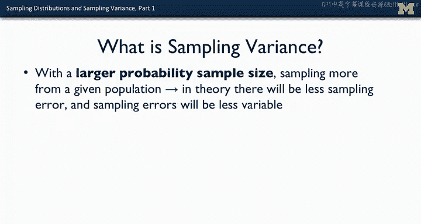

# 密歇根大学《使用Python的统计学（理解并可视化数据、因果推断、建模）｜Statistics with Python》中英字幕 - P27：26_抽样方差与抽样分布(上).zh_en - GPT中英字幕课程资源 - BV1dV411Q7j3

Okay， so now we're going to return to the ideas of probability sampling and provide a little bit more detail about this notion of a sampling distribution and the related notion of sampling variance。

 we're going to talk about how these tools are so important for making inference about populations based on probability samples。

Okay， so here's an overview of this lecture on sampling distributions and sampling variants。

 there are going to be two parts again， we're in part one right now first of all we're going to talk about what exactly is a sampling distribution then we're going to talk about the notion of sampling variant what do we mean when we talk about sampling variance。

Third， we're going to talk about why sampling variance is so important for making population inferences based on probability samples。

Okay， so let's start with the idea of a sampling distribution。Recall earlier in this course。

 we talked about the distribution of values on a variable of interest so we briefly introduced the idea of a normal distribution。

 if we were to plot a histogram of all the possible values on a variable of interest or a density function。

 as you see here in this picture。 you would get a notion of how the values on that particular variable are distributed。

 and many different variables that we're interested in could potentially follow a normal distribution or a bell curve。

 you might see， for example， here， two different subgroups in a population。

 the blue group and the red group。 And those are their distributions of values on some variable that we're interested in studying。

And we assume generally that the values on a variable of interest will follow a certain distribution if we could measure the entire population so we make assumptions about the distribution of values and a variable of interest。

Recall that when we select probability samples to make inferential statements about larger populations。

 we make those statements based on something called a sampling distribution。

 and it's very important at this point to distinguish a sampling distribution from the distribution of values on a variable of interest。

 The sampling distribution is something different。So a sampling distribution is the distribution of survey estimates that we would see it's not a distribution of values on a variable of interest。

 it's a distribution of survey estimates， and it's the distribution of these estimates that we would see if we selected many random samples using the same probability sampling design over and over and over again。

 and we computed an estimate from each of those probability samples。

 so when we talk about a sampling distribution， we're talking about the distribution of values of estimates if we had selected thousands and thousands of hypothetical repeated random probability samples all using the exact same probability sampling design。

If we had the luxury of doing that and we computed our estimate of interest。

 maybe it's a mean or a proportion from each of those probability samples。

 a distribution of estimates would arise。 just like we talk about the distribution of values on a single variable of interest If we were to draw thousands and thousands of probability samples。

 we would see a distribution of estimates where any one sample that we draw。

 we would compute an estimate， and then the distribution would be what all of those estimates would look like if we repeated that probability sampling process over and over and over again。

 That's the idea of a sampling distribution。 What's the distribution of these repeated survey estimates。

 all based on the same probability sample design。So some key properties of sampling distributions。

 remember that they're hypothetical a sampling distribution describes what we would see if we had the luxury of drawing thousands of probability samples again。

 each of them using the same design and measuring the units in each of those probability samples and then computing an estimate based on all those measures that we collect。

 We do that over and over and over again， then we plot the distribution of all those estimates that would arise。

 It's a hypothetical thought exercise。 We're not going actually do that in practice。

 but the sampling distribution and theory describes what that distribution of estimates would look like if we had the luxury of doing that。

 but remember it's a hypothetical idea and we're trying to estimate the features of that sampling distribution based on one sample only。

The sampling distribution is also generally very different in appearance from the distribution of values on a single variable of interest。

 so we don't want to equate those two ideas， sampling distributions generally look very different from what the distribution of the values on a variable of interest look like。

Furthermore， with a larger enough probability sample size。

 so the larger our sample size gets when we're selecting a probability sample。

 the sampling distribution of estimates will look like a normal distribution。

 regardless of what estimate we're computing。 This is a very。

 very attractive property of probability sampling， the larger the size of our sample and we keep drawing estimates in theory over and over again。

 the more that sampling distribution is going to look like a normal distribution that makes it easy to work with these kinds of distributions。

 Why does this happen， something called the central limit theorem or the CLT that says the larger our sample size gets。

 the more that this distribution of estimates is going to attend towards normality as we draw more and more estimates。

Okay， so with those key properties of a sampling distribution down now。

 we have to talk about what exactly we mean by sampling variance。

 so sampling variance is the variability in the estimates that's described by the sampling distribution so hypothetically if we were to draw thousands of thousands of probability samples all using the same design and plot the estimates computed from each of those probability samples we could describe the variability of that sampling distribution and that's what we mean by sampling variance。

 how variable are the estimates that we're trying to compute across these hypothetical repeated samples。

Because we select a sample and we're not measuring everyone in a given population。

 a survey estimate based on a single sample is not going to be exactly equal to the population quantity of interest。

 remember， with probability sampling， we're selecting cases at random so we're selecting a subsample of all the individuals in the larger population。

 and in any one sample， any one of these hypothetical repeated samples。

 that estimate that we compute is not going to be exactly equal to the population quantity that we're interested in。

 because we're taking a subsample of the larger overall population。 and that subsample。

 although we want it to be representative in our probability sampling design。

 the estimate that we compute will not be exactly equal to the overall population value。

This is what's called sampling error。 The fact that we don't measure everybody in a given population。

 and we only measure a sample of individuals in that population。

 the estimate based on that sample will not be exactly equal to the population value。

 We just want our estimates across these hypothetical repeated samples to be equal to that population quantity on average。

 So if we were to average all the estimates that we computed from these hypothetical repeated samples。

 any one of them is not going to be exactly equal to the population quantity that we're interested in。

 but the average of all those estimates will be equal to that population quantity。

 that's the key property of our sample design that we want。

 and that means we have unbiased estimates。 But the idea that any one sample estimate will not be equal to the true population quantity。

 say the mean or the proportion that we're interested in。 That idea is known as sampling error。

So across these hypothetical repeated samples， these sampling errors are going to randomly vary one subsample。

 the mean that we're interested in， that mean might be a little bit lower than the population mean。

 another hypothetical sample， that mean might be a little bit higher。

 Another hypothetical sample that mean might be very close to the population quantity。

 Those estimates are going to bounce around across these hypothetical repeated sample。

 some will be negative， some will be positive， some will be right on the value that we're trying to estimate。

 but there's going to be variability in those sampling errors。

And the variability of those sampling errors describes the variance of the sampling distribution。

 if we look at that entire distribution of sample estimates。

 how much they bounce around the true population value that we're trying to estimate。

 that is the variance of that sampling distribution。

 and that's what we refer to as sampling variance。So if every sample estimate was equal to the population quantity of interest。

 so for example， if our probability sample design involved taking a census where we tried to measure everybody in the population and we did that over and over and over again hypothetically every single estimate would be exactly equal to the true population quantity This is again。

 this notion of a census。 there would be no sampling error and there'd be no sampling variance because every one of our hypothetical repeated samples。

 we're actually trying to measure everyone in the population in the case of a census and if we did this over and over again。

 every single sample estimate， these hypothetical repeated samples would be exactly equal to the population value。

 so there'd be no error and thered be no variability in the errors because every single estimate would be equal to the true population value。

 that's a hypothetical ideal and that's what we strive for in the case of taking a population census but as we talked about earlier。

 very difficult， very expensive to do that in practice。 So instead we take。Samples。Okay。

 with a larger probability sample size sampling more from a given population。

 that is the bigger the size of our sample。 in theory。

 there's going to be less sampling error and sampling errors will be less variable。 Now， why is this。

 Think back to the idea of a census。 The closer and closer that we get to taking a senseensus that is trying to measure everybody in the population。

 the less error that we're going to have the closer and closer we get to trying to measure everybody。

 the less sampling error that we're going to have So the larger our sample size becomes the closer that we get to the population size。

 when thinking about the size of our actual sample。

 the less sampling error we're gonna to have those errors are going to bounce around a little bit less。

 they'll all be closer to the true population value with the larger sample size。

 and then the sampling errors as a result are going to be less variable。

 There's going to be less sampling variance。 So this is another critical feature of trying to make inference about populations。

 I that the bigger your sample size becomes the larger。

Probably sample the less sampling error that we're going to have and the less variable our estimates are going to be so that sampling distribution is going to shrink。

 It's not going to be as wide as if we had a smaller sample size。

So larger samples means less sampling variance， we have more precise estimates and we have more confidence in the inferential statements that we're making because there's less variance across those hypothetical samples in terms of our sample estimates。

 however， getting a larger sample， especially when using probability sampling costs， more money。

 So there's a tradeoff。 the larger the sample the higher the cost but we have more precise estimates。

 and we have more confidence in the statements that we're making about the population。

 So in sampling there's a lot of these tradeoffs between cost and sampling variance。And again。

 the spread of that sampling distribution， all those hypothetical estimates that we might compute。

 the spread of that sampling distribution becomes smaller as the sample size becomes larger。

 that just means that our estimates are less variable， there's less sampling variance。

So here's a picture of some simulated sampling distributions。

 And what you see in this picture is kind of a three by three matrix。 So going down across the rows。

 the first row has the smallest sample size 500。 The next row has the next largest sample size or 1000。

 and the next row， the third row has a sample size of 5000。

 And then going from left to right across the columns。 in the first column。

 we have a simple random sample。 We talked about the idea of simple random sampling。

 And then the second and third columns， these are cluster samples。

 One where the clusters only have 10 sampled units in them。 That's the second column。

 and one where the clusters have 50 sampled units in them。 That's the third column。

 And what you see in this three by three picture are simulated sampling distributions。

 So we simulated repeatedly taking probability samples under these designs。

 simple random sample of size 500， simple random sample of size 1000 etc We simulated sampling values from a population according to these。

😊，Designs and then plotted all those estimates。 So again， this is hypothetical。

 but we did a simulation of what would happen。 So the plots that you see here are sampling distributions of all the possible estimates that we might compute across those repeated samples。

And there are a couple of key themes that emerge here in this three by three picture。 First of all。

 as the sample size increases， or in other words， as we go down the rows from 500 to 1000 to 5000。

 Look what happens to the sampling distributions。 they shrink。

 they don't become as wide as the sample size increases。

 So the estimates become less variable as the sample size increases。 So remember， larger sample size。

 less sampling error， less sampling variance。 and that's borne out here in these pictures。😊。

A second key theme is that when you select cluster samples。

 which recall is used to save costs when collecting data， as you select cluster samples。

 those sampling distributions tend to spread out， so we still have the nice property that as the sample size gets larger。

 the sampling distributions tend to shrink， but as you select clusters of larger and larger sizes as you go from clusters of size 10 to clusters of size 50 look what happens to the sampling distributions as you go from left to right。

 those estimates become a lot more variable as the clusters become larger。

As you're selecting fewer clusters with more individuals in each of those clusters。

 the sampling distributions spread out a lot。 Getting more sample also helps。 It always helps。

 you can see that the sampling distribution shrink as you have larger sample sizes。

 But if you compare a simple random sample of size 500 in the upper left to a cluster sample where there's 50 units selected per cluster of size 5000 in the lower right。

 Look at those sampling distributions they're almost the same。 So a simple random sample size 500。

 the sampling distribution looks like a cluster sample of size 5000。

 where there's 50 units selected per cluster。 So another key trade off between the probability sampling design and how variable our estimates are。

