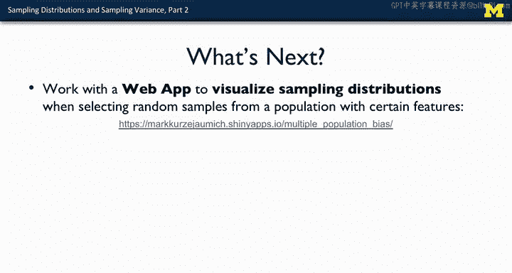

# 密歇根大学《使用Python的统计学（理解并可视化数据、因果推断、建模）｜Statistics with Python》中英字幕 - P28：27_抽样方差与抽样分布(下).zh_en - GPT中英字幕课程资源 - BV1dV411Q7j3

Okay， so here's part two on sampling distributions and sampling variant and where we left off。

 we talked about those simulated sampling distributions。

 we simulated the distributions of estimates that would arise under different probability sampling designs and we showed how with the larger sample size。

 there's less variability in that sampling distribution and how when we use cluster sampling and probability samples。

 those sampling distributions tend to spread out a little bit and become more variable。

 so we talked about we introduce this idea of a cost variance tradeoff if the larger sample size。

 cost more money and shrinks our variance， but we have to deal with these tradeoffs between data collections costing more and getting more precise estimates based on the sampling distributions。

So why is sampling variance important？Well， in practice。

 we only have the resources to select one sample， that simulation that we just left off looking at。

 it was a hypothetical simulation， we generated all these estimates using a computer using a simulation just to simulate the notion of a sampling distribution。

 but when we're collecting data in the real world in practice。

 we only have the resources to select one sample， and then measure that sample and compute estimates。

Important sampling theory。 We talked about Jersey Naman's work in the early 1900s。

 This sampling theory allows us to estimate the features of those sampling distributions。

 including their variance， based on only one sample。

 This is one of the wonderful features of probability sampling is it gives us a statistical mechanism to actually estimate the variability of those sampling distributions when we only select one samples。

 So we don't have to go out and select thousands and thousands of samples and compute estimates based on each of those samples to determine what those sampling distributions look like。

 The sampling theory that Jersey Naman and others developed in the early 1900s。😊。

Allows us to estimate the features of those sampling distributions by only drawing one sample。

 This is why probability sampling is so very important for making statements about larger populations。

The magic of probability sampling that we're talking about here is that we can select one probability sample and the features of that design。

 that probability sample design， the probabilities of selection for different individuals。

 the stratification， if we divided the population into different strata， the cluster sampling。

 if we selected counties and the neighborhoods and then households。

 according to that probability sample design， like we talked about within Hanes。😊。

Given that one probability sample and the features of that probability sample design。

 that gives us all we need to know something about the expected sampling distribution。

 mainly what the variance of that sampling distribution looks like and what the mean of that sampling distribution will look like。

 So this is a wonderful feature of probability sampling we're going to keep building on that idea how we can make representative statements about the population from only selecting one probability sample and then estimating the features of the sampling distribution。

 knowing something about the probability sample design。

Because we can estimate the variance of the sampling distribution based on only one sample。

 we can then make inferential statements about where most estimates based on a particular sample design will fall。

 and that tells us something about the population using a particular probability sampling design。

 if we can make statements about the variability of our estimates and calculate the overall mean of our estimate。

 we can make statements about where all of those estimates based on that probability sample design will tend to fall。

 And that tells us a little bit something about our population。

So we can make statements about likely values of population parameters accounting for the variability in those sampling errors that arises from the random probability sampling so we can make a statement about the overall mean that we're trying to estimate or an overall proportion that we're trying to estimate something that describes a feature of the target population。

 but in addition to computing those overall estimates based on our probability sample。

 we can talk about how variable those estimates might be how much uncertainty was there in the estimate that we're trying to compute and being able to estimate the variance of a sampling distribution allows us to make a statement about the variability of our estimates that we're computing。

Okay， so let's kind of review where we are。 We've talked about the notion of probability sampling and how we can actually estimate the features of a sampling distribution based on only one probability sample。

 knowing the probabilitybabilities of selection for all of our units and knowing other features of the design like stratification and cluster sampling。

 So knowing that information， we can talk about the expected variance of a sampling distribution so we can compute population estimates and then describe the variability of those estimates based on our estimated features of the sampling distribution。

 probability sampling makes all of this possible。 So what we're going to illustrate next is a web application that allows us to visualize sampling distributions when we select random samples from a population with certain features。

 We've included the link here， you'll also find it in the list of lectures and other applications and readings for this particular week。

 But this is the link that we're going to take a look at next that introduces an application for。

We're looking at different hypothetical scenarios of drawing a probability sample from a population with certain features。

We're going to see how random sampling， random probability sampling generally produces sampling distributions with means that are close to the true population quantity of interest。

 In other words， the sampling distributions that we've been talking about。

 they're more or less centered on the true population value of interest。

 the mean of all those estimates is going to be the true population value。

And we're going to see how larger samples produce sampling distributions with less variance similar to the simulation that we talked about in the previous part。

And then we're going to see how biased nonrepresentative samples can produce sampling distributions that paint misleading pictures of the larger population。

 so we're going to use this web application to see how if we're not drawing a nice representative probability sample and our sample is biased focusing on a very specific subset of an overall population that will generate sampling distributions but it's going to generate sampling distributions that aren't centered on our true population value of interest。

 and if this is what happens when we have a bias sampling mechanism。

 that ultimately gives us a misleading picture of what the larger population look like looks like that distribution of estimates based on a bias sampling mechanism。

 the variability may be about correct， but it's not going to be centered on the true population value because we're not getting representative samples every time we draw a sample。

Okay， so we'll illustrate that idea as well using this web application。

