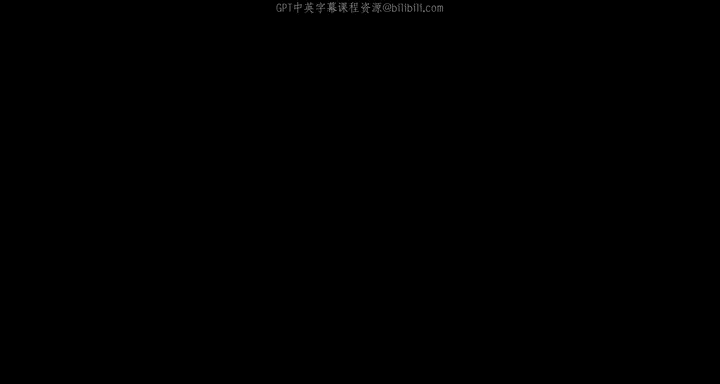

# 密歇根大学《使用Python的统计学（理解并可视化数据、因果推断、建模）｜Statistics with Python》中英字幕 - P29：28_交互式抽样分布演示.zh_en - GPT中英字幕课程资源 - BV1dV411Q7j3

Okay， so here we are now we're going to illustrate this web application that we introduced at the end of the last lecture on sampling distributions and sampling variants and again you can click on the link provided to take a look at this web application and play around a little bit with these notions of sampling distributions and sampling variant for those of you who are interested this web application is an R shiny app we'll touch on that a couple times throughout the specialization but this was generated using our studio actually so let's introduce this web application a little bit here we're talking about the notion of sampling from multiple populations so are we drawing a representative sample from an entire population or do we only sample from a particular subgroup of that population and what can happen when we make these two different choices so here's the scenario that we came up with when designing this particular web application。

wo possible choices in terms of our target population we could either be talking about the entire University of Michigan or we could talk about University of Michigan students。

 faculty and staff who go to the gym or who are who are members of a gym so this is like a subpopulation within the larger university of Michigan population So the first choice you can make with this web application is what your target population is Are you only interested in gym goers or you only interested are you interested more generally in the entire university of Michigan population a second option is how many samples you'd like to draw。

 So this is a hypothetical number of samples to select again。

 we talked about the notion of sampling distributions arising from hypothetical repeated samples following the same probability sampling design。

 So you can actually toggle how many samples you wish to select we're going start with 50 but you can click and drag and decide how many samples you want to select anywhere from。

I have up to 100。The second choice you can make or actually the third choice is the size of each sample。

 so remember we talked about in probability sampling the notion of the central limit theorem and the idea that the larger the size of each sample。

 the less sampling variability that you're going to have and the less sampling error that you're going to have in any one individual estimate because you're getting closer and closer to the size of the actual population so the third choice you can make is how big you want each sample to be。

 you can see here we're starting at 20， but you could go all the way up to 100 if you wanted to with the size of your actual samples。

And then the fourth choice that you can make is what percentage of the University of Michigan actually goes to the gym。

 so this defines the features of the target population how big of a subpopulation are the gym goers。

 We start with them being only 20%， say of students， faculty and staff。

 but we could move this all the way up to 100%， say that everybody in the University of Michigan goes to the gym This dictates what the population distribution of values on a variable of interest is going to look like what fraction of the population ultimately belongs to this subpopulation。

So when you've made these choices in the web application。

 what you can then do is click down here where it says draw samples and what this is going to do iss going to simulate repeated samples 50 in this particular example from the population that you've selected with the features that you've selected what percentage goes to the gym and then illustrate the features of that population and the sampling distribution what does that sampling distribution look like does it tend to be centered on the value that we're interested in or is it shifted away from the value that we're interested in Now when you're setting out to do these kinds of studies。

 there always has to be a variable of interest when you're collecting these data there's a variable that the researchers are interested in when selecting the samples for this particular web application we're going to keep it pretty simple and just talk about body weight so the variable of interest in this case is body weight So we're going to look at the distribution of values on body weight for everybody in the population when we draw our samples and then we're going to look at the。

of the sample estimates for all 50 samples that were're ultimately going to be drawing and the estimate of interest that we're interested in computing from each sample is the mean body weight。

 so the variable of interest is body weight， we measure that for everybody in our sample and then we compute an estimate of the mean body weight for the entire population and we want to see if that sampling distribution of estimated mean body weights is more or less centered on the true population value or if it shifts away。

Okay so let's give this a go here。 We're going to start by selecting all U of M as our target population。

 We're going to draw 50 samples。 Each sample is going be of size 20 and we're going to start by assuming that 20% of the University of Michigan ultimately goes to the gym。

 I'm going to come down here and click on draw samples It's going to take a second to generate all those hypothetical samples and then you'll see some picture show up here on the right hand side of the web application so let's make a couple of things clear first of all。

 this first picture shows the distribution of values on the variable of interest weight for the entire population。

 So remember this is not a sampling distribution。 This is the distribution of all the values on the variable of interest and we break this down by different groups here。

 So the red line shows the distribution of body weight values for all of U of M so that red line is that red solid line that you see here。

That's what the distribution of body weight looks like for all you of M。

 that's the distribution of values on the variable of interest in the population。

The dash blue line that's the distribution for gym goers。

 So you can see a key feature of the population here is that gym goers。

 their distribution of values tends to be much higher than the distribution for nongy goers you see non-gy goers are represented by this dash green line over here whereas gym goers are represented by this dash blue lime。

 So those two subpopulations， gym goers and nongy goers。

 they're very different in terms of distributions on the variable of interest body weight。

 So there's a strong correlation between whether or not you go to the gym and what your body weight is。

 and we set this up artificially for this particular web application just to illustrate what can happen when drawing different kinds of samples So you see the overall population distribution。

 why is this piece lower here because we said that only 20% of U of M goes to the gym。

 So if we look at the overall population distribution， there's less weight down here among gym goers。

But the dash green and the dash blue lines show what each of those subpopulations look like。

 so they're artificially designed to be pretty different from each other just to establish that correlation。

Okay now we wanted to draw 50 samples of size 20 from this particular population and then look at the resulting sampling distribution。

 so let's scroll down a little bit in the web application and now what we see is another red line and in the second visualization here that red line shows the sampling distribution of the estimated means based on those 50 samples that we selected so we selected 50 samples from this population up here for each of those 50 samples we computed the mean body weight and then we plotted the distribution of those 50 estimated means you can actually see those 50 estimated means in the blue dots down here in the web application。

The red line then shows the distribution of those 50 sample estimates。

 That's our sampling distribution。 Remember， it's hypothetical。 In practice。

 we wouldn't draw this many samples and measure each of those samples。

 This is purely hypothetical to illustrate these ideas。

 So what do we see from this sampling distribution。

 The mean of the sampling distribution is in black。 so we have this up here in the text。

 We want to see how that mean of the sampling distribution。

 The mean of all those 50 estimated mean body weights that we just computed in black。

 We want to see how that compares to the overall population mean and that overall population mean is up here。

 this blue line。 so you can see that blue line is something pretty close to 160 actually。

 So that blue line is the overall population mean。 That's what we're trying to estimate with our survey and with our sampling。

So that blue line is repeated down here in the sampling distribution and you see a very key property of probability sampling to begin with here。

 this random probability sampling look how close the black line。

 which is the mean of those 50 estimated mean body weights and the blue line。

 which is the population mean that we're interested in look how close those are to each other based on this random sampling So our sampling distribution of estimates is more or less centered on the true population value。

 So the mean of those 50 estimates is going to be more or less equal to the population mean that we're interested in what this means is that we're computing onbiased estimates。

 So on average， those estimates from the 50 samples。

 on average those estimates will be equal to the true population mean。

 that's one very important property here。What we also see is the notion of sampling variance。

 so our sampling distribution is centered at the true population mean。

 but look at how the estimates vary around that true population mean like we talked about previously in the lectures。

 any one sample represented by these blue dots is not going to be exactly equal to the true population quantity we might get lucky。

 you see that some of these blue dots are very close， but in general。

 there's going to be sampling error when we draw these random samples and you can see some of these dots they veer pretty far away from that overall mean。

 which is close to 160 some are higher than the overall population mean， some are lower。

 the sample estimates they all vary。 there's going to be sampling error associated with these different estimates and that those sampling errors defined the variability of this sampling distribution So based on only one estimate only one estimate from the data that we're collecting we can say we estimate the population mean body。

Weight to be something based on that one sample。 And then we can estimate the variability of this sampling distribution based on that one sample and talk about how variable we expect that estimate to be when making population inference。

 And we can say that depending on how variable this sampling distribution is。

 we're fairly confident that the population mean body weight is within a certain range based on what we know about that sampling variance。

 how variable our sample estimates are。 And you can see in general。

 the sampling estimates are pretty tightly centered around this overall mean that's close to 160。

 they would suggest that there is potentially some variability in our estimate， but overall。

 we would expect our estimates to be very close to the true population quantity。 And remember。

 in reality， we're only selecting one sample。 So we might end up with this sample。

 we might end up with this sample。 we want our probability samples to have the characteristic that on average。

 they're equal to the true population quantity and we。

Seeing that simulated here with this application。Okay， so that's where we sampled。

 We drew a representative sample from all of you of M in selecting our samples。 Now。

 let's see what happens if we take a nonrepresentive sample。

 Let's say we're trying to estimate the mean body weight and we decide to go up to the oncamp fitness center and select a convenience sample。

 we we stop everybody as they're leaving the fitness center， maybe after they worked out。

 and we ask if we can take their body weight can we collect data that way。

 So might not be as expensive to do this， but we still try to do this with a convenient sample of people who are actually at the gym。

 maybe there's some equipment there that allows us to measure body weight。

 So we decide to draw a sample of gym goers and let's keep everything the same here in terms of our parameters。

 We're drawing 50 samples。 Each sample is gonna be of size 20。

And 20% of the population ultimately goes to the gym。Okay， so let's go ahead and redraw the samples。

 We're going to draw a new set of samples。Okay， so population looks exactly the same。

 we have the same basic properties as the population。 20% goes to the gym。

 What really changes now in this new simulation is the sampling distribution blue line。

 our population meanme body weight of interest still in the same place。

 It's still pretty close to 160 but look what happened to the sampling distribution because we were drawing a convenient sample non-probability sample of gym goers look how far away from the population meme that sampling distribution got shifted Now that black line。

 which again is the mean of all those 50 sample estimates， Now it's somewhere between 180 and 190。

 looks like it's about 185。 So in drawing a convenient sample of a particular subpopulation When that subpopulation is very different from the larger overall population in terms of。

Of interest。 Remember， Jim goers had a much higher body weight。

 So it's a very different subpopulation relative to the rest of the population。

 Our sampling distribution， all 50 of these estimates now they're centered at the mean for Jim goers。

re not the sampling distribution is no longer centered at the blue line。

 which is the mean for the entire population。 It's now centered at the mean for gym goers because we drew a convenient sample of a subpopulation that was very different from the rest of the target population。

 So you can extend this idea to say， a sample on the street or a snowball sample if you only contact people with very specific characteristics and collect data from them。

 There's a strong chance that your sampling distribution could be shifted very far away from the true population value that you're interested in。

 And this is what we referred to as sampling bias。 If we were to compute an estimate of the U of M average body weight based on this particular sample。

 we would。A very biased estimate。 And given the sampling variability。

 we would conclude that the body weight is somewhere， I don't know。

 between maybe 182 and 187 or something like that， we'd be really far off from the actual true body weight or the true mean body weight for the overall population。

 So this when we draw probability samples， remember。

 we still have a nice normal sampling distribution here， we can estimate sampling variance。

 but our mean was extremely biased， because we drew a sample from a subpopulation coming from convenience or something like that。

 depending on how how we got those data from that particular subpopulation。

 but we end up with a lot of sampling bias。Now， let's see what happens again。

 if we take another scenario， let's bump the size of each sample all the way up to 100。

 So we came about some more money， some more resources to do the data collection。

 we're still going to draw 50 samples hypothetically， but now each sample is going to be of size 100。

 and we'll go back to simulating all U of M and we draw our sample。

 So we draw a representative sample from all U of M， not just gym Goers。Okay。

 so let's draw that sample again。Population looks the same。

 What happens to the sampling distribution。 It shrinks。 We increase the size of each individual。

 each individual sample from this particular population， we increased it up to 100。

 Now look what happens that black line， the mean of the sampling distribution lays almost on top of the population meme。

 so we have a more precise estimate， there's less sampling error on average。

 And if you look at the variability of those estimates。

 there're much more tightly clustered around the true population meme。

 So it's nice that with that additional money， we were able to draw larger sample sizes that gave us more precise estimates。

 there's less sampling variability in these estimates。

 and we're more tightly clustered around the true population quantity。

 That's a great thing but it was more expensive。 it was more expensive to draw that many to draw samples of size 100。

Let's see if drawing samples of size 100 would help us out at all if we had our bias sampling mechanism。

 again， convenient sample， nonprobability sample， volunteers， whatever the case may be。

 but we largely get gym goers in the sample。 Let's see if this helps us at all。

 So we'll redraw the samples focusing on gym goers only Sc down a little bit。 again。

 we have a narrower sampling distribution。 there's less sampling variability。

 but we still have the same bias problem because our sampling mechanism。

 we only got people who were gym goers and gym goers were very different in terms of their mean body weight。

 So very precise estimate， but a very biased estimate compared to the larger overall population。Okay。

 so we can play around with this a little bit more if we go to all U of M， maybe just hypothetically。

 we increase the number of samples to 75。 Let's take the size of each sample down to 50 and let's increase the percentage of U of M that goes to the gym。

 Let's make it a little bit less rare and see what happens when we do this。

Okay so we'll draw the sample again now the population distribution changes a little bit because we increased the percentage of U of M that goes to the gym。

 so we have a little bit more weight out here。Now， the population mean has shifted a little bit away from 160 because more of the population comes from gym Goers。

 we toggled this feature of the population。 Still， we have these very nice features of the sampling distribution。

 We can estimate the variability of our estimates based on those hypothetical repeated samples and all of those estimates are more or less tightly clustered around the true population quantity。

 But look what can happen。 Some samples may have a very unusual estimate。 That sampling error。

 We again want our sample estimates on average to be equal to the true population quantity and we can achieve this with random probability sampling。

 Now， just to illustrate kind of an extreme。 What happens if all of U of M goes to the gym。

 there's no longer a distinction here。 everybody at U of M actually goes to the gym。

 Let's draw our samples and look at the population。 Now everybody goes to the gym。

 So you see the red line in terms of distributions on the variable。Of interest。

 you see that red line lies right on top of the distribution for the gym goers。

 and the population mean is the mean of the gym goers。

 so that's changing the features of our population。 And now with our our random probability sampling。

 all of the sample estimates are tightly clustered around the overall population meme。

 we have a sampling distribution again， bell shaped again。

 but it has lower sampling variability because we're using a larger sample size and we can make reasonably good inference。

 given variability in the estimates about the range of values that the population mean might take if we drew if we turn the size of each sample down to。

10， let's say， and let's say 50% of U of M went to the gym in simulating this。

 Let's see what happens。 Okay， now we have an equal distribution。

 Half of U of M does not go to the gym。 halflf of U of M goes to the gym。

Look what happens with a sample of size 10。 If each of these samples is of size 10。

 look what happens is that sampling distribution， it really spreads out。

 It's still nice and centered at the true population value。

 you see the blue line in the black line lay right on top of each other。

 but there's much more variability in the estimates。 you can see with a smaller sample。

 there's much more spread in the different estimates， the estimates， on average。

 They're still unbiased。 They still equal that true population mean on average。

 but there's much more spread that sampling distribution is' much more spread out when drawing lower sample size。

 So that might not cost as much money。 but there's just going to be much more variability in our estimates。

 And although the estimates， on average will be equal to the true population quantity。

 we have much more uncertainty， the population mean might range between 160 and 180。

 We have a lot more uncertainty。With smaller sample sizes。

So you can play around a little bit with this web application。

 but this should give you a flavor of some different design decisions and how some design decisions could give you very biased estimates。

 but this illustrates these ideas of sampling distributions and sampling variance that we wish to illustrate in this section and to illustrate how important sampling variances to making inference。

 we can have precise statements about the population or we can have uncertain statements about the population it's just very important that on average our estimates be equal to the true population quantity and probability sampling where everybody has a known probability of selection allows our sampling distributions to behave like that。

 So if at all possible we'd like to try and work with probability samples in practice。

