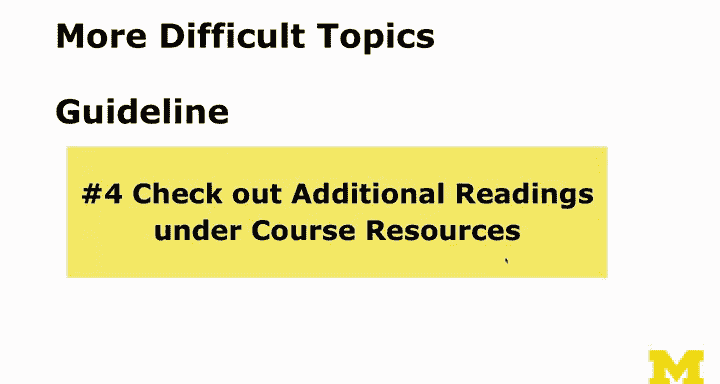

# 密歇根大学《使用Python的统计学（理解并可视化数据、因果推断、建模）｜Statistics with Python》中英字幕 - P2：1_数据理解与可视化指南.zh_en - GPT中英字幕课程资源 - BV1dV411Q7j3

Hello， the purpose of this brief lecture is to provide you the learner with guidelines and suggestions for maximizing what you take away from this course on understanding and visualizing data with Python。

This course will rely heavily on the use of Jupiter notebooks to illustrate and demonstrate concepts that are covered during the lectures using Python。

Now， in general， you will note that the notebooks are listed after a series of lectures and various assessments that are given each week of the course。

Let's take a look at week 1。Here we have videos and readings。We have。A discussion prompt。

 And there's a couple quizzes。And finally， at the end， we have our notebooks。

You will notice that you often see a notebook and video on pairs。So our advice is to not wait。

Don't wait to open the notebooks。 In fact， we strongly encourage you to keep the notebooks open simultaneously as you go through the various lectures。

You can then pause the lectures and then try things out in the notebooks as you learn about them。

Using larger monitors or multiple monitors could certainly help facilitate your ability to do this。

Past learners， though have found that this approach will maximize your uptake of information。

 your sense of how to apply what you're learning in Python。

Here's a snapshot of my workspace as I was going through part of week one。On the right screen。

 I had the video of a team member who was guiding me。

 The learner through what a notebook kernelel is and how to change the kernel through a drop down menu。

On my left screen， I had my notebook open， and I was pointing and clicking and following along。

 trying out the same steps。One focus of this course is understanding data， what it is。

 the types of data and where data come from。It is very important to understand where data come from when you are preparing for an analysis。

As we get into week 4， you will learn a great deal about the origins of data。

 including how we select samples and how to account for sample design in data analysis。

 There is a lot of good content here。😊，So our advice for this week is to make good use of the variety of in video questions that were added to make these ideas more concrete。

😊，We instructors welcome your individual questions about the content in this course。Now。

 while these questions may not be answered immediately。When they are answered。

 they'll be archived in the FAQs， so they're made available for future learners to enhance their experience。

Many questions will be quickly answered in the discussion forums。

But you should feel free to ask that more complex question， too。It will be routed to the instructors。

Finally， we are learning from you。There are some topics that some learners have found more difficult to grasp in the past。

So we have included a list of additional readings that have been designed to help clarify these topics。

 so be sure to check out the additional reading section that's under the course resources。

I hope these guidelines and tips will help you as you engage with the awesome content ahead。😊。

