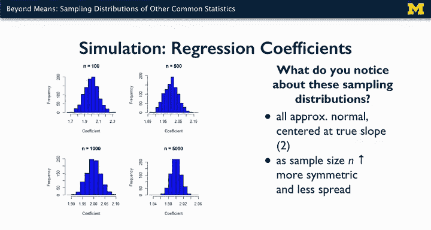

# 密歇根大学《使用Python的统计学（理解并可视化数据、因果推断、建模）｜Statistics with Python》中英字幕 - P30：29_超越均值：常见统计量的抽样分布.zh_en - GPT中英字幕课程资源 - BV1dV411Q7j3

Okay， so welcome back to our week four discussion of sampling from large populations and how we're able to make inference based on samples from large populations。

 Again， we're talking about sampling in the framework of where data come from when we actually want to start analyzing data So in this lecture we're going to talk about the idea of sampling distributions a little bit more so far we've been talking about what the sampling distributions for estimated means look like across hypothetical repeated samples。

 Now we're going to introduce an interesting result where for many common statistics。

 the sampling distributions of those statistics are remarkably normal with large enough samples and so we'll talk about the idea about how you can make inference about other types of statistics based on normal sampling distributions and we'll move forward with that idea when talking about other types of sampling。

So the interesting result we want to focus on in this lecture is that when you're given a large enough sample from some population。

 the sampling distributions of most statistics of interest will tend to normality。

 and this is regardless of how the input variables are actually distributed themselves。

 So the picture that you see here shows an example sampling distribution like we've been talking about previously across hypothetical repeated samples。

 what would we expect the distribution of estimates to look like and the central limit theorem。

 says that given a large enough sample， the distribution of estimates will tend to look like a bell shaped curve or normal distribution this result。

 which again is based on the central limit theorem。

 is what drives designbased statistical inference or what sometimes referred to as frequent to statistical inference。

 the idea that we can look at this sampling distribution assuming that is normal and make inference about the value of a given statistic in a larger population based on that theoretical normal distribution。

So let's consider an example again， so far in this week。

 we've been talking about the sampling distributions of means and we showed a web application that allowed you to simulate some sampling distributions using means。

 Let's consider another common type of statistic and data analysis。

 which is the Pearson correlation coefficient。 So the Pearson correlation coefficient describes the linear association between any two continuous variables。

 And what you see in this slide here are a couple of example hypothetical Pearson correlations that show you how tightly correlated to continuous variables might be in a scatter plot。

 So you see for a Pearson correlation of one or negative one。

 the two variables have a very strong linear association。

 and as those correlations move more towards0， you see that the variables essentially have no correlation at all。

 and you just see a cloud of data points。 So this is very different from a simple meanme describing the sample and possibly describing a larger population。

 the correlation coefficient describes the linear association between two variables。

Very commonly used statistic in data analysis to describe initial associations between variables。

So what we're going to do is simulate some sampling distribution similar to that web application that we were looking at for the Pearson correlation coefficient。

 What we're going to suppose is that the true correlation in the population is 0。7。

 So what that means is if you look back at the previous slide。

 we're talking about a fairly strong correlation， not a perfect straight line。

 but two variables that still have a very strong correlation or association in a linear sense。

 So we're going to suppose that the true correlation is 0。

7 a strong positive correlation between the two variables。

 and we're going to take 1000 samples of a specified sample size。

 let's call that little n from this population where the true population correlation is 0。7。

 we're just going to take simple random samples and we're going to do this for various sample sizes ranging from 100 up to 5000。

 So we'll look at a sample size of 100 and then 500 and then 1000 and then 5000 just to illustrate some different points here。

So here are the results of this little simulation study。

 What you see is a picture of sampling distributions。 You see these sampling distributions in blue。

 These are the distributions of all the simulated correlation coefficients based on samples of a certain size。

 So again， remember in the true population the correlation is 0。

7 if we had all the data for everybody in the population and we computed the Pearson correlation coefficient we would see 0。

7。 So what you see in the picture is for the sample sizes of 151005000。

 meaning that every single sample had that particular size and we computed the correlation coefficient based on the simulated data in that simple random sample。

 these are the distributions of correlations that would emerge。

 So there are a couple key things to notice about these sampling distributions。First of all。

 all of the distributions are approximately normal。

 You see that these these distributions of estimates across the thousand samples all look like bell shaped curves。

 and they're all centered at the true correlation。 So what that means is that the simple random sampling。

 remember is giving us an unbiased estimate of that correlation coefficient on average。

 all of those estimates are going to be equal to 0。7， which is the true population parameter。

 So you see all the distributions are centered at about 0。

7 and they're all approximately normally distributed。 So pretty much regardless of the sample size。

 they follow these normal distributions。But then what we note is that as the sample size little N increases。

 the distributions become even more symmetric and there's less spread。

 If you look at the x axes of each of these four different plots。

 you see that for a sample size of 100， the range of estimated correlation coefficients for those samples of size of 100 was somewhere between about 0。

55 and about 0。85。 But then as the sample size gets larger。

 you see that that range shrinks So there's less spread in the distribution of the estimates from those repeated samples。

 When you get up to a sample size of 5000 for each of the samples notice that the estimated correlations range from about 0。

69 to 0。73 again， centered at around 0。7。 So what this is illustrating is that the central limit theorem is working。

 we're getting these nice normal distributions， but we get more precise estimates of what the population parameter is with a larger sample size。

 and you can see again for the sample size of 5000 we're ranging somewhere between 0。69 and 0。73 and。

Inm of the sampling distribution。 So there's less spread with larger sample sizes。

 This is where we get the idea of more precise estimation， with larger samples。

Here's another simulation。 so we looked at the correlation coefficient case。

 Another very common type of statistic and data analysis is the regression coefficient。

 So what regression allows us to do is assess the relationships between multiple variables and we're going to be talking more about that in this particular specialization。

 But this picture shows the estimated relationship again between two variables。

 and what we're going to focus on now is the estimated slope or the estimated change in some dependent variable y for a one unit change in some predictive variable x that describes a linear relationship between two continuous variables。

 So with linear regression， we actually get an estimate of what that slope parameter is。

 unlike in correlation coefficient analysis where we just get a simple description of that correlation。

 So we actually wish to estimate this slope that describes the change in y for a one unit change in x。

 and the picture just shows for a variety of hypothetical data points the fit of a simple linear regression model to those data that describes the linear relationship between those two。

So we're going to simulate in the same idea multiple calculations of a regression slope for samples of different sizes to see what happens to those sampling distributions。

So what we're going to do is suppose that in our population of interest。

 the true linear relationship in the population is described by this regression equation。

 The deep a variable Y is defined by two times the predictive variable x plus some random error。

 so the true slope that we're trying to estimate by drawing samples is actually two we're going to take 1000 samples again of a specified sample size little n and we're going to do this for that same set of four different hypothetical sample sizes。

100，5001000 and 5000。So here's another picture of those sampling distributions。

 and the first thing you observe is it looks just like that last slide we were looking at。

 all the distributions look remarkably normal and fairly symmetric。 And again。

 as we increase the sample size， you can see that the spread of those estimated regression coefficients again shrinks。

 so there's not as much variability in the estimates across the hypothetical samples。

So all of these different distributions are approximately normal and centered at the true slope。

 and as the sample size little n increases， they become more symmetric and there's less spread。

So in terms of sampling distribution properties， the properties of sampling distributions from many popular statistics。

 regardless of complexity， they tend to be normal， they tend to be symmetrical。

 and they tend to be centered at the true value。 and larger sample sizes means that you have less variability in the estimates。

 The key point that's coming across here is that we can estimate the variances of these normal distributions based on only one sample。

 And this is what enables us to make inference about the larger population while also accounting for sampling variability。

So one other thing we're going to deal with later on the specialization is non-normal sampling distributions。

 not all statistics are going to have normal sampling distributions like we've seen now for means and correlation coefficients and regression coefficients In these cases more specialized procedures are needed to make population inferences and we're going to talk about ideas like Bayesian methodology and a cool example that we'll talk about later in the specialization is a statistic known as a variance component in the context of multilevel modeling the sampling distribution for these statistics are generally not normal and we'll talk about how to make inference in those cases。

So what's next， How exactly do we make population inferences based on one sample。

 We've talked a lot about sampling distributions now。

 now we want to take the next step and say based on just one sample。

 how would we ultimately make a population inference。

 We can estimate features of the sampling distribution based on that one sample。

 but how do we get from that point to making a population inference。

