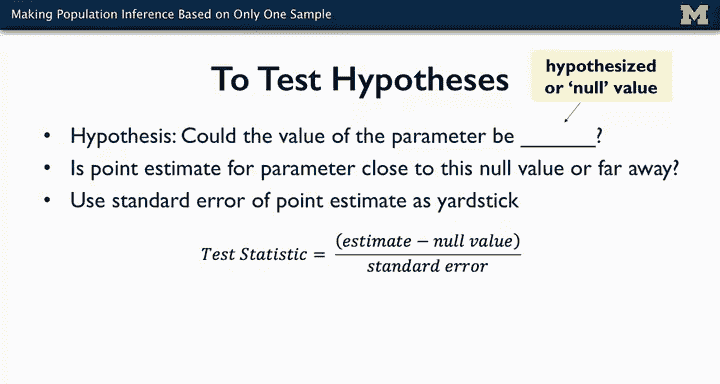
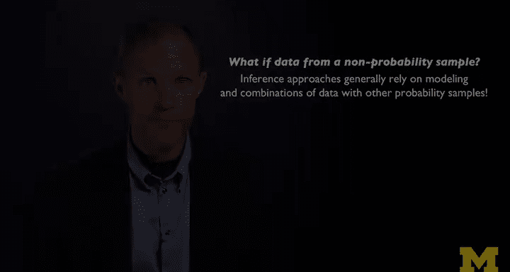

# 密歇根大学《使用Python的统计学（理解并可视化数据、因果推断、建模）｜Statistics with Python》中英字幕 - P31：30_基于单样本的总体推断.zh_en - GPT中英字幕课程资源 - BV1dV411Q7j3

Okay， so now that we have the idea of a sampling distribution down。

 the notion that under a particular sample design， in theory we could draw thousands and thousands of samples using that design and simulate what the distribution of all the possible estimates would look like we're going to take the next step and think about how to make inference about a population based on only one sample in practice we can't go out and draw thousands and thousands of samples。

 we just don't have the resources to do that。 So in research and data analysis。

 what we end up with is one sample and we want to try to make inference about a population based on that one sample。

That's what we're going to be talking about in today's lecture。So the lecture overview。

 general approaches to making population inferences based on estimated features of sampling distributions。

 we're going to talk about two general approaches， one is to estimate a confidence interval for the parameters of interest in the population and another is testing hypotheses about the parameters of interest and again we're going to talk about the implications of our sample design for how we go about making these kinds of inferences。

 but those are going to be the two techniques that we talk about。

Some examples of what we mean by a parameter of interest and this is really the ultimate product of our data analysis are we interested in estimating a mean。

 are we interested in estimating a proportion， a regression coefficient， an odds ratio。

 there are many statistics out there that we could be using to answer research questions so that's what we're referring to when we talk about a parameter of interest。

 something that describes a feature of the population whether it's a relationship or an individual descriptive statistic。

 this is what we're referring to by parameter of interest。

 so there are many more but these are some of the examples that we're going to focus on。

So a key assumption in making inference is again， this notion of the normality of a sampling distribution so the approaches that we're going to be talking about forming confidence intervals and testing hypotheses。

 these assume that the sampling distributions for these estimates are approximately normal and we talked about this in previous lectures that under different size samples。

 these distributions will tend to be become less variable we get more precise estimation。

 but for a variety of relatively modest sample sizes。

 the distributions will always tend to look normal based on the central limit theorem So again。

 this idea， this assumption that the sampling distributions are normal is often met if the sample sizes are large enough and remember when we talk about a sampling distribution we're talking about all possible values of an estimate of a parameter of interest across hypothetical repeated samples so our inference is going to be driven by what that sampling distribution looks like。

A good question that comes up here is what would we do if the sampling distribution is not in fact approximately normal。

 can we still use these inferential procedures， confidence interval formation and hypothesis testing and the answer is we're going to be discussing alternative inferential approaches for these cases later on in the course。

 but a variety of very commonly reported statistics tend to follow a normal sampling distribution we're going to be referring to procedures in that setting in this particular lecture。

So how do we go about doing this in kind of a step by step fashion step one is to compute what we call a point estimate。

 this is an estimate of our one parameter of interest for the overall population。

 so we start by computing an unbiased point estimate of the parameter of interest。

What do we mean by an unbiased point estimate Well recall from some of our earlier discussions。

 what this means is that the average of all the possible values for that point estimate again across hypothetical repeated samples is equal to the true parameter value and this average is also known as the expected value of that point estimate。

 what is the value of that point estimate that we would expect to see across hypothetical repeated samples when we say that an estimate on bias that means that the average of all these possible values across hypothetical repeated samples is equal to the true parameter value So the picture that you see here on the slide shows that straight line representing a true parameter value。

A sampling distribution that would give us an unbiased estimate of the true population parameter。

 you see that in red， that's the red distribution and note that the distribution is centered at the true parameter value。

 so on average the estimates produced in those hypothetical repeated samples will give us the true parameter value。

Now， a biased estimate， you can see how the sampling distribution for that particular estimate in blue here is shifted away from the true parameter value。

 so what that means is that with bias sampling on average。

 the estimate that we're computing will be far away from the true population parameter and we looked at this idea in the web application that we were studying earlier on in this week。

So an unbiased point estimate means that the sampling distribution is centered at the true population parameter that we're interested in。

 so we try to design samples that will produce data that on average， when we draw samples repeatedly。

 those estimates that we compute will be equal to the true population parameter。

 this is why it's so important to design samples that will give us these types of unbiased estimates。

So a key idea here， we want the estimate that we're computing to be unbiased with respect to the sample design。

 so given the sample design that was used， we want to compute an estimate of a population parameter of interest that is unbiased when we account for features of the sample design that was employed to collect the data if cases have unequal probabilities of selection for example。

 that leads to the need to use weights in computing our finite population parameter estimate and we need those weights to compute an unbiased point estimate if we fail to use weights when sample designs have unequal probabilities of selection。

 say I have a much higher probability of being selected than one of my colleagues I need those weights to get back to an unbiased picture of the overall population and a failure to use weights and estimation is going to shift our sampling distribution like we saw in the previous slide。

So we have our point estimate， we compute an unbiased point estimate。

 if we need to use weights based on the sample design。

 we would do so in computing that point estimate。Now we need to estimate the sampling variance associated with that point estimate and what that means is we want to estimate the variance of that sampling distribution again。

 we don't have the resources to draw thousands and thousands of samples and compute that variance based on all those different samples。

 we need to estimate that sampling variance associated with our point estimate based on one sample only。

So much like computing an unbiased point estimate of our parameter of interest。

 we also want to compute an unbiased estimate of the sampling variance for that sample distribution for this particular point estimate。

 so we want an unbiased point estimate and we want an unbiased estimate of the sampling variance。

So an unbiased variance estimate correctly describes the variance of the sampling distribution under the sample design that was used。

 so again， if we plot all the hypothetical values of a possible estimate。

 you see that little blue arrow in this particular plot that's the variability that we're trying to estimate based on only one sample。

 and once we have a good unbiased estimate of that variability。

 meaning the variability that we would expect to see， given the sample design that was used。

 then we have the tools that we need in order to make inference about the value of that parameter in the overall population。

So another key point here， the square root of the variance that we're trying to estimate。

 that's what we refer to as the standard error of the point estimate so when we estimate the variance of that sampling distribution to make inference we generally rely on what's called the standard error of the point estimate and what that really mean is average how far aware are the different estimates that we compute in these samples from the truth and we get an estimate of that standard error by taking the square root of the variance So another thing that you can conclude from this result is that the standard error is really describing the standard deviation of the sampling distribution we estimate the variance of the sampling distribution。

 take the square root that gives us a standard deviation so the standard error is the standard deviation of the sampling distribution of estimates and we use that standard error to make inference about the overall population parameter。

So step one or a technique one I should say to making inference is forming a confidence interval and what we do to form a confidence interval is take our best estimate。

 our unbiased point estimate， and we add or subtract a margin of error as it's called。

 so we allow for sampling variability in describing the plausible values for that particular parameter in the population。

So the best estimate again is our unbiased point estimate of whatever the parameter is。

 and then the margin of error describes in kind of heuristic terms a few estimated standard errors。

 so we allow for， in many cases， two standard errors on either side of that unbiased estimate to describe a range of plausible values for that particular parameter in the population。

A few again， generally is some type of multiplier from an appropriate distribution that's based on the desired confidence level for your inference and the corresponding sample design。

 So you might sometimes hear about a 95% confidence level what that equates to is a 。

05 level of significance。 we're going to be learning more about hypothesis testing and so forth in the next course。

 but what this basically means is that 95% of the intervals that would be constructed in this way would cover the true population parameter。

 So if we take the best estimate， we add or subtract， say two times the standard error。

 95% of the intervals constructed in that way are going to cover the true parameter that we're interested in So very commonly used confidence level in statistical inference。

So here's a picture of that idea， taking the best point estimate。

 adding or subtracting the margin of error again， let's just use two times the standard error that we estimate to form this confidence interval。

 The key idea is that for a 95% confidence interval we would expect that 95% of the intervals computed this way are going to cover that true population value across these repeated samples so in the picture that you see here the black arrow pointing down that's our true parameter value each of the different horizontal lines represents a confidence interval formed in this way。

 taking the best estimate adding or subtracting maybe twice the estimated standard error and you can see that the vast majority of the intervals computed in that way across these hypothetical repeated samples each line being a sample cover that black line in that true parameter value。

 some will not， but the vast majority will。The caution here is that it's important to get all three pieces right to make correct population inferences if the best estimate in forming these intervals is not。

 in fact， an unbiased point estimate or the margin of error does not use the correct multiplier。

 we were using two in general for a 95% confidence interval or that margin of error does not use an unbiased estimate of the standard error。

 the confidence interval will not have the advertised coverage of the true population parameter。

 so even though we might call it a 95% confidence interval。

 maybe it only covers the true parameter 90% of the time or 80% of the time we really need to get all three of those pieces right to make sure that our confidence intervals have the advertised coverage of the true population parameter。

So the interval gives us a range of reasonable values for that parameter in the population That's really the key idea here by forming a confidence interval we get a good idea of plausible values for that population parameter if the hypothesized value for that population parameter lies outside of the confidence interval。

 we generally don't have enough statistical evidence to support that value at the corresponding level of significance or the corresponding confidence level so if we want a 0。

05 level of significance and we use a 95% confidence interval we could make conclusions about hypotheses by looking to see whether our hypothesized value lies outside of our compute confidence interval if that's the case we really don't have enough evidence in support of that particular population parameter。

So a second approach to making inference about population parameters is hypothesis testing。

 so our hypothesis could read， could the value of the parameter be something and that something is our hypothesized oral value。

 that's the hypothesis that we wish to test。And we look at the we really answer the question。

 is the point estimate for the parameter close to this null value or is it really far away， again。

 using this idea of a standard error？So we use the standard error of a point estimate， again。

 the estimated standard deviation of the sampling distribution。

 we use that standard error as a yardstick， a very common form of a test statistic for these kinds of hypotheses is to take in the numerator our unbiased point estimate。

 subtract the null hypothesis value， whatever our hypothesissized value is and divide by the standard error that gives us an idea of how far away our estimate is from that particular null hypothesis value。

 how much evidence we have against that particular null value。

If the null is true， then we can look at the probability of seeing a test statistic this extreme or even more extreme。

 if the probability of seeing a test statistic that large under the null hypothesis is small。

 we would reject that null hypothesis。So an important reminder about these two inferential procedures。

 all of these inferential procedures are valid if probability sampling was used。

 all the techniques that we just described rely on the idea of a probability sample。

What happens if we have data from a non-proability sample well inference approaches generally rely on modeling in these cases。

 so fitting statistical models and making conclusions about estimates without relying on this kind of safety of working in a probability sampling framework and knowing what that sampling distribution is expected to look like。

 we also might combine data with other probability samples and make inference using that type of approach。

