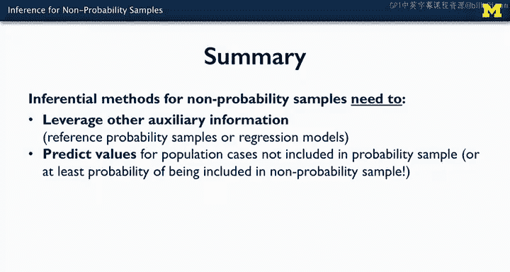

# 密歇根大学《使用Python的统计学（理解并可视化数据、因果推断、建模）｜Statistics with Python》中英字幕 - P32：31_非概率样本的统计推断.zh_en - GPT中英字幕课程资源 - BV1dV411Q7j3

Okay， so welcome back。 We're continuing our discussion here in week4 of how to make inference about population parameters based on single samples from larger populations。

 and so far in the last lecture， we talked about how to make inference about a population parameter based on a single probability sample and one of the ideas that we introduced at the end of the last lecture was what should be done if。

 in fact， the data did not come from a probability sample。

 and we actually have data from a non-prob sample。 recall earlier in this week。

 we had some lectures describing hypothetical non-prob sample。

 So now what we're going to talk about is how we can make inference about population parameters if the data were actually generated from a nonprobability sample。

 and I do want to say that we're going to be talking more about inferenceferential methods like forming confidence intervals testing hypotheses in course number two of this specialization we're just providing a brief introduction at this point。

So an overview of this lecture on non-proability samples and making inference the essential problem is that non-probability samples do not let us rely on sampling theory for making population inferences based on expected sampling distributions so sampling theory is an area of mathematics that allows us to infer features of populations based on these hypothetical sampling distributions。

 it's the math that lets us estimate the features of those sampling distributions。

 determine whether or not they're unbiased compute estimates of the standard deviations of those distributions which like we referred to as what we call a standard error of that particular estimate with non-probability samples。

 we can't rely on that mathematical theory for making population inference we have to rely on other statistical approaches to try to make population inference probability sampling is what gives rise to the sampling theory that allows us to make the inferences that we were discussing in the prior lecture。

So two approaches that have more or less grown up in the literature a non-probability sampling include quasi randomization。

 or what we referred to as pseudoranization when we first introduced the ideas of non-probability sampling and also population modeling and we're going to introduce each of these different two approaches in this lecture。

So approach number one called quasi randomization。 The big idea of this approach to making inference based on non-probability samples is that we combine data from a non-probability sample。

 maybe it was cheap like we talked about snowball samples， convenient sample and so forth。

 We combine the data that were generated from that non-prob sample with data from another probability sample that collected the same types of measures So we go out。

 we find some more data that may have come from a probability sample and collected similar variables to those that were collected in the non-prob sample。

 So this picture just kind of shows the idea we've collected information from different sampled individuals from the non-prob sample and we combine that information with the information that was collected in another probability sample。

 This is a separate independent sample from the non-prob sample。

 but it's important that both samples collected the same measures from the individuals that were sampled。

So here's an example， supposeose that we want to measure blood pressure。

 age and race ethnicity on a sample of volunteers， so these are the survey measures of interest。

 The key is that we're talking about a sample of volunteers so we're not talking about a probability sample of individuals from some larger population frame or some larger population list we've invited volunteers to come participate in the study so we don't have any control over the sampling mechanism we're not sampling from a well-defined list。

 we're just inviting volunteers who are interested in participating in the study we're not drawing a probability sample。

 but we still end up with a sample from the population。

We want to combine the data collected from these volunteers with other data from a probability sample。

 So in this course， we're talking about the NHANS data。

 the National health and nutrition examination survey data So those are data that describe physical characteristics of the larger US population based on a large probability sample。

 a large nationally representative sample from the US population and the NHANS data collects the same types of information。

 blood pressure age and race ethnicity， so if we have that information on our sample of volunteers。

 maybe in addition to other variables that we only collected from the non-prob sample。

 we can then combine those three variables with the data from the larger probability sample。

 something like NHAS， and we're going to use that information to help instruct our inferences。

So the idea of this approach， kind of in an operational point of view。

 we stacked the two dataset sets together。 We literally stacked them on top of each other。 So again。

 the non-proability sample may have other response variable that we're really interested in stuff that wasn't collected from the probability sample and that's okay。

 We're just stacking the two data files and taking advantage of any overlapping variables between the non-prob sample and the probability sample we then create a variable。

 let's call it NP sample just for illustration， that variable is equal to one。

 if the sampled individual is a member of the non-prob sample。

 and thatmp sample variable is equal to0。 if that individual is a member of the probability sample。

 So while the table that you see here is what the resulting stacked data set might look like。

 We have common measures of blood pressure。 We have common measures of age。

 we have common measures of race and ethnicity， maybe a couple other types of responses that were in common。

 but in addition to all these variables we're going to have a whole set of。

Variables that you don't see here that were only measured on the non probability sample that might be what we're interested in。

And so then we have this indicator of whether or not a person was a respondent in the nonprobability sample。

 so that's what the data set would look like and again you have to imagine a series of other columns that would only have data present for the nonprob sample respondents。

What we do then is fit something called a logistic regression model。

 we're going to talk more about this later on in the specialization but in this model what we're trying to do is predict the probability of having a one on the NP sample variable that we just formed。

 or in other words， the probability of being in the non-pro sample with those common variables like age and blood pressure and race ethnicity。

In fitting that model， we're going to weight the non probability cases by a simple value of one so we don't give them any kind of differential weight。

And we're going to weight the probability cases by their survey weights。

 the weights that we've been talking about in previous lectures that reflect their probabilities of selection。

 so we're trying to simulate what's happening in the population based on the probability cases and then trying to make inference about the probability of being in the non-pro sample based on that overall model if we had combine both of these types of cases together and again。

 we'll talk more about logistic regression later， but we just want to make the basic idea clear here assuming that we have a lot of data coming from a probability sample。

 we're trying to predict the probability of appearing in this non-prob sample from the population based on the probabilitybabilities that we see in the other probability sample dataset。

Okay， so the big idea is that we can predict the probability of appearing in the non-prob sample。

 say being a volunteer or being a part of a snowball sample or whatever that was that design might have been within whatever probability is represented by the probability sample。

 This is what we get from stacking the two data sets together。

 we get a slice of the overall population and when we combine those two data files together with each other。

 we want to try to estimate the probability of an individual in that population appearing in that non-proability sample of volunteers once we have these predicted probabilitybabilities based on that logistic regression model of being in the non-prob sample。

 we treat those the inverse of those probabilities as survey weights in a standard weighted survey analysis so we estimate the probability that a given individual is going to volunteer or be part of a quota sample or be part of a snowball sample and then we invert that predicted probability。

That gives us a weight that says how many people in this population that we're getting a sense of by adding that probability sample to the data。

 we're getting a sense of how many people in the target population would really be represented by this type of individual that's our survey weight and then we use the weight that weight when analyzing all the data in the nonprob sample。

 we use a standard weighted analysis using those new survey weights that we've computed based on this procedure。

The issue in this approach is， again， this sticky issue of estimating sampling variance In the last lecture。

 we talked about the idea that in the probability sample。

 we can estimate the variance of that sampling distribution with this type of quasiite randomization approach。

 We can't really do that。 There's not really an entirely clear method of how to estimate a sampling distribution。

 using these new kind of pseudo weights that we computed based on this method。

 So the literature in this area。 and this is a pretty new area。 overall in statistics。

 there's not a whole lot written about this idea but the literature suggests that some type of so-called replication method is needed to estimate that sampling variance。

 basically we try to simulate replications of this process， developing these new weights。

 Comp these weighted estimates over and over again and generate an empirical picture of what that sampling distribution might look like given the data that we collected and we compute weighted estimates to do this based on several rep samples from。

The same data set that we have available。 So if we stack a probability sample with a non-prob sample go through the approach that we just described。

 we do this over again。 We just draw a replicate sample from that original data。

 we draw a new sample of cases based on the original data we collected。

 We're resampling from the data that we've already collected。 then we repeat the process。

 stack the files together， estimate the probability of being in the non-proability sample。

 recompute weighted estimates and so forth and so on。 We do this over and over and over again。

 each time resampling from the original data that we collected， and we compute these estimates。

 and we generate a hypothetical or we simulate a sampling distribution that we would expect to see following this procedure over and over again。

So instead of going out and physically drawing thousands and thousands of samples。

 we simulate that resampling process from the original data we collected。

 and we use that as a tool for making inference about the population parameters。

 So it's a pretty interesting idea。For a deep and fairly technical dive into more about this approach。

 we refer you here to a 2017 article in the journal called Statistical Science。

 this article is calledInference for Noprobability samples by Mike Elliott and Rick Valllt。

 again fairly new article that describes these and other techniques for making inference on non-prob samples。

 here we're giving you the essential tools to use each of these approaches。

 but Mike and Rick lay out the Ma in a little bit more detail that underlies each of these different approaches for those of you who may be participating in this course and interested for seeing more of the technical details。

Okay， so the second approach that we might employ for making population inference based on nonproability samples is an approach that relies on population modeling。

 and the big idea here is that we use predictive modeling to predict aggregate sample quantities is usually totals。

 but some type of aggregate sample quantity on our key variables of interest。

 for population units that were not included in the non-probability sample。

 So if you think of the big picture here， suppose that you have a data that contains information on everyone in the population and we have some general auxiliary information on everybody in that population and in a given non-probability sample we only collect measurements on the variables of interest for a small subset of that overall population。

 So for a very small subset of that overall big data set for everybody in the population we collect these additional variables for everybody else。

 they have missing values on those survey variables that we are trying to measure。

 but we still have that。Otherili auxiliary information on those individuals who were not included in the nonprobability sample。

 So following this idea， we fit another type of regression model。

 and we used that model derived from the nonprobability sample to make predictions of what all the other people in the population might have said had they actually been a part of the non-probability sample。

 this relies on having good auxiliary information available for everybody in the population so that we can actually make those predictions for all the people that were not included in the nonprobability sample。

 And then given the predictions of the variables of interest for everybody else who was not included in the nonprobability sample we compute our estimates of interest using estimated totals on the variables of interest based on those predictions。

 So for example， for computing a weighted meme we would calculate the overall total of a variable of interest for everyone in the population using the observed values in the nonprob sample and。

predictedred values for everybody else who was not included in the non probability sample。

 And then we would divide that predicted total by the estimated population size。

 And that gives us an estimate of our overall population mean。

The key point about this approach relative to that quasi randomization approach is that we don't need a probability sample that collected the same measures。

 Remember the first approach we needed to stack those two data sets together for this predictive modeling approach All we need is good auxiliary information and everybody in the population so that we can develop these predictions for the cases that weren't actually included in the non-prob sample so that's a second approach that we could use provided that we have that good auxary information for everybody in the population。

So this approach， it fundamentally relies on having good predictive models。

 so models that enable us to compute good predictions of the variables of interest using that other auxili information that's available for all the people who weren't included in the non-prob samples So we're going to spend a lot of time talking more about good models later on in the specialization。

 but this approach for making inference for non-probability samples really relies on having good predictive regression models and standard errors for these estimates like we talked about in the previous slide。

 these can be based on fitted regression models or using similar replication methods like we talked about for the quasi randomization approach。

 So there are model-based approach to computing the standard errors of our estimates。

 those are driven by the fitted regression models or we could use the same type of resampling approach where we repeat this process over and over and over again based on samples that we draw from the data set that we already have。

So we could use similar replication methods if we wanted to， and again。

 you can refer to that Elliot Valtar for more details on this type of approach。

So to summarize these ideas， inferential methods for non-probability samples need to think about the following。

 leveraging other auxiliary information， so this could be in reference probability samples that collected similar measures that were also collected in our nonprobability sample or regression models that leverage this auxiliary information for all the individuals who were not included in the non-proability sample。

 in addition to the individuals who actually were in the nonproability sample。

 we need to have that auxiliary information available for everybody using either of these two approaches。

And we also rely on the idea of predicting values for population cases that were not included in the probability sample。

 or at least being able to predict the probability of being included in the non probability sample。

 again， using that quasi randomization idea， so we need to have good predictive models that allow us to make predictions for everybody who did not become part of that nonprob sample。

In the absence of this kind of auxary information， it becomes a really difficult problem making good population inference。

 we're kind of left out without many solutions if we don't have the ability to stack the files together like we talked about with quasisite randomization or we don't have the ability to make good predictions for people who weren't in the nonpro sample。

 So in a sense， both of these approaches rely on having good auxiliary information that allows us to either predict values that we weren't able to observe or predict the probability of appearing in a non-prob sample。

 and the absence of this information that's unfortunately not too much we could do with non-prob samples as as far as making inference about a larger population。

