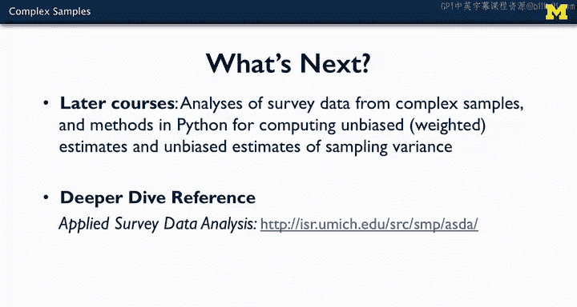

# 密歇根大学《使用Python的统计学（理解并可视化数据、因果推断、建模）｜Statistics with Python》中英字幕 - P33：32_复杂样本处理方法.zh_en - GPT中英字幕课程资源 - BV1dV411Q7j3

Okay， so welcome back in our final lecture for this particular week about where data come from。

 the ideas of sampling and making population inference based on sampling distributions。

 we're going to spend a little bit more time talking about the idea of complex sampling so we've hinted at some of these ideas in earlier lectures today in this lecture right now we're going to go into a little bit more detail about these particular ideas so we've talked about probability sampling we've talked about non-probability sampling and sampling distributions now we're going to talk about special types of probability samples known as complex samples and some of the features of those sample designs that we need to account for when analyzing the data from that particular probability sample。

Okay， so here's an overview of what we'll be talking about in this lecture。

 a complex sample is any probability sample where the design。

 the sample design involves more than just simple random sampling。

 again taking population units at random from some larger population so we're going to present a more in-depth review of complex samples and we're going to discuss important considerations for making population inferences based on those complex samples。

So some features of complex samples， one important feature of this type of sampling design is called stratification。

 so stratification is defined as the allocation of an overall sample to different strata or mutually exclusive divisions of the larger population so for example。

 in a large national sample from the United States。

 these could be different regions in the United States and in the map that you see here to the right。

 you see different possible divisions of the US population into four different general regions。

 these might be sampling strata where we allocate some amount of our sample to come from each of these four different regions。

There are several different potential allocation schemes in this case for stratification。

 either way or either allocation scheme that we use。

 our aim is to minimize sampling variance for particular variables given fixed cost。

 and we're going to talk about how exactly that works， but when we choose an allocation scheme。

 we do so in a way that's going to minimize our sampling variance。

 given that we're working under a fixed budget for collecting the data via the sampling process。

So here's an example of one type of allocation scheme under stratifications called proportionate allocation。

 so suppose our population was defined by 70% of the population units belonging to stratum 1 and 30% of the population units belonging to stratum2 so 70% of the population appears in one stratum and 30% of the population appears in the other。

In this case， 70% of the overall sample would be allocated to the first stratum and 30% would be allocated to the second stratum。

 so this's a very simple idea if I wanted to draw a representative sample of 100 individuals。

 70 of those individuals would be sampled from the first stratum。

 and 30 of those individuals would be sampled from the second stratum。

 this is the idea of proportionate allocation， the sample is proportionately allocated to each of the different stratum based on their relative sizes in the overall population。

So why do we think about stratification when designing samples stratification has the very attractive property of eliminating between stratum variance and means or totals of interest on the variable of interest from the overall sampling variance The idea here we go back to the notion of theoretical repeated sampling according to some kind of probability sampling design if stratification is a part of our sample design and we come up with an allocation scheme like we just talked about with that 70-30 example across all those hypothetical repeated samples every single one of those samples。

 70% of our sample is going to go to stratum 1， 30% of our sample is going to go to stratum 2 and that's not going to change across the different hypothetical samples every hypothetical sample is going to employ the exact same allocation and we're always going to have sample coming from each of those two stratum This removes the variability。

Between stratum or between strata in our variables of interest from the sampling variability。

 we're always going to have some sample from each of those different strata if we don't stratify a sample。

We run the risk of selecting random samples where we don't have representation from some of those strata and this stratification ensures that we're always selecting sample from these different strata。

 we remove the between stratum variability from our overall sampling variance because we always have sample coming from the different strata across the hypothetical repeated samples。

 So this is a very good thing in terms of our overall estimates。

 if we think back about sampling distributions， this shrinks the variability of our sampling distributions because we're removing that between stratum variance in our values of interest So it's very important to account for this kind of stratification in our analysis。

 Otherwise， our sampling variance may seem like it's too large。

 our estimates of the sampling variance。 remember we talked about making inference based on a probability sample Our estimates of those standard errors may be larger than they should be。

 In other words， they're going to be biased estimates of the sampling variance。

Statification was actually used in selecting the sample。

 and we don't account for that when we actually compute the standard errors and what this means is that our inferences would be too conservative。

 our confidence intervals would be too wide because we have more sampling variability than we really should if stratification was used。

 so it's very important to account for stratified sampling when we actually analyze data。

Another very important feature of complex sampling is cluster sampling。

 which we'll just refer to as clustering。In cluster sampling。

 random sampling of larger clusters of population elements occurs possibly across multiple stages。

 for example， in a national sample we might first sample US counties。

 and then within those US counties we might sample area segments and within those area segments we might sample households。

 recall this picture that we saw in an earlier lecture where we start off by sampling counties。

 then we sample area segments within those counties。

 then we sample households within those area segments。

This idea of cluster sampling is used in practice to reduce the cost of data collection。

 It's very expensive to visit little and randomly sampled units from a large and widespread population。

 instead we draw random samples of clusters according to a probability sampling design。

 and then we visit those clusters and collect data from that small clustered area。

 so this is a convenient tool for selecting a random probability sample。

 but minimizing the cost of data collection， so very important from an operational perspective。

So we know that cluster sampling reduces costs， that's a good thing。

But it tends to increase the sampling variance of our estimates。

 So going back again to the idea of a sampling distribution， When we draw a cluster sample。

 the resulting estimates that we compute will be more spread out because the information we get from within the same cluster tends to be more similar。

 So if we draw very different clusters in any given sample。

 there could be a lot more variability in our estimates。

 So the spread of that sampling distribution tends to get larger when we draw cluster sample。

 So we have this kind of tradeoff clustering reduces costs。 on one hand。

 but we tend to have more sampling variance。 on the other hand， our estimates have more variability。

And again， this happens because units coming from the same cluster tend to have similar or correlated values on the variables of interest。

 we're not measuring unique information when we draw the cluster sampling， so we do it to save costs。

 but we don't pick up on as much unique information as we could if we weren't drawing a cluster sample and we have this risk of inflated sampling variability if the clusters tend to be very different from each other。

So much like with stratification， it's important to account for cluster sampling when we analyze the survey data。

 otherwise our inferences might become too liberal unlike stratification。

 our confidence intervals might become too narrow we may be saying that the sampling distribution is much tighter。

 then it should be otherwise if we had actually perform cluster sampling we're ignoring an element of the sample design that inflates the variability of our estimates。

 so that's another mistake that we want to avoid if there was cluster sampling actually perform we want to account for that when we actually estimate sampling variance。

 and we estimate our standard errors， otherwise we may be overstating the precision of our estimates without accounting for cluster sampling。

A third very important feature of complex sampling is waiting so remember complex samples are probability samples。

 but if these complex samples are defined by multiple stages of cluster sampling within stra。

 like we talked about counties then area segments than households if that kind of sample design is used within sampling strata。

 or there are certain subgroups of the populations that of the population that are sampled at higher rates。

 this idea of oversamp from particular population subgroups。

 we end up with unequal probabilities of selection for different population units。

So the probability of being included in the probability sample could be very different for different people。

 depending on their characteristics， depending on where they were sampled from and so forth。

And if there are， in fact， unequal probabilities of selection for different people in the overall population。

 we need to account for these unequal probabilities to make unbiased population inferences。

 Otherwise， we're gonna to get a biased picture of the population because maybe certain types of people were oversampled relative to how often they appear in the population or certain types of geographic areas had larger sample selected。

 then again would be in the overall population picture。

 So the sample that we get following these kinds of designs may not be an exact reflection of the overall population and the weights for accounting for these unequal probabilities of selection give us a tool for making sure that the sample looks like the overall population accounting for these unequal probabilities。

 So think back to when we talked about unbiased point estimates if there were unequal probabilities of selection。

 we need to compute weights based on those unequal probabilities to make sure that our estimates are unbiased。

 meaning on average， they'll be equal to the。True population parameter。Okay。

 so when we use weights and analysis， how exactly does this work？

Partly weights and complex samples are defined by the inverse of a given person's probability of selection and these are the weights again that we would ultimately use when analyzing the data So a little example here and we referred to this in an earlier lecture if my probability of being included in a given complex sample was one out of 100。

 That means that my sampling weight would be 100。 I simply invert my selection probability one divided by one divided by 100 that gives me 100。

So this means that I represent myself and 99 other individuals in the larger population。

This is the idea of inverting the probability of selection and my weight has a very natural interpretation。

 I had a  one in 100 chance of being selected， so I have to speak for myself and 99 other people in the population if another individual had a one in 1000 chance of being selecteding the probability sample they have to speak for themselves and 999 other people in the population again to get us back to good population representation so these weights are critically important in getting us back to a representative picture of the overall target population。

Weights can also be adjusted for different probabilities of responding to a given survey request in different subgroups。

 so suppose that my probability of selection was  one out of 100 like we just discussed。

 but I belong to a population subgroup say Caucasian males where only 50% of Caucasian males actually responded to the survey request。

 I need to account for this differential probability of responding to the survey request in adjusting my overall weight。

 so my adjusted weight in this context would be my initial sampling weight one divided by 0。

01 or one divided by 1 over 100。I would multiply that sampling weight by 1 divided by 0。5。

 which is my probability of responding to the survey request depending on the subgroup that I belong to。

 so not only do I have to speak for myself and 99 other people based on the sample design。

According to that sample design， only one out of every two people actually responded who are like me。

 so I have to speak for 99 other people to begin with。

 but then I also have to speak for all the other people who didn't respond to the actual survey request and I need this additional adjustment to the overall weight that would be used in analysis so given the 50% response rate in my particular subgroup white Caucasians that means that I now have to speak for myself and 199 other people all those additional people who were sampled like me where only 50% of them actually responded so my weight goes from being 100 to actually being 200 I have to speak for another100 people who didn't respond and belong to my particular subgroup so weights are often adjusted for non-respon to account for that differential non-response across different subgroups because you'll never see a survey where there's 100% response rates and response rates tend to be going down over time so we need to adjust for that。

And one of the ways that we do that is by adjusting these survey weights for the N response。

So it's important in that we need to use these weights and compute unbiased estimates that account for the sampling and account for differential non-response。

 a failure to use these weights and analysis can lead to very serious bias。

 especially if the weights are correlated with variables of interest or the probabilities of responding are correlated with variables of interest。

 we can compute a very biased estimate if we don't use these weights in computing our overall unbiased point estimates。

The drawback of using weights in analysis is that much like cluster sampling。

 highly variable adjusted survey weights tend to increase the sampling variance of weighted estimates。

 So there's a lot of variability in our weights， that means there's a lot of uncertainty in terms of who we're actually sampling and who they represent。

 And if you think about this across repeated samples。 If there's a lot of variability in the weights。

 that can lead to a lot of variability in our estimates across the repeated samples。

 So highly variable survey weights will tend to increase the sampling variance of our weighted estimates。

Even if the weights produce unbiased point estimates， so going back to inference。

 we talked about that multistep process， you get an unbiased point estimates by using the weights。

 that's a good thing。But if the weights are highly variable。

 our estimates of sampling variance become much larger and that's what we have to be careful of。

 so people producing survey data sets like the US Census Bureau and so forth。

 they try to provide people who are analyzing the data with weights that do not have that much variability。

 they try to minimize that increase in the sampling variance due to the use of weights in estimation。

So putting all those ideas together， we can think about what are called design effects。

 and that's the effect of a complex sample design on the overall sampling variance that we're interested in estimating。

So thinking about those three key complex sampling features。

 we talked about the idea that stratification reduces sampling variance。

 it gives us more precise estimates because we're removing that between stratum variability from the overall sampling variance。

 every hypothetical sample will come from the same strata of the population。

Cluster sampling and weighting on the other hand， they tend to increase sampling variance okay so you can see from the arrows in this particular picture。

 these are the different kind of design effects on the overall standard error of a given estimate in this picture。

 the thick bold line represents the standard error of an estimated proportion。

 we assume in this case that the proportion of interest is equal to 0。

5 just as a hypothetical illustration。In a simple random sample from a population where the proportion was 0。

5， the graph shows that as the sample size increases on the horizontal axis。

 the standard error of that proportion that's equal to 0。5 will go down。

 So the sampling variance for that estimated proportion will go down as the sample size gets larger When we decide to use complex sampling。

 there are these poles on that sampling variance。 cluster sampling and waiting will tend to pull up the standard error stratification tends to pull down the standard error。

And the net multiplicative effect of all of these different complex sample design features on the standard error is what we refer to as a design effect。

 This is the net multiplicative change in the variance of an estimate relative to simple random sampling and that's what we're illustrating in this particular picture here So these design effects give people who design samples an idea of how to improve samples to try to minimize increases in sampling variance。

In terms of analysis。Most survey analysis procedures in statistical software and we'll be talking about this later in the specialization we'll provide you with tools for computing unbiased point estimates。

 using these final survey weights in addition to unbiased estimates of sampling variants that reflect the stratified sampling that was conducted。

 the cluster sampling that was conducted and the possibility of variability in the weights or maybe replicate sampling weights。

 depending on what data producers make available for estimating sampling variance。

 but survey analysis procedures can take this information from a given data set that's been collected and then use this information to give you your unbiased point estimates and your unbiased estimates of the sampling variance。

 the key is that when we do analysis we need to account for these features rather than ignoring them entirely to make sure we're getting unbiased estimates。

So it's important to use appropriate statistical software procedures that allow you to compute these kinds of estimates and in doing this we need to identify all of these complex sampling features to the statistical analysis software like the weights。

 the stratum codes and the cluster codes once the software has all this information defined it can compute these unbiased estimates of parameters of interest and sampling variants for you very quickly we just need to make sure to identify all these features in the eventual analysis。

Now， a failure。To identify those features of complex samples when performing data analysis is what's often referred to as analytic error and secondary many individuals who perform secondary analyses of survey data sets don't take these sampling features into account。

 unfortunately， this again， like we've been discussing can lead to very biased inferences based on the survey data if weights are available。

 we need to at least consider them when computing our point estimates。

If stratification and cluster sampling was used to select a sample。

 we need to account for those features in estimating the sampling variance。

 we need to come up with a good estimate of what that sampling variance would look like if we did in fact draw hypothetical repeated samples using that design so a failure to account for these features is known as analytic error and many secondary analyst of survey data are not aware of these issues this is where it's very important to be aware of where your data come from and what type of sample design was used before you start to analyze the data。

We've included links here to a couple of references that you can pursue that present deeper dives into this issue of analytic error and how often it happens。

 the implications of doing it and other related literature so after listening this lecture we just want to really emphasize the point that if you ever have to work with survey data it's important to understand where those data came from what type of sampling was used was their waiting performed was there stratified sampling performed。

 was there cluster sampling performed you always want to read about that before you sit down to analyze the data。

So it's very important to look at the documentation for a given data before you jump into using it so our focus should be on looking at data and understanding where the data come from。

 that's been what we've talked about this entire week is understanding what generates the data that we're actually working with and probability sampling is widely used to produce data sets that ultimately are subjected to statistical analysis So in understanding where the data came from。

 we need to carefully read the documentation that goes along with the survey data before we actually start working with the data and looking at the data we need to understand what type of sampling was used。

 was it a probability sample， was it a non-probability sample。

 was it a complex sample we need to have a good idea of all this stuff and that documentation is going to tell us was complex sampling performed。

 what variables are available in the data to capture these complex sampling features like weights and stratum codes and cluster codes。

This is all essential in terms of understanding where the data came from and what we need to account for when we sit down to do the analysis。

 so this is a key fundamental feature of all probability samples and we really need to account for these features when we analyze the data。

So when you're scouring this kind of documentation。

 you can think of a couple important keywords that you can look for that would indicate the fact that complex sampling was actually performed。

 things like multistage sampling or weights or stratification or cluster sampling or design effects these are all words to look for in your documentation to see if this kind of complex sampling was actually performed so careful evaluation of documentation is always very important for really having a good understanding of where data came from and what we should do when using those data to estimate features of sampling distributions and ultimately make inferences about the larger population。

So what's next in later courses in the specialization。

 we're going to be talking about analyses of survey data from complex samples。

 methods that can be used in Python for computing unbiased or weighted estimates。

 methods for computing unbiased estimates of sampling variants。

 and we're going to get more into inferential procedures， different kinds of analytic procedures。

 but at this point it's very important to understand where the data came from first before we get into these other kinds of analyses and having a good understanding of where the data came from is always going to improve the quality of your overall analyses for a deeper dive reference on complex samples。

There's a recent second edition of the book that's called Applied Survey Data analysis。

 and we've included the web link here where you can learn more about that particular book and some of the software resources and methodologies that it makes available for dealing with data from complex samples。

 so feel free to follow this link if you'd like more information about this particular topic。

