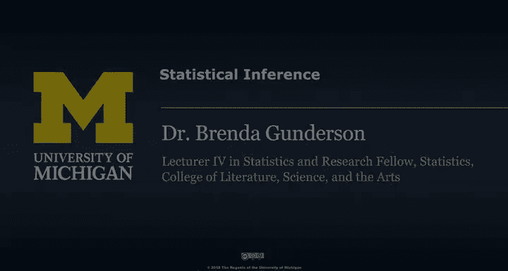

# 密歇根大学《使用Python的统计学（理解并可视化数据、因果推断、建模）｜Statistics with Python》中英字幕 - P34：0_欢迎来到课程.zh_en - GPT中英字幕课程资源 - BV1dV411Q7j3

Welcome to Inferential statistical Ana with Python。

This is a second course in a larger statistics with Python specialization。

Each course built upon the previous course， giving you a nice well rounded view about what statistics is and the ability to apply what you're learning using Python。

The second course has four parts。In the first part。

 we're going to get a preview of the inference techniques。

 the research questions that we're going to be able to explore。

You'll have a chance to share with us the research questions that you see in your life。

We'll do a little big A or big B activity。That'll help us understand better how we make decisions between competing theories using data。

We'll also do a little bit of this or that。To get us a little more comfortable with some of the language and notation that we're going to be seeing in the course。

On the programming side， we'll work with Jupiter notebooks and move into some intermediate Python concepts。

In part two。We'll start asking the question what is that parameter value？

How to estimate parameters with confidence。When we will beyond on our best estimate and go out plus or minus margin of error。

Giving us a range of reasonable values that we can be quite confident might be reasonable for that parameter。

We'll move on to answering questions that are more on the nature of is there a significant difference？

Hypothesis testing techniques， where we'll take our data， convert it to a test statistic。

Work out at corresponding P value to help us make a decision between competing theories。

We'll have an interesting discussion about P values。

 P hacking and some good practices when conducting research。

One of the activities you get to work on has to do with chocolate。

An experiment to decide whether chocolate should be introduced into the diet for cyclists to help them perform better。

In part 4， we'll start working on learning applications and taking some deeper dives into some other concepts。

Look at the practice at doing a lot more communicating of the infferluential results。

We'll handle complex sampling design。And talk a little bit about some alternative methods for inference。

Throughout the class we'll give you opportunities to do some assessments of your learning。

Resources allow you to do some of those deeper dives into some other topics。

And some hands on practice through some web applets， and of course， your Python tutorials。

You're going to get to hear from a number of our team members and we're going to share with you our perspectives and our insights about statistical inference。

