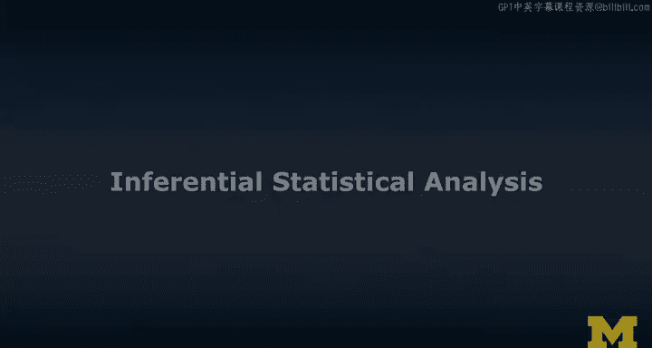
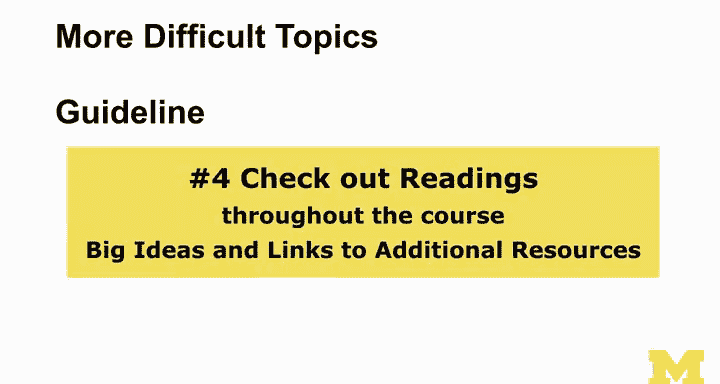

# 密歇根大学《使用Python的统计学（理解并可视化数据、因果推断、建模）｜Statistics with Python》中英字幕 - P35：1_基于Python的统计推断指南.zh_en - GPT中英字幕课程资源 - BV1dV411Q7j3

Hello， the purpose of this brief lecture is to provide you the learner with guidelines and suggestions for maximizing what you take away from this course on inferential statistical analysis with Python。

This course will rely heavily on the use of Jupiter notebooks to illustrate and demonstrate concepts that are covered during the lectures using Python。

In general， you're going to see that the notebooks are listed after a series of lectures， exercises。

 and quizzes that are given in each week of the course。Let's look at week one。

We have a number of videos。We have some readings。And there's even a discussion prompt。

And if we go down to the end， here's where we see those notebooks。

Now there are both videos and notebooks here， often in pairs。

So don't wait until you' have gone through those lectures to open up those notebooks。

 We strongly encourage you to keep notebooks open simultaneously as you go through the various lectures。

 You can pause the lectures and then try things out in the notebooks as you learn about them。😊。

Using larger monitors or multiple monitors could help facilitate your ability to do this。

But past learners have found that this approach will maximize your uptake of information。

And your sense of how to apply what you're learning in Python。

Here's a snapshot of my workspace as I was going through part of week one。

On one screen I had the video of a team member who was beginning to guide me。

 the learner through the ideas of what a function is in Python。

 and how to go about defining a function。On my other screen， I had the notebook open。

 and I was ready to try out those same steps。😊，In weeks，2，3， and 4。

We provide you with a sampling of various inference techniques。

 You'll be introduced to the ideas of confidence interval estimation and hypothesis testing for a few types of population parameters。

Now that first pass through inference for a population proportion。

 you'll have a few more videos to engage with。Then for subsequent parameters。

 we'll have one good example to get you acquainted with that type of scenario。

So we aren't going to be learning intricate details of all the inference methods you will be seeing。

Nor are we able to cover all the inference methods you might want to see？

So our advice for these weeks is to make good use of the foundational content that you have mastered。

 Don't skip over those readings。Will provide you with a solid foundation of what these inference techniques are about。

 You， the learner， will have the ability to pick up on those intricate details and related techniques through research on your own。

You can go off to learn more beyond the content covered here to make these ideas more concrete。

 You will be ready to keep on learning。😊，Next， we instructors welcome your individual questions about the content in this course。

While these questions may not be answered immediately。When answered。

 they will be available as FA Qs and made available for future learners to enhance their experience。

😊，Most questions will be quickly answered in the discussion forums。

But you should feel free to ask the more complex question， too。

 which would be routed to the instructors。Finally， we are learning from you。

 and there are some topics that some learners have found more difficult to grasp in the past。

For example， in week four， you see how accounting for complex sampling designs can affect the inference procedures。

We encourage you to make good use of the readings that we have placed throughout the course。

A lot of which have big idea summaries and links to additional resources。

I hope these guidelines and tips will help you as you engage with the incredibly useful content ahead。

