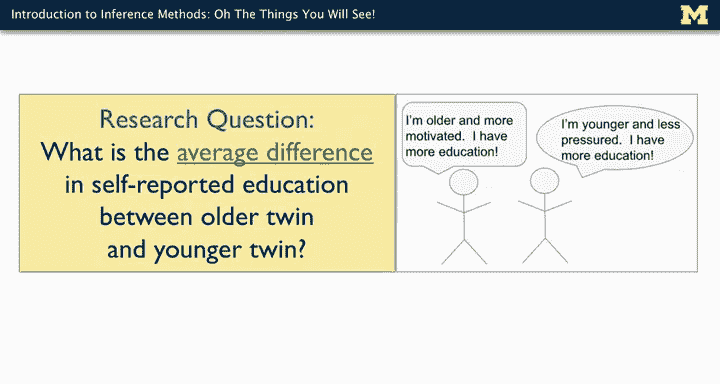

# 密歇根大学《使用Python的统计学（理解并可视化数据、因果推断、建模）｜Statistics with Python》中英字幕 - P36：2_统计推断方法导览.zh_en - GPT中英字幕课程资源 - BV1dV411Q7j3

。

Hello。We wanted to give you an introduction to some of the inference methods that you will see ahead。

In particular， we're going to start using our data to do statistical inference。

To either estimate some parameters of interest with confidence or test some theories about those parameters。

For example， what proportion of all parents with toddlers report that they use a car seat for all travel with their toddler？

In this case， the focus is on a proportion。And we're wanting to learn what that proportion is。

So we'll be looking at estimating a population proportion with confidence。

Perhaps we're interested in learning what is the average cartwhe distance for all adults。

That distance of traveling with a cartw when you start with your foot and measure to the end of the cart wheel。

 What is that average distance。 So here， the focus is on average or mean。

We're still trying to learn what that value might be。

 so we will learn how to estimate a population mean with confidence。

Maybe we want to look at some twin data， the older twin versus the younger twin。

What is the average difference in self reported education？Older versus younger。

So now we're going to have a set of measurements， but they're going to be matched or paired by the twin pair。

 And we're still looking at what is that average distance。

 So the focus is still on an average or mean。

Estimating a population mean difference with confidence。

Maybe now we're interested in looking at Mexican American adults that are living in the United States。

And we have a specific question of interest， do males have significantly higher mean body mass index as compared to females？

So now we're wanting to compare two groups we have a specific question of interest as to whether one group is significantly higher than the other in terms of this mean or average response。

Here we're interested that in testing a theory about two different population means and how they compare。

In the past， about 52 per cent of parents believed that electronics and social media was the cause for their teenager' lack of sleep。

Is that the case to day， or do we have more parents today day believing that their lack of sleep is due to these electronics and social media。

So we have a status quo of 52% cent in the past， and we want to know if that rate has gone up。

 Do more parents to day believe that statement。Testing a theory about a population rate or population proportion。

These are just some of the examples that you're going to actually see ahead as we get into the statistical inference side。

 using our data to estimate parameters with confidence and test theories about those parameters。

