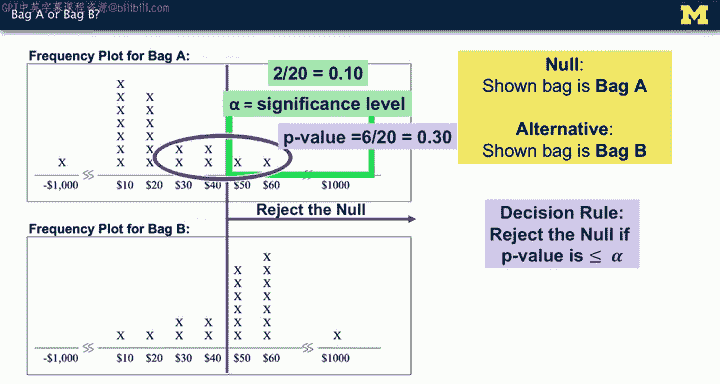

# 密歇根大学《使用Python的统计学（理解并可视化数据、因果推断、建模）｜Statistics with Python》中英字幕 - P37：3_A袋或B袋：概率选择问题.zh_en - GPT中英字幕课程资源 - BV1dV411Q7j3

Welcome。In this lecture， we're going to see an introduction to some of the ideas behind decision making and testing of theories。

So we have two banks， bage。And big B。Both banks contain 20 vouchers with values written on them。

Here's a picture of what those values are。 So big A。Has a negative $1000 voucher in there。

It's got some positive ones too， with a total value though， that would put you down to $560。Bg B。

 on the other hand， has all positive voucher values。 The total value for this bag is $1890。

The labels for the two bags are going to be removed。And then。

I'm going to mix up the bags really well。And I'm going to show you one thing。

You're going to be allowed to take some data from that big to make a decision。

As to which big you think it is。And then you can decide to keep this spaig that's shown or ask for the other one。

Now， the end result is whatever beg you end up taking is the one that you either have to pay out the 560 if it's big a or you earn over 1000。

 So， of course， we don't want big A。Another way you can view the information。

Is that we have two different models for the Sch bag。This might be Beet， that's our null theory。

And the alternative， the more promising one that we'd like to have， Ba B is our alternative。

And those two models are presented in these two frequency plots。

You're going to be allowed to take one observation， one voucher from the bag after it's mixed well。

And a between these two competing theories。So how are you going to make that decision？

Let's start with the easy ones。If we reached in and selected a negative $1000 voucher。We know。

 It's baget。And we would say， I don't want that big。 I want the other one， please。

What if we reached in。And the voucher we pulled out is $1000 voucher。 Well。

 now we know it's big B that's being shown。 Please give me that big。But what about the value，60。

6ix0 could occur in either of the two banks。But if the selected voucher value was a $60 voucher。

 Which one would you select， Would you stay with the k null and say it's bage or would you decide。

 I think that's big B。You look at the results and you say $60。

 that voucher value would have a much more likely chance of coming from Ba B。Big A only has one。

 Bigg B has many more。So we'd probably go with the alternative theory。 I think the shn be is Ba be。

What if we go to the other end And the voucher that we select is a $10 voucher value。 Now。

 which of the two theories would you select， Would you stay with the k null and say。

 I think it's bag A， or would you go with big B， It could happen under big B。But again。

 that would be a more likely observation under baget。 so you're going to stay with the k null。

We're starting to form a decision rule。We're looking at the values that are possible for our observation for our data and deciding which ones seem unusual under the null theory。

 thus more likely under the alternative， which would lead us to reject that null。

So let's try a few other values。 What if the voucher value was a 50， what would you decide。

Would you say that would lead you to reject the null or stay with the null。Once again。

$50 is more likely under bag B than bag A。So we would probably say$50。 I'll think this is big B。

How about $20。Much more likely under Ba A could happen under Ba B。 So， again。

 let's put that value is， oh， we'll stay with the null。 We'll think this is bag A。Now。

 what if it was $30 or $40？Those values equally likely under the two different competing models or theories。

 that might be a harder decision。But we're taking the values and deciding which ones would lead us to reject the null hypothesis and which ones would lead us to stay with that null hypothesis。

Now， which values generally LED us to say， I think it's big B。 reject the null。

 We the larger ones or the smaller ones。Since here。

 the larger values are more likely under the alternative， less likely under the null。

 It's those larger values that are more extreme and lead us to rejecting。

 So our direction of extre is said to be too the right to the larger values。

So let's look at a potential decision rule that we could use。Let's decide we will reject that null。

 think the bag is bag be and keep it。 If our voucher value that we pull out is $50 or more。

Reasonable rule？We can actually evaluate how well this rule would perform even before we look at our data。

Because there are chances of making mistakes。 We can decide it's big B， And it really is big A。

 or we might end up deciding it's big。 A， when it's really big B。

 Those are the two mistakes we could make。 So let's talk a little bit about those errors。

So the first error。What if we were to reject the null。Meaning we got a $50 or $60 voucher value。

 but really the null is true。Where on our two graphs does that happen。

 that we are looking at rejecting the null when the null is true。Well， if the null is true。

 it's bage， so look at that distribution。And where are the parts that would lead us to reject the null。

 Well they would be that $50 or $60 voucher values。 There's only two possibilities out of the 20。

For which we would end up making the wrong decision。

Rejecting the k null when the null was really true。2 out of 20。10%， not too bad。Now， of course。

 there is the other mistake that could be made。The other error would be that you decide to stay with that null。

 not reject it。 But the alternative was really true。 It was really big B。

Where on our two pictures does that type of outcome occur？Failing to reject。

 not rejecting the k null， but the alternative is true。

Alternative true means look at big B and find the part， which would lead you to not rejecting。Well。

 that's going to be all of these values here。1，2，3，4，5，6。

6 out of 20 is the rate for which that error might be made。 If the alternative is really true。

 we'd make a mistake using this rule。6ix out of 20，30% of the time。

So these two mistakes that could be made in decision making have names。

They're called a type1 and a type2 error， real clever names。

And the probabilities of those errors happening also have notation。

A type1 error probability is denoted by alpha， which is also called the significance level。

And then a chance of a type 2 error happening。Is beta。So alpha beta。

 we can see there's a little bit of play here if we were to take that rule of $50 vouchers or more and move that line one way or the other。

 we'd be changing that level of a type 1 and type 2 error rates。

Now we have decided to go with our rule of $50 or more。

Picking that rule that cut off of $50 more is effectively picking our significance level right up front。

We're deciding that the significance level is going to be set at 10%。

The results that we get from our data have to be so unusual that they would occur 10% of the time or less。

And then I would reject the null。Often， rather than stating the decisional in terms of the values of the actual response and having to consider that for every different background。

 we instead take a look at picking the elf that we'd like to have right up front。

 that probability of a type 1 error being set。And then we look at our data and calculate a probability from it。

That probably being the P value。How likely is it to get the results you got or more extreme？

So let's try this out。Let's pick aboutou your value from our shown bag and see what we want to do。嗯。

We'll mix it up real while。For we。$40。$40 voucher value。So according to our rule。

 what would be our decision？Are we going to reject that null？Or fail to reject that k null。

In order to reject the k null we needed $50 or higher and this isn't。

 so we're going to stay with the null theory， we can't refute that theory。And say。

 I think this is Bee。And ask for the other bake instead。Now we just made a decision。

To stay with the k null。It's possible that that decision we just made by asking for the other bag could end up being a bad decision。

 An error in the sense of having to pay out $560， because we thought this was bag a。

But really it's big B， and we asked for the other one， which is the big A。

Once you've made a decision though， there either is a correct decision that was just made or an error。

No more probability about those mistakes being made， it's either right or wrong。Now。

 from the P value approach， we would be looking at the value we got，40。And we'd be calculating。

 how likely is it to get that value or something more extreme if the null theory were really true。

How compatible is this result with that null theory？Well， from our chart。

$40 or higher under the null。Could occur。Four different ways。4 out of 20。

20 per cent chance of getting what we got or more extreme。 That's kind of likely。

 That's more likely than what we put down as a requirement with that level of alpha selected at 10 per cent。

So another option for making decisions in general is to set your significance level alpha up front。

Take your data and calculate from that data the corresponding probability called the P value。

 How compatible is your data with H not。And if that P value is small。

Your results are not compatible with that null theory。 You're going to reject that theory。

But if your P value is somewhat large， larger than what you required。You're not going to reject。

So a universal decision rule that could be used。Is to reject the null if your P value is small。

 how small， less than or equal to the significance level that you picked up front by drawing that line in the sand。

This overall P value approaches what we see in a lot of write up of studies。

 the corresponding P values reported and reporting then whether or not the results were found to be significant。

So looking at that P value again， let's do a little what if？

If the observed value from the bag had been a $60 voucher value。

Then our P value for that observation would have been the chance of getting what you got 60 or more extreme。

 there is nothing more extreme， so just one out of 20。Under that null theory。

That P value was small compared to our significant level that we picked up front。

So we would reject the k null with a 60。What if the value pulled out of the bank had been a $50 voucher value？

Calculating the chance of getting what you did get or more extreme under the null theory now would be。

10% exactly equal to our significance level。Leading us to still reject the null。

 we had just enough evidence to lead us to reject。But if we got a 30 or 40 or one of these other values。

 let's say 30。Now， the probability of getting what we got or more extreme to the right to the larger values。

That's much larger，30% chance here。The P value is larger than alpha。

 We do not have enough evidence to reject the null。

So with our big A and B B example， we have seen a little bit about how you might state the competing theories。

 the hypotheses。We've learned that you would basically select a significance level for making your decision。

And then we've used data to make that decision via a probability value from that data called a P value。

Don't worry， all of these terms and ideas will becoming more and more understood as we see more details about making inferences ahead。

