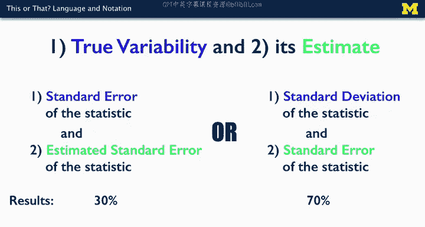

# 密歇根大学《使用Python的统计学（理解并可视化数据、因果推断、建模）｜Statistics with Python》中英字幕 - P38：4_专业术语与符号规范.zh_en - GPT中英字幕课程资源 - BV1dV411Q7j3

Yeah。Welcome。Statistical notation and terminology is important。

But it also can be a little bit confusing。Some notation is fairly common。But others。

 not so standardized。We wanted to share with you a little statistical notation and terminology that you're now going to start to see a little bit more in the course material ahead。

😊，So I came up with some this or that questions around different views。

 comparisons about how to represent different statistical concepts and some of the terminology。

I sent these on to our course development team so that they could cast their vote。

Now I started with a couple of questions that were fun questions about ice cream and gymnastics moves。

So the first question posed was， if you had to choose your flavor of ice cream。

 would it be vanilla or chocolate？Turns out that our team members were evenly split。

 and I'm on the vanilla side， although I do like to enhance my vanilla ice cream with a little chocolate candy sprinkled on top。

The second question has to do with gymnastics moves。

Ties in with our cartwheel data set that you'll see in some of the examples。If you had to。

 at this point， perform either a rollover or what I call a somersault or a cartwheel。

 which of those two would you choose？When asked of our team members。

 we have more that prefer the somersault or rollover over the cartwheel now I'm on the cartwel side and I have sometimes done a cartwheel for my in- class students when they perform very well on a review clicker question。

So how about if we turn to some more statistical ideas？First。

 when we're talking about trying to learn about the population mean response。

 when we have a population of interest and the response is quantitative。

 we often represent the true mean response with a Greek letter mu。Now。

 most of the time that quantity won't necessarily be known to us because we don't have all the data for the entire population。

 so we end up having to take a sample。The question then is。

 how should we represent that sample mean that statistic or estimate of this population parameter？

There are some that view， take any parameter， and just simply put a hat over it。

 and now you've got your estimate of it。So when asking our team members。

 what would be your preferred notation for a sample mean， new hat or X bar？We had 70% saying Xpar。

 which happens to be a notation that you might see on statistical calculators and in some software。

And 30% that say put a hat on it whenever you're talking about an estimate of a parameter。

If we turn to the variability side。So now we have a population of interest。

 a response that's quantitative when we're talking about。

 say the variability or the standard deviation in that population of responses Classic again is to use a Greek symbol called sigma to represent that standard deviation。

😊，So before we talk about different ways to represent an estimate of this population standard deviation。

 we've got a short little story called the Sigma story that's going to be shared with you by Brady West。

And I just want to share a little story from a statistics class here at University of Michigan a couple years back this was a course on sampling。

 so sampling something we learned about in the first course and in this course the professor of statistics was writing the Greek notation or the Greek letter Sigma quite often and the professor was using sigma to refer to a standard deviation so we introduced the idea of the standard deviation of the values on a variable of interest and this professor was using Sigma like we see here to refer standard deviation but this was an introductory course and not a lot of students had seen the use of Greek notation for statistics before so the students just accepted what the professor was saying and the course went on so the thing about Sigma is that different professors and even different manuscripts different faculty members the Sigma symbol could appear in different ways so here's one way。

ri it the way that I would usually write it Here's another way that I've seen where some faculty or even some texts may use a little bit more of a curve on the tail of that sigma。

 so you see there's a little bit of a curve in the way that this is written。

 but still referring to the same thing， usually it refers to a standard deviation of the values and a variable of interest。

Some faculty， when they're writing on the board or again the writing and texts could actually。

Curve the sigma symbol even a little bit more so you see this is really getting tilted a little bit。

 but the faculty member may still intend for that to represent a standard deviation or a sigma well it turns out in this statistics class the faculty member who was teaching that class tended to write the sigmas like this so whenever the faculty member was writing sigma on the board again the faculty member was referring to this standard deviation of the values on a variable of interest but one of the students in that course kind of was speculative about what this really meant the whole semester never really said anything in class just kind of went along with the flow after the class was over the student came to visit the professor in his office and said。

 you know professor I was really confused by this notion of the standard deviation when you were going through all your examples in class and you were writing the standard deviation on the board like this and the student said professor why did you always set the standard deviation equal to6。

So the student didn't recognize that the professor was using the Greek symbol Sigma。

 but because of the way the professor wrote this on the board， which may have looked like this。

 the student thought that every time the standard deviation was appearing on the board。

 that professor was simply writing six and assuming that the standard deviation was equal to6 so for the entire semester the student was assuming that the standard deviation of any variable of interest was equal to6 so it depends a lot in statistics what symbols mean and we're talking about different ways of interpreting different symbols and how they may refer to the same thing。

 but whenever you're using notation， whenever you're using Greek symbols or other notation to refer to these kinds of concepts。

 you have to be very clear about what those symbols mean and make sure that your audience and the people reading your work know what you mean by Sigma if you're actually writing things out this way。

 so just a funny little story about how different people can view notation in different ways in different notation could be used to refer the same thing。

 but generally when you see sig。It refers to the standard deviation of a variable of interest。

All right， population standard deviation， Sigma， not6， but sigma。

If we're now going to estimate that population standard deviation。

 what is the preference put a hat on it， sigma hat， or use S for the sample standard deviation？

So we had a few who were on the X bar side for a mean， move over to say。

 now let's just put a hat on it， Sigma hat to represent an estimate or that statistic versus S S。

 however， is what you often see on a calculator and in some computer output。

Let's turn to proportions。 So now our response is not quantitative。 Talk about the mean response。

 but now a categorical outcome。 And we might want to learn about what is the true proportion in our population that said yes。

And then use our data to come up with an estimate of that true proportion。Looked around。

 and there's a couple different views。 Some like to refer to the population proportion as that pie。

 pi， and then pie hat representing the estimate。 So staying with the Greek letter side。

Others use P for the population proportion and still put a hat on that to represent the statistic or estimate。

When polling our team members。Overwhelmingly， many of us use the P& P hat notation to represent the true proportion in a population that would say yes。

 compared to the estimate based on some data。You'll actually see PM&P hat in some of your material coming up soon。

Let's move on to the idea of confidence intervals， this will be the first inference technique that we take a look at in a little more detail。

We discussed in our introduction earlier that it's your best guess。

 plus or minus a margin of error that we go out each way to form our interval of reasonable values for this parameter。

That margin of errors comprised of two main parts。A multiplier。

 a few that reflects how confident we want to be in that process。

 and then some measure of the variability， the sampling variability in our statistic。

Let's focus on that view， that confident idea。You may recall that often 95% confidence is the level we like to use。

And when we talked about the empirical rule， going out one。

 two standard deviations each way gave us about 95% in the middle。

So when asking our team members for that multiplier that you use in your 95% confidence interval。

 do you use to or do you now use that exact value， 1。

96 that would actually produce exactly 95% in the middle， 1。96 or two？

Where there's a couple that like the two idea and others that， say let's just use 1。96。

 it becomes a number that kind of sticks in your head and you'll see 1。

96 used as our multiplier when we develop 95% confidence intervals in our material coming up。

Let's now turn to the other idea within a margin of error， that idea of variability of our statistic。

You may recall that statistics because they're based on data are going to vary from one sample to the next sample。

 if you repeated that same process， you might get a different value for that estimate that statistic。

 so there's a distribution of values that are possible for your statistic and that spread。

Reflects the variability in that statistic。So now we're going talk a little bit about terminology。

 what do we call that true variability measure， and then what do we give is the name for the estimate of that variability because it's often the estimate of this variability that we end up using in our margin of error that's based on our data。

So there's sort of two camps about this。Some say since they are now talking about the variability of a different thing。

 a statistic， instead of the individual values of a response， but a statistic。

 a summary of all those responses， let's call that now that standard deviation。

 let's call it the standard error of the statistic。

And then since you often have to put in your best guess about that， your estimate of it。

 just say it's the estimated standard error。On the other side， we have some say， well。

 you're talking just about the standard deviation of your statistic。

 that's just the thing that's varying now。 so just call it the standard deviation of your statistic and have a name for that estimate to be the standard error。

So you can see this could be a little confusing， is the standard error of our statistic the true variability。

 or is it representing the estimated variability in that statistic？

Pold our course development team members。And most of us are on the side of standard deviation and then standard error for the estimate。

But we also generate some nice discussion and we decided to come up with and use for this course。

 the first method of standard error of a statistic represents now variability in this kind of idea an estim or statistic。

 and then when you use your data to plug in for that standard error， you call it the estimated one。

So that's the convention that we're going to use in this course。

So you can see that not everyone agrees。What notation and what terminology to use。

 but as long as we provide definitions of what we're using and we're consistent in those definitions。

 we're going to be okay。In fact， we have provided for you a nice summary of some of the notation and terminology you're going to see in the course coming up ahead so that you can refer to that as needed。

Certainly， these terminology and notations are helpful because they allow us to be a little more efficient when we're explaining how to do some statistical analyses。

 also more efficient， perhaps when understanding some of the statistical output we might see are some of the more technical reports。

However， we are going to also focus on words。 We're going to be talking about how to write interpretations。

 and that's going to be one of the more important features we'll discuss in this course。

 So when you're writing up a summary of your results， it's fine to write sample mean。

Rather than using X bar or mu hatt， whatever might be your preferred notation。So again。

 we're providing you some summaries of what will be the common notation and terminology you'll be using in this class。

 so it's not going to be too hard， we can handle a little bit of notation and terminology because it's going to help us on our learning journey ahead。

