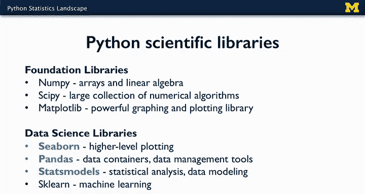

# 密歇根大学《使用Python的统计学（理解并可视化数据、因果推断、建模）｜Statistics with Python》中英字幕 - P39：5_Python统计生态再探.zh_en - GPT中英字幕课程资源 - BV1dV411Q7j3

嗯。

Hello， my name is Kirby Shedon。 I'm a professor of statistics at the University of Michigan。

The language we're going to be using in this course is Python。

 This will be a brief presentation about the landscape of Python tools that can be used for doing data analysis。

Python has been around for a long time since 1991。 It's considered easy to learn and it's popular because the code is easy to read and doesn't use a lot of obscure syntax。

Python also has a large standard library that makes it easy to write short scripts to accomplish many common tasks。

Unlike domain specific languages like R， Matlab and Saas。

 Python is a general purpose language that was not designed specifically for data analysis。However。

 by using Python together with some very powerful libraries。

 Python can become an ideal environment for analyzing data。While Python is easy to learn。

 it is not particularly fast， but speed can be an important consideration when conducting data analyses。

To resolve this issue， the libraries used for data analysis and Python are actually written in C。

 but they can be called through Python。Ordinary users of Python can use these libraries without knowing any C and can take advantage of the speed of these highly optimized libraries。

The libraries we will use in this course were developed over the last 25 years by independent teams of programmers。

 mostly working out of the open source community。There are libraries for data management。

 numerical calculations， graphing， and statistical modeling among other areas。

These libraries are reasonably mature and stable and can be trusted for producing accurate and meaningful results for work in research and in industry。

The libraries we will use in this course are listed on this slide。The first three libraries， num Pai。

 Sip piei and Mot Platlab， provide a foundation。These libraries are called by the other libraries that you will be using。

 but generally you will not directly utilize these libraries in your own code。

The libraries listed in blue are the libraries that you will directly use in all the work of this course。

Specifically， Seabornoure is a high level language for graphics and data visualization。

Pandndas is a powerful library for data manipulation and data management。

And Stats models provides a wide variety of statistical modeling tools。Finally。

 we've listed another library here called S KLn。 This is one of the many libraries that you may want to consider beyond this course。

SKLearn provides a number of tools for machine learning and predictive analytics。

Throughout this course， you will see examples of how Python can be used for data analysis。

The core Python language in the libraries that we have discussed here will be covered in detail。

By using these tools in the Jupiter Note， you will be able to focus on the language and tools without having to worry about installation and configuration。

