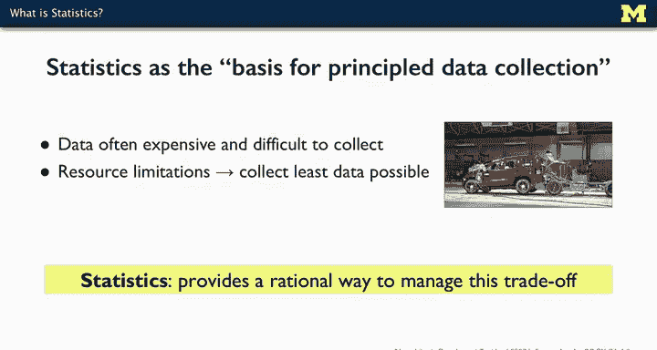

# 密歇根大学《使用Python的统计学（理解并可视化数据、因果推断、建模）｜Statistics with Python》中英字幕 - P3：2_统计学本质解析.zh_en - GPT中英字幕课程资源 - BV1dV411Q7j3

Yeah。

Hello， in this lecture， we're going to talk about what is statistics。

 We're going to do a little bit of terminology。 We'll have a few perspectives about the field of statistics。

 maybe a touch of history， and then some of our connections with our allied fields。

So what is statistics？Well， it's the subject that encompasses all aspects of learning from data。

So as a methodology， we're talking about the tools。

 the methods to allow us to work with data to understand that data。Now statisticians。

ToApp and develop data analysis methods， and we're constantly seeking to understand their properties。

 When will those tools provide us insight， When are they possibly misleading。

Researchers across all different academic fields， workers in various industrial settings are applying and extending the statistical methodology。

 and they're contributing new ideas and methods for conducting data analysis。Now。

 I think a little terminology is needed up front， the difference between a statistic and the field of statistics。

So we encounter statistics every day， we're talking about numericalographical summaries of a collection of data。

This could be the average score in the final exam that I report to my students。

Or maybe we're interested in the minimum temperature at some location over some time frame。

Or perhaps what proportion of people are retired in our survey that might allow us to extend to what that might be in the city？

These are statistics， but the field of statistics is that academic discipline that's focusing on research methodology。

As statisticians were developing new statistical tools， were calculating statistics from the data。

 and most importantly we're collaborating with the subject matter experts so that we can interpret those results in appropriate ways。

Statistics is certainly a very evolving and dynamic field。

 and along with that then we have challenges which provide opportunities。

The properties of the various statistical methods are under continual study。

To know when to use them in appropriate ways。We have a ton of new application areas and those new areas are leading to the need to develop some new analytical methods。

Then of course， the way we measure data out there， the new types of sensors that are available that leads to new types of data that need analysis。

And of course， we're relying often on those advances in computing。

 that now not only allows us to do data analysis but more sophisticated analysis on the large volume of data that is being collected。

There are different schools of thought about the field of statisticsistic。

 Statistics is sort of a big tent discipline。 It's incorporating new ideas from theory。

 practice in our allied fields。So we're going to take a look at some different perspectives on the field of statistics and how people who work with data view that field。

We'll start with the art of summarizing data。Data can be overwhelming。

And then there's the need to make sense of that data。

 which usually involves reducing and summarization。

One of the main goals of reduction of data is to make that data set comprehensible to the human observer。

Stticians have a variety of different techniques for summarizing data。

 and those need to line up with the goals of the data consumer to be meaningful。

So a statistician is well trained at utilizing appropriate。

 rigorous and effective methods for summarizing data。Data can be misleading。

A primary motivation for developing the field of statistics was to give us a structure。

 a framework for being able to assess whether claims based on data are meaningful。In general。

 insights from data are not 100% accurate。But it is certainly wonderful that we have a way to quantify how far away reported findings may be from the truth。

Many public opinion polls report results along with a margin of error。

This margin of error is providing an idea of what that potential discrepancy will be between the reported and the actual states of public opinion。

Now understanding data is very important， but of course that leads to the need of being able to act on what we've learned。

There are some fields of statistics where that idea of decision making is the ultimate goal of any statistical analysis。

In our personal and our professional lives， we are making decisions in the face of uncertainty。

 We have to balance， what are the costs and the benefits of the different approaches。For example。

 a person finds that they might be at higher than average risk for a certain type of cancer。

 should they undergo a preventative procedure。Statistics can help inform that decision making process。

Now， when we summarize data， we're often focusing first on that typical or central value。

But certainly in statistics， we place great emphasis on understanding variation in data。If we know。

 on average， Americans have around $6000 of credit card debt， we have a pretty good idea。

 that' central value。For credit card debt distribution。

But if we're provided that about 10 per cent have more than $30000 in credit card debt。 Well。

 now that percentile gives us a little bit more information about the variability in credit card debt for our population。

Some of the central tasks and statistics is forecasting or prediction。

We can't know the future with absolute certainly， but if we have efficient use of data that's available。

 we can sometimes make fairly accurate predictions about the future。We have weather predictions。

A prediction of when there's going to be a risk for an earthquake。

Trying to estimate what that future demand will be for a new product that's going out on the market。

Predicting the outcome of an election。Or whether or not a patient will respond favorably to some treatment。

Now we're collecting a lot of data and some of those variables that we measure。

 some of those are able to be measured with pretty high accuracy， I mean。

 a person's age or their height。And then there are some variables that are a little bit more difficult to measure。

 I mean， blood pressure actually varies from minute to minute。

So that's a little bit more difficult to pin down。And then there are those constructs such as mood。

 personality， political ideology， these are much more difficult， much harder to define。

 and then quantify。Statistics plays a major role in constructing and evaluating good。

 rigorous approaches for measuring these difficult to define concepts。

 and then for assessing the quality of the various approaches。Finally。

 we come to statistics as the basis for principled data collection。

Sometimes data can be very expensive and difficult to collect。 I mean。

 if you have to destroy your product in order to take a measurement on it。

 we certainly are looking at having the ability to collect the least amount of data possible。

Resource limitations limit how much data can be collected。 But if we have too little data。

 that can mean that the findings will be not as good。

So statistics provides a nice rational way to manage this trade off， wanting more data。

 but knowing and allowing those resource limitations。

So how about a little？History of statistics， some of the milestones。

When we've been collecting data for forever， back in ancient times。

 ancient civilizations have been collecting data on harvest， on floods， population sizes。

In the 1700s， we're talking about the development of probability theory。

 so now randomness and variation can be more mathematically defined。

Modern statistics emerges in the 19th century， primarily coming from addressing questions that came from the areas of genetics。

 conometrics。Satistical theory advances in the 20th century with a lot new application areas in science and industry。

And of course， the emergence of the ability to have computers to do that data analysis。

And then we're in that era of big data， massive data， data science， and machine learning。

Statistic certainly has a lot of intersections with its allied fields。

Computer science to provide us the algorithms， the structures for working with data and the programming languages for manipulating that data。

In mathmatics， we get the language and the notation for expressing some of these statistical concepts more concisely and the tools for being able to evaluate and understand the properties of those statistical methods。

One branch of mathematics is probability theory， that crucial part of the foundation of statistics that allows us to express the ideas of randomness and uncertainty。

And then data science， that gives us that database management， machine learning。

 that infrastructure to be able to carry out data analyses。

Statistics has certainly grown from a small but important field to now be a major linchpin in research and industry。

A number of different emerge applications include computer vision。Automated driving。

 the ability to have facial recognition。Recommender systems from that online searching and online purchasing。

In the health field， we have predictive and analytics， precision medicine。Fraad detection。

Risk assessment in environment and infrastructure。Social and government services in terms of job training and behavioral therapy。

So statistics and statistical thinking。Helps us to understand that data and that information that surrounds us。

So get excited。And best wishes on your statistical journey ahead。

