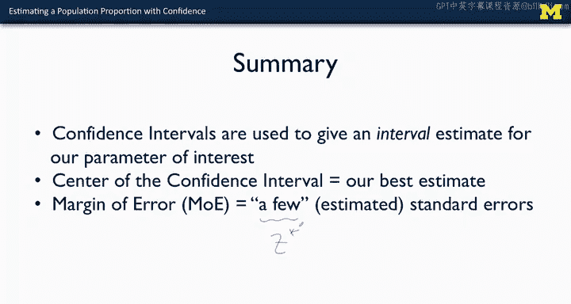

# 密歇根大学《使用Python的统计学（理解并可视化数据、因果推断、建模）｜Statistics with Python》中英字幕 - P40：6_基于置信度的总体比例估计.zh_en - GPT中英字幕课程资源 - BV1dV411Q7j3

Hello and welcome back In previous lectures we've been talking a little bit about what a confidence interval is and today we're going to actually calculate one ourselves and specifically we're going to be looking at population proportions。

So to go back， we looked at a confidence interval as being a best estimate plus or minus our margin of error。

And what we said was the best estimate is our unbiased point estimate。

 which for our case of one proportion， that's going to be what we call P hat。

And the margin of error is defined as a few estimated standard errors。

 so the a few here is just a multiplier that's based off of our confidence level。

 so typically you have a 95% confidence level， so this a few would be 1。

96 or two depending on what you prefer。And having a 95% confidence level leads to a 5% significance level。

 which will come in handy later on。To look at one proportions。

 we're going to be using an example from the CS Mot Children's Hospital。

 which is a hospital based in Ann Arbor， Michigan， where they are constantly doing national polls on children's health。

 so we're going to be looking at an example of children's safety precautions that parents use when driving。

A little bit of the background of the poll is。Motz asked what proportion of parents reported they use a car seat for all travel with their toddler。

So the first two things we want to do whenever we have a statement that we want to do inference on is come up with our parameter of interest and our population。

So our population here is going to be parents with a toddler and our parameter of interest is a proportion。

 so that will be lowercase P for our use。And then having these two set up。

 we can now construct a 95% confidence interval for the population proportion of parents reporting they use a car seat for all travel with their toddler。

Mots went out and did this poll and they sampled 659 parents with a toddler。

And they asked if a car seat was used for all travel with their toddler。

 540 of those parents responded yes to this question。

To go back to our original best estimate plus or minus the margin of error。

 this is always where you begin with calculating confidence interval。

 we first want to come up with our best estimate， which is going to be P hat or the sample proportion and calculating this is simple enough of just taking our sample size and the number of yeses dividing the two so x over n where x is typically called the number of responses that said yes。

 and we get our P hat to be 540 over 659， and that gives us P hat of 0。85。So now we have P hat。

 we now need to figure out our margin of error， so the right hand side of that plus or minus。

And again， the margin of error is a few estimated standard errors。

 which now we have estimated standard error of P hat。The few。

 because we're looking at specifically a 95% confidence interval。It's going to be 1。

96 or you could use2 again， just your preference， and then this estimated standard error is this equation down here of the square root of P times1 P hat times 1 minus P hat divided by n。

So to plug everything into this equation we have our P hat of 0。

85 and our sample size of 659 with that， we simply plug it all in， we'll get 0。85 plus or minus 1。

96 times the square root of 085 times 1 minus085 divided by 659。

Which leads us down to a confidence interval of 0。8227 to 。8773。Now with the confidence interval。

 you're always going to have a lower bound and an upper bound and the center of this confidence interval should be our best estimate。

 so our P hat should be the center of this confidence interval of our 95% confidence interval。

And before we go on and continue with our analysis。

 we first want to describe what does this confidence interval mean。

 so what is it that we actually just calculated here？

Which a confidence interval is a range of reasonable values for our parameter。

 So what we can say is something like with 95% confidence。

 the population proportion of parents with a toddler who use a car seat for all travel is estimated to be between 82。

27% and 87。73%。 So this interval 82 to 73。So this interval of 82。27 to 87。

73% is just where we believe our parameter to be， it might be in there it might not be。

 we're not entirely sure if it is or not， but we're 95% confident that it most likely is。

So to wrap up what we've talked about in this lecture。

 we calculated our first confidence interval by using our best estimate and our margin of error of P hat。

And it gives us an interval estimate of our parameter of interest。

 so we're taking our statistic P hatAT， and we're using it to come up with an idea of what our parameter might be。

 what the actual value could be。The center of confidence interval is always going to be equal to our best estimate because that's what we center the interval around。

And we simply add or subtract the margin of error from it。And that margin of error again。

 is defined as a few estimated standard errors。And this a few， as we'll see。

 is oftentimes called Z star for a one proportion case。

 and then you take whatever standard error estimated standard error you need。

