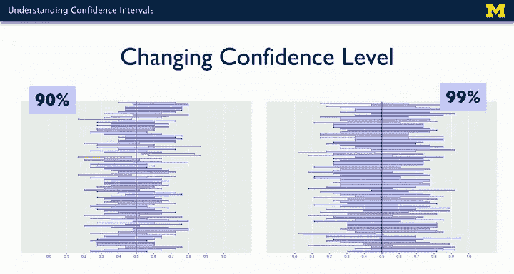

# 密歇根大学《使用Python的统计学（理解并可视化数据、因果推断、建模）｜Statistics with Python》中英字幕 - P41：7_置信区间原理详解.zh_en - GPT中英字幕课程资源 - BV1dV411Q7j3

Welcome。Now that we've seen how to make Comp intervals。

 we want to talk a little bit more about how to correctly interpret them。

 what they are used for and how they help us。So we're going to talk about how to interpret confidence intervals。

ALi bit about what that confidence level really means。

And then also understand how we might change up our interval if we want to instead be 99% confident instead of 95%。

To get us going， let's look at a background for have a little context。

In a sample of 659 parents with toddlers。540 about 85% stated they use a car seat for all travel with their toddler。

From these results， a comp interval was provided。Going from about 82。3% up to 87。7%。

So what does this conference interval tell us how might we interpret this interval？

To better understand that， it might be first good to ask a question。

What do we make confidence intervals for？So think about it。 We make a comp 4 a。Is it a parameter？

Or a statistic。We make a comp for， a parameter。In our example。

 we would say that this interval is a confidence interval for a population proportion of all parents with toddlers who report they use a car seat regularly。

For a population proportion， now we used our sample proportion to construct this interval。

 but we don't refer to this interval as being a con intervalable for a sample proportion。

It's a range of values to help us estimate what we think that population rate might be。

With a high level of confidence。What we have here is a pretty good statement about the interval reporting it and then some good context around it。

 But we can improve upon that in a couple ways。We want to make it more of an interpretation that conveys that it's coming from data。

And make sure we always are talking about what confidence level we were using。

So here's a couple of good statements。We estimate， with 95% confidence。

That population proportion of parents with toddlers who report they use a car seat for all travel somewhere between that 。

8227 up to that 87，73。Another good way of saying。Based on our sample of 659 parents with othersddlers with 95% confidence we'd estimate between 82。

3 and up to 87。7% of all parents report they use a car seat for all travel。Both of these statements。

 well written。Do include the confidence level that was used。 that phrase with 95% confidence。

Both of these statements convey that we are using the data to estimate the population parameter。

 in this case， estimating a population proportion。In the second phrase， it says based on our sample。

 we would estimate the rate to be for all such parents or for that population of all such parents with toddlers。

And finally， that last statement nicely includes the sample size。

 which is often left out and a very important feature for us to truly understand the results of a study。

So we have this range of reasonable values for which we would estimate could possibly be that population proportion。

In fact，83% cent falls in this interval， So it would be a reasonable value for that population rate。

 We could not refute it。 Our data would not reject。83% cent could be that true rate。

86% could be that true rate。 We get a range of reasonable values for that parameter based on our one sample from that population of interest。

So how do we better understand what that with 95% confidence phrase really means？Well。

 let's think about that a moment。Does the interval we have here that 82 to that 87。

 does it contain the sample proportion of parents with toddlers who reported they use a car seat for all travel？

Does it contain the sample proportion， Think about that。Is the sample proportion in this interval。

 Of course， it is most certainly is in the interval Ca we centered the interval at that best guess。

 that 85 per cent， that was our best estimate。 We went from that best estimate each way。

 a margin of error。So every interval is going to contain that corresponding sample statistic that best estimate would be right in the middle。

But what would your answer be to this question？Does our conference interval contain the population proportion of all parents with toddlers report they use a car seat for all travel。

What did you think。We would have to answer this， as we don't know。

In order for me to be able to say whether this answer would be a yes， it's in there or no， it's not。

 I would have to know the value of that population proportion。

That population proportion is a fixed value， but it's still unknown。 I don't know what it is。

 That's why we designed a study， to be able to gather data that's representative。

 to be able to estimate its value。So I cannot tell you whether this particular already made interval has the true proportion in it or not。

😊，So that leads us to one way that might often be incorrectly interpreting that confidence level。

 and we don't want to think of it as a chance or probability that there's a 95% chance the population proportion is in our interval that we just made。

That intervals already computed。 It's fixed that population proportion。

 that true rate for our population is a fixed number 2。 We're trying to learn what it is。

 but it ends up either being in between these two values or it's not。In some sense。

 the probability would either be one。Or zero， we just don't know which of those two answers it is。

The confidence level refers instead then to the confidence we have in the process we use to make our interval。

Not as a probability after our interval was made， but how confident we are about the statistical procedure that was used。

So let's think about that。Let's take a population for which we know already。

 the population proportion who would say yes， is 50 per cent。 Usually， that's not known。

But we need to know what the right answer is so we can evaluate how well the process is working。

Let's go to that population and take a sample of 25。Let's take our best estimate from that sample。

 the sample proportion and nuts's make an interval around it。Let's do that a lot of times。

 Let's say 100 times。 Take 100 samples， each of the same size from the same population。

 createate a comp of each time。What might we see。Well， here， the very first interval。

 the first line at the top of this image。Is showing us that the estimate was a little bit below the true rate of 50 per cent。

 But when we went around that best estimate each way。

 the interval still captured had the true proportion of 。5 in it。So it was colored blue。

 It's a good interval。And the next interval also included the true proportion。

The estimate was initially a little bit high， but the margin of error each way allowed us to have it interval that in the end。

 once it was observed， did have the true proportion in it。But a little further down。

 we see another interval。 It's got a different color。

It was an estimate from that sample that ended up being a bit too high。

 so much so that the interval around it did not capture that 50 per cent。 That true rate。

96 of our intervals here did contain the true proportion。 Four of them did not。

Each particular interval either did or did not。Do this again another0 times。

 and the results will vary different intervals based on different samples。 But here 95。

 of those 100 generated intervals did end up containing the true parameter。And only five did not。

Each interval either does or does not contain the true value。 But in the long run。

 we expect most of them， to。So this 95% confidence level is what we would expect in the long run。

Regarding that statistical procedure， about 95% of the intervals that are made with this method we used are expected to contain the true value。

That's why we're confident in the one that we did。 We're going to do this once。

 Take one sample representative， if we can。 largege sample size。Produce our interval。

And we're confident in that result， because this process guarantees that you would expect 95% of those intervals made with that method you're using to contain that true value。

Our last idea is to look at how you might change up that confidence level。

 what if you want to be 99% confident or maybe only 90% confident。Well。

 if you remember how we construct our interval， best guess plus or minus of few estimated standard errors。

 that few is the thing that reflects your confidence。So if you want to be more confident。

 the multiplier we need to use then has to be adjusted。Instead of being just 1。96 or about 2 for 95%。

 we might have to make it now two and a half，2。576。 if we want to be 99% confident。

The more confident we want to be， the multiplier is getting larger。

 the interval is going to be wider。So it's a trade off。Don't need to be as confident。

 your interval can be a little more precise。 want to be more confident you need that wider net to hopefully produce an interval that's going to have that true value in it。

We go back to our parents with toddlers。We would see that the 90% interval has a smaller margin of error and as we become more confident。

 Indeed， the interval is going to be wider。Here's the image that shows 90% intervals being generated and the 99% intervals。

99% compete intervals are generally wider than the corresponding 90% intervals based on the same data。

So we have seen now how to interpret our conference intervals better。

We better understand what that confidence level really means。

And we do have some options for the desired conference level that we would like to use。

