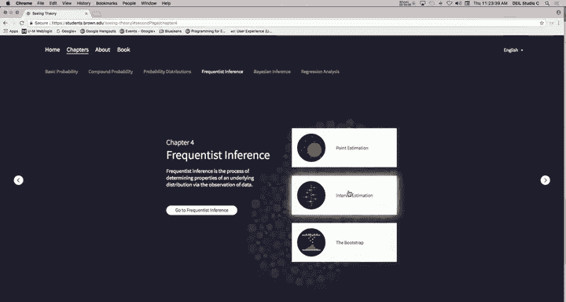
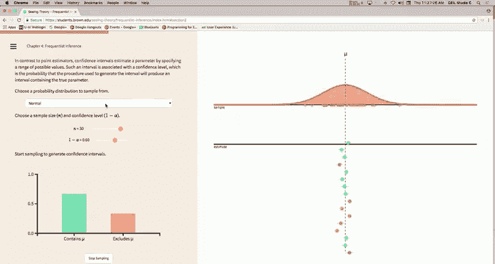

# 密歇根大学《使用Python的统计学（理解并可视化数据、因果推断、建模）｜Statistics with Python》中英字幕 - P42：8_Seeing Theory理论可视化演示.zh_en - GPT中英字幕课程资源 - BV1dV411Q7j3

Hello and welcome back。 My name is Mark and today I'm going to be showing you how to use the Seeing theoryory app Seeing theory was created by Daniel Coonan。

 an undergraduate at Brown University His goal was to make statistics more accessible through the use of interactive visualizations。

 specifically today we'll be working with the interactive visualization he has created for confidence intervals。

To get started， either click on the link provided or head to your web browser and type in Seeing Theory Brown University。

 So whether you use the link or use your web browser。

 you should see a page that looks like this Student。brown。edu/seeingtheory。Once you're here。

 go ahead and click on chapters in the top left corner。And then to navigate to the chapter we want。

 go ahead and click on frequententest inference， you can see the six chapters listed near the top of the page。

 go ahead and click on that fourth one。Once you're here。

 you're going to click on interval estimation， this middle white box。

And that should take you to the applet that we desire。

On the left hand side are going to be a couple inputs that we're going to change throughout today and on the right will be the interactive visualization where that takes place so the first things first we need to choose a distribution in which we're going to sample from they've listed a couple different ones here。

 we're going to start with a normal distribution。Now you can see up on the right hand side。

 we've got a normal distribution and the population parameter for that distribution is right down the center as notated by this dotted line。

Now we can choose a sample size and a confidence level for confidence intervals that we'll be creating。

 and we can go ahead and start sampling。For the first go around。

 we're just going to stay with a sample size of five and a confidence level of 90%。

So what does this 90% mean？90% confidence level means that if we were to take repeated samples of the same size here。

 sample size is five， then we would expect each of out of the resulting intervals that we have。

 90% of them should contain that true population parameter that we're after。

So let's go ahead and start sampling。So you can see that we're taking samples of five from this distribution up here。

And they're dropping down and creating an interval， we've got our best estimate in the center。

 plus or minus some margin of error。The app goes ahead and colors the green one if they contain or overlap with that true population parameter。

 and it changes is red if it does not。If you can see on the left side here。

 we've got a nice bar chart that shows just what percentage of these intervals have captured that true population parameter and which ones have not。

And again， over time， since we set this to a 90% confidence level。

 we should see that this bar chart should level out to about 90% and 10% for those that contain the true parameter and those that do not。

So now let's see how these intervals are affected by changing the sample size and the confidence level first let's change the sample size。

 so if we slide this n equals 5 all the way to the right to its max value of 30。

We'll see that the intervals。That the widths of our intervals got much narrower than they previously were。

So now in looking at this， again， if we watch over time since we didn't change our confidence level at all。

 we should still see about 90% and 10% for these two bars。

 and they're fairly closer now 91% and 8% so if we kept watching this in the long run over time。

 we should see this level out to about 90% and 10%。Finally。

 let's go ahead and change our confidence level if we slide this bar a little bit to the left。

 let's say 0。6 or so。This is where the app can get a little bit touchy。Okay， so 60%。

Now we should still be getting。We still have a sample size of 30。

 but if we look at how many of these are green and how many of these are red。

 only about 60% of these new intervals being created should contain that true population proportion。

So this gives you a good idea of really what confidence level is。

 a confidence interval is just a single interval here as it moves down the screen。

 the confidence level however is saying that over time if you took repeated samples of the same sample size。

 we would expect to see 60% of these resulting intervals containing the true population proportion。

And that's pretty much roughly what we're saying seeing here。Now。

 feel free to go ahead and change the distribution， the sample size， or the confidence level。

 play with this on your own， but this will give you a good grasp of confidence intervals。

 confidence levels， and the inputs that change them。

