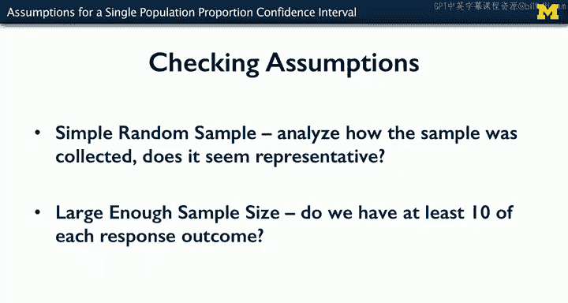

# 密歇根大学《使用Python的统计学（理解并可视化数据、因果推断、建模）｜Statistics with Python》中英字幕 - P43：9_单总体比例置信区间的前提假设.zh_en - GPT中英字幕课程资源 - BV1dV411Q7j3

。

Hello and welcome back。 My name is Mark Roowski， and I'm a lecturer here in the Department of Statistics。

 Today we're going to be learning about the assumptions necessary for a confidence interval。

 specifically for a single population proportion。Just a quick refresher on confidence intervals and what we use them for。

 we use confidence intervals to give us a good estimate of a population proportion so in order to do this we're going to create a confidence interval where the midpoint or center of the interval is going to be our best estimate this best estimate will be our sample proportion or our point estimate from the sample and then we're going to add and subtract a margin of error onto both ends of this midpoint this margin of error can be thought of as kind of wiggle room for our estimate and this wiggle room or margin of error。

Is going to reflect the variability that is expected within these sample estimates。

When creating a confidence interval we need to check a couple assumptions first and the first of those is to make sure that our sample of data is a simple random sample。

 a simple random sample is a representative subset of the population of interest with this we need to make sure that each of the observations or each of the subjects has an equal probability of being chosen if we can get a simple random sample then we'll have a reliable representation of our population of interest and that will give us a good midpoint for our interval。

The second assumption that we need， we need to make sure that we have a large enough sample size。

Why do we need this large enough sample size， well if we have a large enough sample size。

 then we can approximate our sampling distribution with a normal curve。

In the calculation of our margin of error， we use a critical z value or a z multiplier。

 and this is taken from a standard normal curve， so if we have a large enough sample size for our data then we can approximate our sampling distribution or a distribution of sample proportions with a normal curve。

 but what exactly is large enough？There are a lot of different viewpoints on the subject on what is deemed large enough。

 regardless the larger the sample size we have， the better approximation we're going to get as our n increases。

 our sampling distribution is going to become more and more bell shaped and that's really what we're after。

For us， with a single population proportion and a confidence interval。

 we're going to define large enough as at least 10 of each response outcomes。

 this is generally yeses and nos， so we would need at least 10 yeses and at least 10 nos within our sample。

So how do we check these two assumptions to make sure that we have a simple random sample what we're going to do is analyze how the sample was collected。

 we need to make sure that this sample is representative of the population of interests for this course generally we're just going to have a simple random sample and make this assumption but oftentimes you can have more complex sampling designs and this can be taken account for with weighting and other various techniques。

 but again for this course generally we'll have simple random samples。

To make sure that we have a large enough sample size。

 we just need to make sure that we have at least 10 of each response outcomes and again。

 as we said previously that just means simply 10 yeses and 10 nos within our sample if both of these assumptions are met。

 we can move forward with creating our confidence interval and this confidence interval is going to give us a good estimate of the true population proportion。

