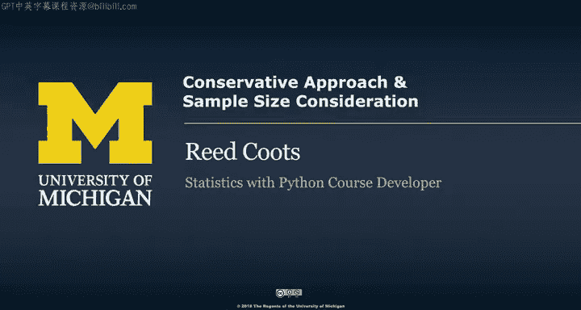
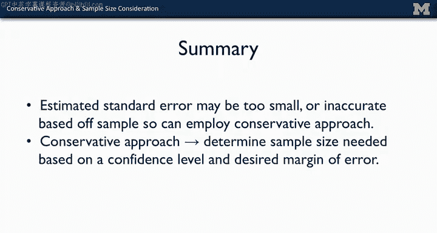

# 密歇根大学《使用Python的统计学（理解并可视化数据、因果推断、建模）｜Statistics with Python》中英字幕 - P44：10_保守估计：样本量考量方法.zh_en - GPT中英字幕课程资源 - BV1dV411Q7j3

Hello and welcome back。 So we've talked about confidence intervals as being a best estimate plus or minus our margin of error。

 And today we're going to do the same thing， except now we're going to look at a conservative approach。

 which is where we play a little bit safer and have a bigger margin of error than what we typically would use。

 And then with that， we can come up with a sample size consideration。

 So we can vary how wide or how narrow our confidence interval will be based off our sample size。

So we're going to start where we usually start with confidence intervals of being a best estimate plus or minus our margin of error。

 and just to reiterate our margin of error is a few estimated standard errors where that a few is a multiplier and we multiply that by our estimated standard error of our best estimate。

For a one proportion case at the 95% level， it would look something like this of P hat plus or minus1。

96， so the 1。96 is the a few we have， and we multiply that by the estimated standard error of P hat being the square root of P hat times 1 minus P hat over n。

So in a previous example， we had looked at the Mos Car seat example。

 which is where Mos Children Hospital took a sample of 659 parents with a toddler。

 540 of those or 85% stated they use a car seat for all travel with their toddler。

With this background we were able to come up with our P hat of 0。85， we had a sample size of 659。

 and then we plug all this in and we ended up getting a confidence interval of 0。823 to 0。877。

 so this is where we believe our parameter of p to B。

How we're going to change this up is by looking at the estimated standard error here。

Because we're using P hat to come up with our estimated standard error。

 so maybe a question we would ask ourselves is what if P hat is not accurate。

 maybe we didn't do a good enough job of making a random sample。Because of this question。

 sometimes you want to maximize the estimated standard error and how this is done is by plugging in P hat of 0。

5。So at P hat of 0。5， we would have 0。5 times 0。5 divided by n all underneath a square root。

 so it's like 0。5 squared or1 half， so the one half comes out of the square root。

 and we end up with just the conservative standard error of1 over two times the square root of n。

Having this new standard error， we can use it to again calculate our confidence intervals instead of using the above estimated standard error。

 we're going to now use this conservative standard error。

So here we're back to the Mos car C example where we still have a PAT of 0。

85 and a sample size of 659， but now I'm using my estimated or conservative standard error of 1 over two times the squared of n You'll also notice that here I chose to use2 as my a few for the 95% level just because I get nice cancellation between my twos here。

So really， it boils down to my confidence interval is just P hat plus or minus1 over the square root of n。

So our margin of error is only dependent on the sample size， which is a very。

 very nice thing to have。It allows us to vary our confidence interval width just by changing the sample size。

Having this new formula for a conservative confidence interval。

 because we're using the conservative standard error。

 we're making a conservative confidence interval。We can calculate it all out and we get。

95% confidence interval with a 4% margin of error， so that is 0。81 to 0。89。 So again。

 this is a wider interval than what we just previously saw。

 which it should be because we maximized our margin of error。So what we could talk about。

With our margin of error， is that。It's only dependent on two things。

 One of those is the confidence level。 So that's the a few where we typically have a 95%。

 which leads to 1。96 or2 being that Z multiplier。And our sample size。

 So we've usually picked out a confidence interval before we begin。

 And then we also want to pick out a sample size。 So let's say that now。

What sample size would we need to have a 95% conservative confidence interval with a margin of error of only 3%。

 So we're able to minimize our margin of error to something more reasonable。

 So in the previous example， we had 4%。 Now we're trying to make it a little bit more snug and get only a 3% margin of error。

 So we're estimating our parameter better。And we do that by varying our sample size。

So going back to our margin of error for the 95% level， we just had one over the square root of n。

 so I can solve for n here and get n is equal to1 over the margin of error or MOE and square that。

And we wanted a margin of error of 3%。Plugging in that margin of error， we get 1 over 0。03 squared。

 which gives us a sample size of 1，111。11。Now you can't have a fraction of a person。

 so what we do is we always round this number up because we want to have at most a 3% margin of error。

 so the larger sample size is the smaller your margin of error should be。

 so we round this number up and we say n should be greater than or equal to 1112 to obtain at most a 3% margin of error。

Now， what if we instead wanted to look at a 99% confidence interval instead of our typical 95% when still wanting a 3% margin of error？

So what we can do here is look at our margin of error。

 which again is just the right hand side and we have z star times 1 over 2 times the square root of n。

 so the z star here is our a few that we typically say。

 and then the estimated standard error or the conservative standard error is 1 over2 times the square root of n。

Again， there it is reiterated。 we have a nice equation， we can solve for n with this。

 and we get doing the algebra out n is equal to z star over two times the margin of error squared。

Using this， we can actually calculate what sample size we would need to have a 3% margin of error。

So to find a 3% margin of error at the 99% confidence level。

 we're just going to use our sample size equation here。

 z star over two times the margin of error squared。We have looking up at a table or Googling。

 we would have a Z star of 2。576 at the 99% level， and we want a margin of error of 3% or 0。03。

Plugging in all these numbers， we would get n equaling 1843。27。 Again， we're not done yet。

 We want to round this number up always because we can't have a fraction of a person。

 and we want to make sure that we get at most a 3% margin of error。 So we round up。

And say n is greater than or equal to 1，844。To summarize what we've talked about in today's lecture。

We looked at the estimated standard error a little bit more in depth and sometimes it can be too small or inaccurate based off of our sample。

 so we employ the conservative approach， which again。

 is us maximizing our standard error by setting P hat equal to 0。5 in the standard error equation。

With that conservative approach， we can determine a sample size based off our confidence level and a desired margin of error。

So with any confidence level， you can look up your Z star multiplier， the a few。

 and with a desired margin of error， which oftentimes is 3% for clinical trials。

 you can plug all those numbers in and get a sample size that you would want to obtain for your research。

