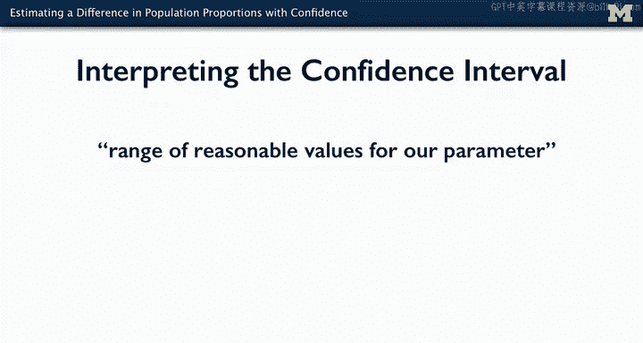

# 密歇根大学《使用Python的统计学（理解并可视化数据、因果推断、建模）｜Statistics with Python》中英字幕 - P45：11_双总体比例差异的置信估计.zh_en - GPT中英字幕课程资源 - BV1dV411Q7j3

。

In this video， we'll be talking about estimating a difference in two population proportions with confidence。

To start off with， we're looking at a poll that was conducted by CS Mott Children's Hospital。

 they conduct a lot of national polls on issues in children's health。

 and in this particular poll they were asking about water safety and about swimming lessons。

The research question that we'll be looking at is， what is the difference in population proportions of parents reporting that their children age 6 to 18 have had some swimming lessons between white children and black children？

So our populations of interest， we have two of them。

 we'll be looking at all parents of white children age 6 to 18 and all parents of black children age 6 to 18。

Now in this case， our parameter， since we're looking at two different population proportions。

 will be the difference in our two population proportions In notation， this will be P1 minus P2。

Now because we have two proportions in here， we need to specify which group is what we use the subscripts。

 the group1 and group two labels to identify that we have two different population proportions here。

And in this case， you have to specify which is group1 and which is group two。

In this video we'll be using Group one as the parents of white children and group two as the parents of Black children。

Now， our goal for this video is constructing a 95% confidence interval for the difference in population proportions of parents reporting that their child has had swimming lessons between the parents of white children and the parents of black children。

All right， so let's go ahead and look at the survey results。

We took a sample of 247 parents of black children。And we found that 91 said that their child has had some swimming lessons。

We also took a sample of 988 parents of white children。

 and we found that 543 said that their child has had some swimming lessons。

Now it's hard to look at just those numbers and come up with a really clear answer to our question of what is the difference in the population proportions of children who have taken swimming lessons？

So what we'll want to do is look at confidence interval basics。

 so if you remember we have our best estimate plus or minus the margin of error。

Now we do know how to calculate confidence intervals for each of these population proportions separately。

But what would we do once we've calculated those two confidence intervals to create a joint confidence interval for the difference in those two population proportions？

We'll stick to this formula and modify it for our use with the difference in population proportions。

To start off with， let's think about what our best estimate might be。 Our parameter remember。

 is P1 minus P2。So we could estimate it with the sample proportions instead of the population proportions。

And get an estimate for our parameter that way， we might look at P hat 1 minus P hat 2。

 or the difference in the two sample proportions。Here we still have that plus or minus the margin of error。

If you remember in the past， we used our margin of error being a few standard errors。

 so we'll substitute in for the margin of error， a few standard errors。Now。

 since we're looking at a 95% confidence interval， we'll use 1。96 as a few。

And our standard error formula will be given to you here。But within that standard error formula。

 it looks pretty similar to the standard error formula that we had for a single portion。

So here you notice that we have P hat 1 times 1 minus P hat1 over n1。

And we add that to the same thing for group2， but that looks really similar to the standard error for a single population proportion found in that formula。

And here we'll square root it again。So first， let's think about what is the best estimateifier parameter？

We'll use P hatAT1， we can calculate that sample proportion pretty easily， it's 543 divided by 988。

 and so we find that we in our sample， 55% of the parents reported that their child has had some swimming lessons of those parents avoid children。

Remembering that group two is the parents of black children。

 we can calculate the same sample proportion。And so we find that it's 91 over 247。

 we see that 37% of the parents of black children report that their child has had some swimming lessons。

And so we can go ahead and calculate the simple difference between these two。

 and we find that the parents of white children report that their child has had swimming lessons is 18% more than the parents of black children。

So we have our simple estimate， 0。18。But we also want to estimate with some sort of confidence。

 so we can't forget about that margin of error。Looking back at that formula for the confidence interval for the difference in two proportions。

 we can go ahead and substitute in our P hatAT numbers and our sample size numbers so we know what P hatAT 1 and P hatAT2 are。

 we know what N1 and N2 are we can go ahead and substitute those numbers in。

 go ahead and plug and chug and we'll find that our confidence interval goes from about 11% to about 25%。

So let's think about what that confidence interval means if you remember a confidence interval is a range of reasonable values for our parameter our parameter is the difference in the two population proportions。

And so our interval will look something like this， with 95% confidence。

 the population proportion of parents with white children who have taken swimming lessons is roughly 11% to roughly 25% higher than the population proportion of parents with black children who have taken swimming lessons。

So we've covered the actual calculation of the confidence interval。

 as well as a little bit of the interpretation of the confidence interval。😊，In the next video。

 we'll talk more about how you interpret confidence intervals。

 as well as some of the underlying assumptions that you should check before you actually calculate that confidence interval。

