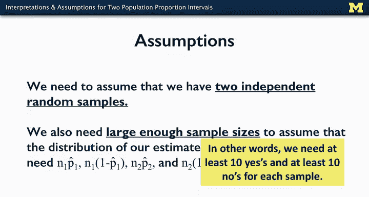

# 密歇根大学《使用Python的统计学（理解并可视化数据、因果推断、建模）｜Statistics with Python》中英字幕 - P46：12_双总体比例区间的解释与假设条件.zh_en - GPT中英字幕课程资源 - BV1dV411Q7j3

In the last video we talked about how you calculate a confidence interval for a difference in two population proportions in this video we'll talk a little bit more about how you can interpret that confidence interval and some of the assumptions that you should check before you actually perform the confidence interval。

To start with， let's remind you what that confidence interval was。

 That confidence interval is the range of reasonable values for our parameter。

 and we found that with 95% confidence， the population proportion of parents with white children who have taken swimming lessons is about 11% to about 25% higher than the population proportion of parents with black children who have taken swimming lessons。

So let's think about that。 Does it seem like there's a difference in the two population proportions？

In order to understand if there's a difference in the two population portions。

 we can look at what our parameter is。If we're looking at intervals of differences。

 we can think about is there a difference between the two parameters？

If both of the parameters are equal， that would mean the difference in our two parameters is 0。

 so p1 minus p2 would be equal0 if those two parameters were in fact， the same。Now。

 if those parameters are unequal， that means that the difference p1 minus p2 would not be equal to0。

So since our confidence interval is a range of reasonable values for our parameter。

 we want to look to see if zero is in the range of reasonable values。

If zero seems to be reasonable in our confidence interval。

 that implies that it seems possible that the parameters are equal to each other。

 that there truly is no difference between our two population proportions or whatever our two parameters are。

If zero is not contained in that confidence interval。

 it seems like our parameters are pretty likely to be unequal。

 they don't seem like they're very similar to each other or the same。And so that indicates， you know。

 there might be a difference in the two population proportions or whatever parameter that we're looking at。

So there are also some assumptions that you should check before you actually calculate your confidence interval。

 we bypassed those in the last video because we wanted to show you what that interval calculation looks like。

 but it is important to check those assumptions before you actually calculate the interval。First off。

 we need to assume that we have two independent random samples。

This really occurs within the sampling scheme， and so that needs to be told to you beforehand it either has been done or hasn't been done。

 there's not really a way to check that once you've been given the information from your samples。

Our second assumption is that we also need large enough sample sizes to assume that the distribution of our estimate is normal。

What that means in this case is we need n1 times P hat1， n1 times 1 minus P hat， n2 times P hat2。

 and n2 times 1 minus P hat 2， all to be at least 10 Now that's a mouthful to understand what that means in easily understood terms that means that we need at least 10 yeses and at least 10 nos in each of the samples。

 you can calculate that by plugging in each of those numbers into those four formulas and checking to make sure that there are at least 10。

 but you can also calculate it by checking to see if we have at least10 nos and at least 10 yeses in each sample。

There's a lot of formulas in that last sentence， so in other words。

 we need at least 10 yeses and at least 10 nos in each of the samples。

 you can go through and check looking at the numbers if you are given， for example， a two way table。

 just to make sure that you do have at least 10 yeses and at least 10 nos。

So what we've done here is we've looked at the assumptions that you should check before you calculate your confidence interval。

 we've talked about how you actually go through and calculate that confidence interval in the previous video。

😊，We found in our example that our confidence interval showed that the population proportion of white children who have had swimming lessons is somewhere between about 11% to about 25% higher than the population proportion of black children who have had swimming lessons。

And we've talked a little bit about how you can interpret that confidence interval。

 that in this case it does appear as if the population proportion of white children who have had swimming lessons is higher than the population proportion of black children who have had swimming lessons。

